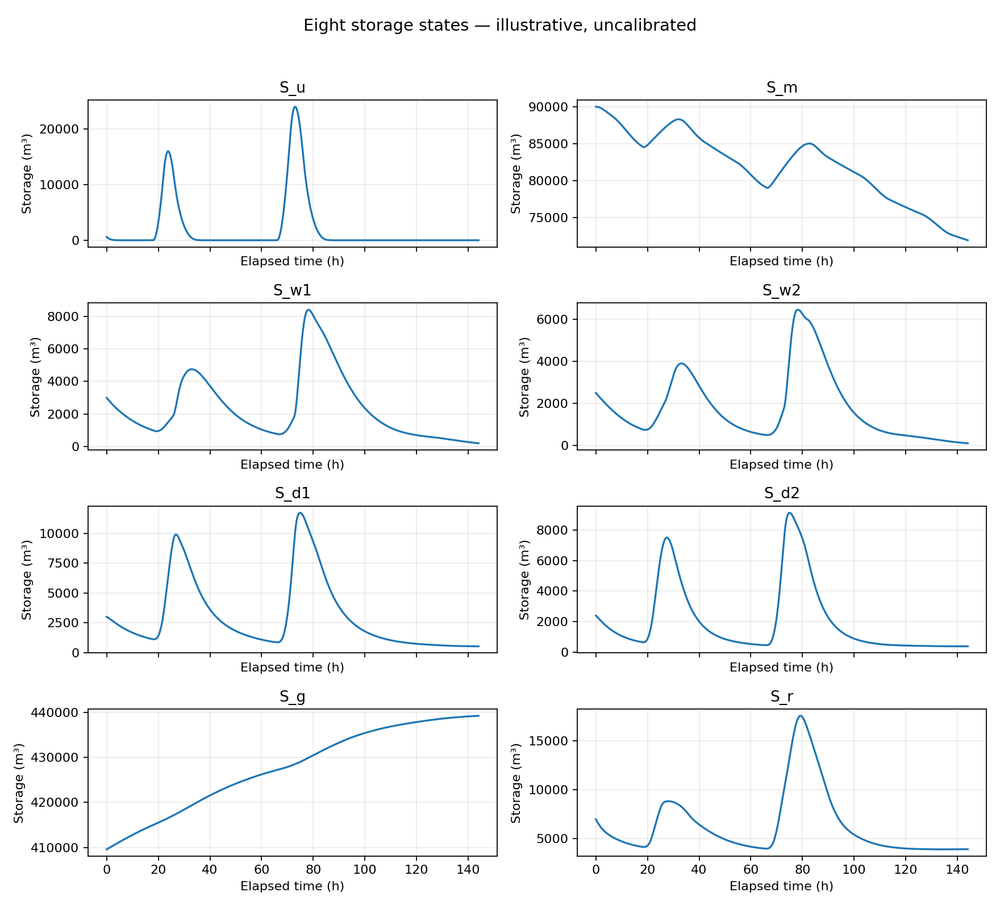
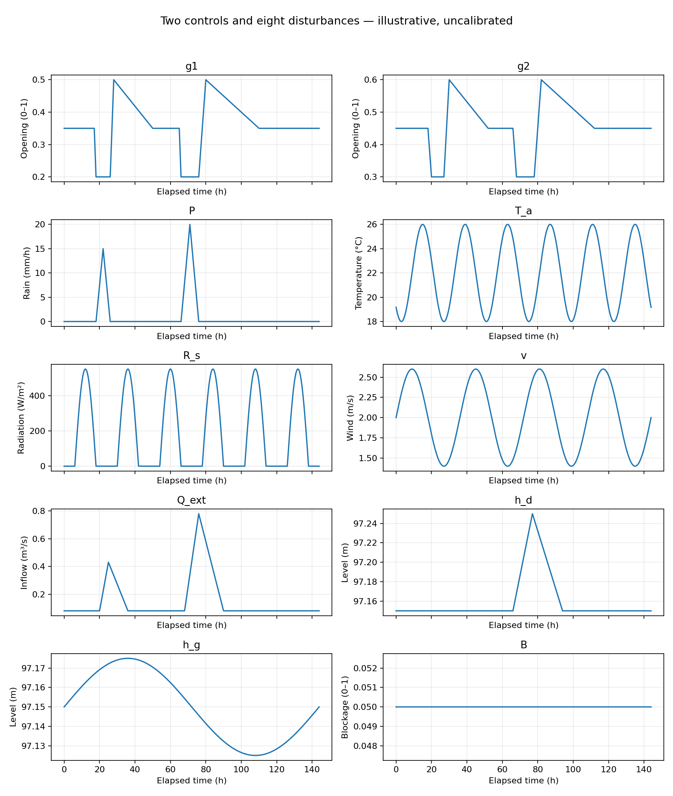

# A Initial model and baseline

[Project overview](../README.md) · [B Current optimization and comparisons](../B/README.md)

A is the first completed project: the eight-state dynamic model, its algebraic relationships and its illustrative baseline simulation. This page contains the final model description, files, run instructions and results for A.

The initial model and A–J figures use synthetic inputs and remain uncalibrated. Its accepted dam-spillway formulation is preserved in the A folder. The current work belongs to B and has its own accepted model scope and results.

## System and inputs

The states are upland surface water, upland soil water, two wetlands, two dam pools, groundwater, and a river reach, in this order:

`x = [S_u, S_m, S_w1, S_w2, S_d1, S_d2, S_g, S_r]`

Each main branch follows **upland → dam pool → gate → wetland → river**. Direct upland runoff to the river and the soil–groundwater pathway remain included. The river outlet is the downstream boundary; external inflow and signed external groundwater exchange also cross the system boundary.

- **Controls:** two prescribed gate-opening histories, each between 0 and 1.
- **Fixed wetland settings:** vegetation category and fractional cover, selected independently for each branch and held fixed during the run.
- **Disturbances:** precipitation, temperature, solar radiation, wind, external river inflow, downstream water level, external groundwater level, and outlet blockage.

Storage is in m³, time in seconds, and flow in m³/s. Internal flows are one-way; receiving-water levels can suppress discharge.

## What data and assumptions were used?

A is the initial synthetic demonstration. It has no gauge, weather-station, soil-survey, surveyed-elevation, or observed gate-operation dataset. Its numerical values are preserved in [the model parameter definition](wetland_flood_model.py#L51), and **every parameter, forcing setting, initial condition, and plot-comparison value is listed with its provenance in the [complete A value register](model_notes.md#complete-numerical-provenance-for-the-accepted-a-example)**. The register distinguishes assumed values, derived quantities, general physical constants, numerical settings, and calculated results. The regional event observations and source records used later belong to [B](../B/README.md).

| Part of the A example | Values and origin |
|---|---|
| Hypothetical area | 600,000 m² upland; dam pools [10,000, 8,000] m²; wetlands [12,000, 10,000] m²; river 20,000 m². All areas are assumptions. Their sum is 660,000 m² (0.66 km²), not the Underwood Creek gauge catchment. |
| Geometry and hydraulics | Assumed constant areas, bed/outlet elevations, linear capped ratings, infiltration/recharge rates, groundwater conductances, and dam/wetland overflow coefficients. A retains both independent dam spillways and wetland overflow. |
| Wetland design | A/A: synthetic class A in both wetlands, with cover [0.65, 0.60]. Derived drainage resistances [2.1, 2.2] s/m² and ET multipliers [1.065, 1.06]. These classes are not real species. |
| Precipitation | Two invented triangular storms at elapsed 18–26 h and 66–76 h, peaking at 15 and 20 mm/h. Storm depths are 60 and 100 mm, totaling 160 mm. |
| Weather | Synthetic temperature 18–26 °C, daytime half-sine radiation with peak 550 W/m², and wind 1.4–2.6 m/s. Fixed relative humidity 0.65 is also assumed. |
| Boundary inputs | Assumed external inflow: 0.08 m³/s base plus two triangular pulses; downstream level: 97.15 m base plus a 0.10 m pulse; external groundwater level: 97.15 ± 0.025 m; outlet blockage: 0.05. All elevations use an assumed datum. |
| Gate controls | Two independently prescribed, linearly interpolated schedules, listed in the [forcing register](model_notes.md#exact-synthetic-forcing-and-operating-schedules). They are not optimized or measured. |
| Initial conditions | Volumes `[600, 90000, 3000, 2500, 3000, 2400, 409600, 7000]` m³ in the stated eight-state order, derived from assumed depths, groundwater head, and 75% soil-capacity wetness. |
| Simulation | Six days (144 h), 120 s step, official `ode4u`; settings chosen for the course example. No calendar date is assigned. |

General thermodynamic constants and the saturation-vapor-pressure formula have narrowly identified references in the [ET source table](model_notes.md#evaporative-demand-constants-and-coefficients). Those references do not justify the hypothetical geometry, vegetation coefficients, or site forcing. Where there is no empirical source, the register says **assumed** instead of attributing the value to an unrelated reference.

## Main files

| File | Purpose |
|---|---|
| [model_notes.md](model_notes.md) | System boundary, eight ODEs, main algebraic relationships, figure guide, and baseline interpretation. |
| [wetland_flood_model.py](wetland_flood_model.py) | Numerical constants in `class c`, model RHS, synthetic inputs, official solver integration, and baseline outputs. |
| [algebraic_plots.py](algebraic_plots.py) | Generates A–G without loading the ODE solver. |
| [requirements.txt](requirements.txt) | NumPy and Matplotlib versions used locally. |
| [.gitignore](../.gitignore) | Excludes local records, results, environments, caches, and private/reference material. |
| [plots/](plots) | Existing A–J figures for this illustrative example. |

## Install and run

Run these commands from the project root on macOS/Linux with Python 3.13 available as `python3`. The existing environment used Python **3.13.5**, NumPy **2.2.6**, and Matplotlib **3.10.6**.

```sh
python3 -m venv .venv
source .venv/bin/activate
python -m pip install -r A/requirements.txt
```

### Algebraic plots only

```sh
python -m A.algebraic_plots
```

This generates A–G using NumPy and Matplotlib; it does not require the ODE solver.

### Baseline ODE simulation

The baseline uses Henri P. Gavin's official [multivarious solver](https://github.com/hpgavin/multivarious), specifically `ode4u`. The verified source revision is `06d7aed5b541ec7fe26a6dc69be6aa7fb610aa02` (package version 1.2.1). Its package initializer also requires SciPy; SciPy **1.16.2** was used locally. Install the baseline dependencies separately (the VCS install requires Git):

```sh
python -m pip install scipy==1.16.2
python -m pip install --no-deps "multivarious @ git+https://github.com/hpgavin/multivarious.git@06d7aed5b541ec7fe26a6dc69be6aa7fb610aa02"
python -m A.wetland_flood_model
```

If the verified official checkout already exists at `A/work/multivarious`, the loader uses it before the installed package, so the VCS installation can be omitted. That checkout remains an external, ignored dependency. No solver is bundled or substituted.

The script generates A–G, runs one six-day baseline with a 120 s step, and generates H–J. Figures go to `A/plots/`; numerical arrays and diagnostics go to the ignored `A/results/baseline.npz` and `A/results/baseline_summary.json`. Rerunning overwrites these outputs.

**Execution record:** algebraic plotting and the baseline were run in the existing environment with the verified official checkout. A fresh virtual-environment installation and the VCS installation commands above have not been tested. After the physical relocation, the original baseline was reintegrated at 120 seconds and matched its saved time, state, input, output and balance arrays exactly. Saved numerical files were not overwritten. The stage organization changes file locations and import paths, not the scientific model.

## Figures and interpretation

A–G show gate release, wetland drainage, wetland overflow, upland infiltration, evaporative demand, river-outlet blockage, and groundwater exchange, respectively. H shows all eight storage histories; I shows river and wetland responses; J shows the two controls and eight disturbances. [Model notes](model_notes.md) explain each figure.


The recorded baseline gives peak river outflow **1.357896 m³/s** and peak river level **97.879407 m**. Storage and release timing shape the response; this single run does not establish a wetland-restoration benefit. Fixed geometry, empirical flow laws, simplified evaporation, and synthetic inputs limit interpretation. Numerical balance checks are not physical validation, and the results are not real flood predictions.

The saved baseline also gives total river outlet volume **171,870.645335 m³**, gross external inflow **184,872 m³**, and **0 h** above the assumed 97.90 m reporting threshold. The maximum integrated water-balance discrepancy is **0.076735 m³** (approximately **0.00004151%** of gross event inflow). These are calculated outputs from the saved baseline, with exact values and calculation definitions in the [result register](model_notes.md#recorded-baseline-results-and-calculation-lineage). The reporting threshold is not a local flood-safety certification.





The first image shows the model response, the storage figure shows where water accumulates and recedes, and the input figure shows the prescribed causes. The full [A–J figure guide](model_notes.md#figure-guide) explains the equations, axes, and comparison settings. The numerical arrays remain local under `A/results/`; their absence from GitHub does not mean that the written result tables or figures are omitted.

The implementation follows the course-provided `earth_heat_2.py` template (local copy: `A/reference/01_course/earth_heat_2.py`) (`class c`, `system(t,x,u,c)`, and `ode4u`). Professor handouts and local development records are excluded from the submitted files. No project license has been selected.

