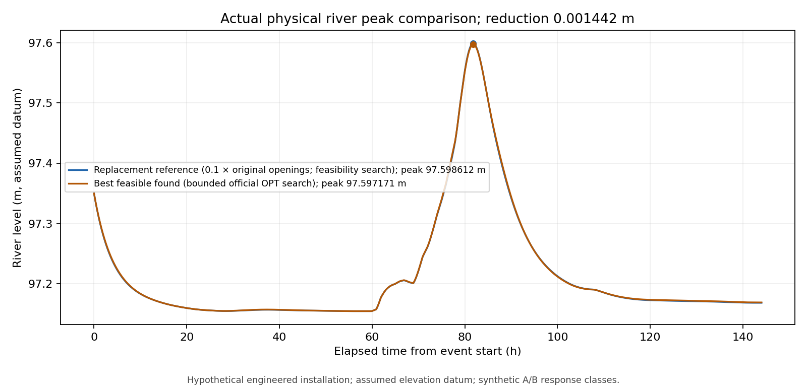
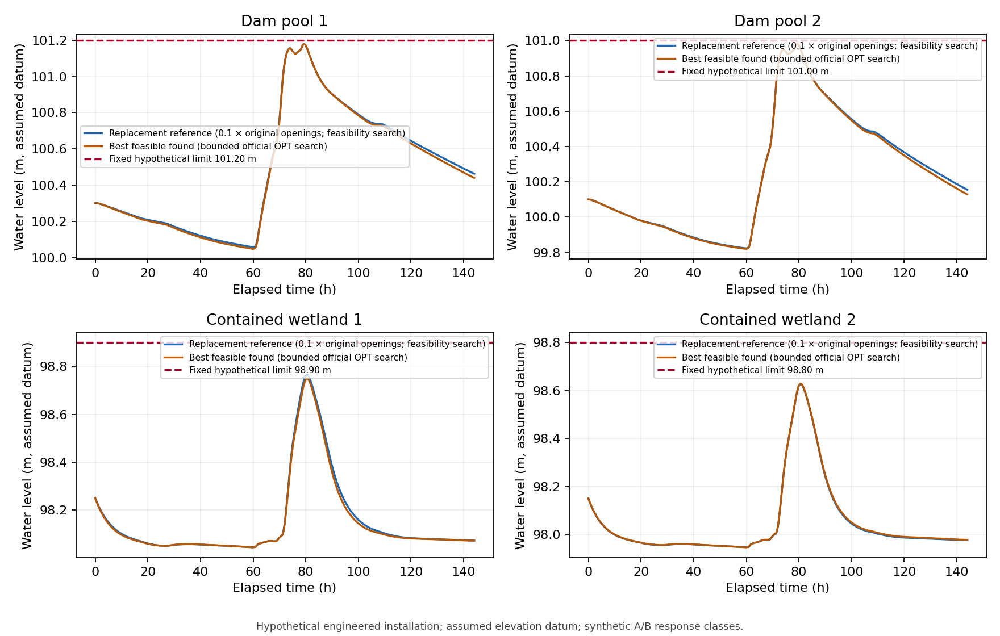

# First exploratory B.2 case — actual execution results

The approved **hypothetical 0.66 km² engineered installation**, driven by regional weather for **2022-09-09 00:00 UTC to 2022-09-15 00:00 UTC**, produced a hydraulically valid replacement reference and a feasible candidate from the professor's official OPT module. The refined physical river peak decreased from **97.598612259 m** to **97.597170751 m**, a reduction of **0.001441508 m (1.442 mm)**. This is a small improvement in this uncalibrated hypothetical model, not demonstrated real-world flood mitigation, an Underwood Creek calibration, or engineering safety certification.

The submitted B.1 objective remains `min max_t H_r(t)`. The B.1 constraints and four approved design limits are unchanged. The user-approved gate head/opening condition is an **additional hydraulic-applicability constraint**, not a numerical convergence check. A.2 code, parameters embedded in its source, and A–J results were not altered or rerun.

## Original baseline and replacement reference

The original gate schedule is **hydraulically invalid** under the approved B.2 gate geometry. Its first encountered invalid official `ode4u` RHS/RK stage occurred on **branch 2 at 8,100 s (2.25 h; 2022-09-09 02:15 UTC)**:

| Quantity | Value |
|---|---:|
| Upstream depth above sill, H | 0.168102128260 m |
| Gate opening height, a | 0.135000000000 m |
| Required depth, 1.25a | 0.168750000000 m |
| Physical residual, 1.25a − H | **+0.000647871740 m** |
| Normalized gate opening | 0.45 |

Integration stopped before evaluating an unsupported gate discharge. This timestamp identifies the first detected invalid integration stage, not an analytically located continuous-time crossing. No complete original-baseline trajectory or river peak is reported. See the local [original baseline diagnostic](../results/original_baseline_check.json).

A separate, labeled **reference feasibility search** tested uniform open-loop multipliers `[0, 0.25, 0.10, 0.05]` of the original gate knots. Closed gates, 0.10 and 0.05 completed valid simulations; 0.25 was rejected. The largest tested hydraulically admissible multiplier, **0.10**, was selected. Covers remained 0.65 and 0.60, synthetic classes remained A/A, and knot times were unchanged. This is not clipping during integration and is not the original baseline. No geometry, initial state, forcing or safety limit was adjusted. The resulting replacement reference also satisfies the unchanged safety limits. See [reference search records](../results/reference_search.json).

## Approved physical scope and input checks

Wetlands are explicitly proposed **embanked/contained units**. Assumed settled crests are dam pools `[101.55, 101.35] m` and wetlands `[99.25, 99.15] m`; subtracting the assumed 0.35 m freeboard gives fixed limits `[101.20, 101.00, 98.90, 98.80] m`. These elevations and freeboard choice are engineering assumptions. The NRCS reference supports a freeboard concept; it does not supply these elevations or certify this installation. All elevations use an assumed common model datum, not NAVD88.

The gate tailwater is the associated wetland level. Since `98.90 < 100.00` and `98.80 < 99.80`, every safety-feasible wetland trajectory is below its gate sill by at least 1.10 m or 1.00 m. Wetland-induced gate submergence is therefore excluded under these tailwater assumptions. All recorded gate evaluations in the refined reference and candidate were free-flow evaluations. The relevant restriction remains `1.25a − H ≤ 0` when a gate is open, wet and forward-flowing; it is enforced at every RHS/RK stage without clipping.

The [independent forcing audit](../results/exploratory_forcing_audit.json) passed all 22 checks:

- **Station observations:** KMKE precipitation accumulation records and KMWC temperature/wind reports. They are regional point observations spatially transferred to the hypothetical installation, not observations of its footprint. Fixed RH 0.7084916611553665 and pressure 98,692.51171875 Pa are derived event-time station means.
- **Rain:** 4,321 UTC nodes at 120 s; total **145.3 mm**. Selected accumulation intervals are nonoverlapping and contiguous. Each source-interval integral is preserved to within 1.66 × 10⁻¹¹ mm. Five trace intervals use an approved **quantified-zero lower bound**, not measured zero rainfall. Two missing individual hourly amounts are only resolved at the retained three-hour trace-accumulation level.
- **Solar:** NASA POWER gridded estimate, not a local radiometer; **21,166.81 Wh/m²** across 144 hours. Each hourly energy is preserved to within 4.67 × 10⁻¹⁰ Wh/m². UTC request/response alignment is verified. Interpreting labels as hour starts remains the approved processing assumption because the raw response has no explicit interval bounds.
- **Assumed conditions:** `Q_ext=0`, `h_d=h_g=97.15 m`, blockage `B=0`, and common initial storages. Initial soil storage **90,000 m³** is assumed, not an observed reconstruction of September 2022.
- USGS 04087088 remains contextual evidence only: it is neither the simulated outlet target nor inserted inflow. Synthetic A/B classes are paired hydraulic/ET response classes, not species or Milwaukee vegetation recommendations.

## Actual physical comparison

Both columns below use fresh **60 s** official `ode4u` integrations with identical initial states, forcing knots and fixed physical parameters. The 120 s weather reconstruction is interpolated unchanged during refinement.

| Metric | Replacement reference | Best feasible candidate |
|---|---:|---:|
| Physical river peak H_r, m | 97.598612259 | 97.597170751 |
| Peak time after event start, h | 81.800000 | 81.816667 |
| Maximum outlet flow, m³/s | 0.996916131 | 0.993712781 |
| Total outlet volume, m³ | 76457.724 | 76896.402 |
| Maximum numerical water-balance error, m³ | 0.021958012 | 0.021408471 |
| Relative numerical balance error | 2.28972578e-07 | 2.23242106e-07 |
| Synthetic class pair | A/A | A/A |
| Fixed cover fractions | 0.65, 0.60 | 0.560771978, 0.614506680 |

Outlet volume increases slightly even though the peak objective decreases; volume was not substituted for the B.1 objective. No flood-duration statistic is supplied because no flood threshold was invented. Neither peak occurs near the horizon, and neither river trajectory is rising at its final sample; no additional post-horizon scenario was run.



## Constraint residuals

The convention is **residual ≤ 0**. Physical residuals below are in metres and are maxima over the refined reporting grid. Every listed residual is strictly negative. All 20 optimizer residuals and eight separately audited native/reconstructed bounds pass, including nonnegative storage and soil capacity. Gate applicability additionally passed every RHS/RK-stage check; these finite-grid checks do not prove continuous-time feasibility.

| Constraint | Fixed upper limit, m | Reference residual, m | Candidate residual, m |
|---|---:|---:|---:|
| H_d1_safe | 101.20 | -0.021472230 | -0.021781547 |
| H_d2_safe | 101.00 | -0.020513458 | -0.021054978 |
| H_w1_safe | 98.90 | -0.134340381 | -0.149991145 |
| H_w2_safe | 98.80 | -0.173503619 | -0.171271033 |
| gate1_head_opening: 1.25a − H | 0 (residual) | -0.044310335 | -0.033926383 |
| gate2_head_opening: 1.25a − H | 0 (residual) | -0.006091303 | -0.002715288 |

The tightest candidate upstream design margin is about 0.02105 m; its smallest sampled gate-applicability margin is about 0.002715 m. These are model margins, not engineering certification. The numerical feasibility tolerance is 10⁻⁶ on dimensionless residuals. The separate 0.001 m margin on inherited strict geometric domains is not physical freeboard and does not relax the gate rule or safety levels. See the [complete constraint audit](../tables/constraint_audit.csv).



## Official OPT execution and termination

Official `multivarious` version **1.2.1**, revision **06d7aed5b541ec7fe26a6dc69be6aa7fb610aa02**, supplied both `ode4u` and `nms`; the vendor checkout was not modified. Each of four synthetic class pairs retains 26 continuous decisions: 24 gate knots and two cover fractions.

For each pair, the exact reference-valued seed was independently evaluated. A 40-callback search first used the full physical `[0,1]` box. A second search allowed at most 140 callbacks in the explicitly recorded numerical neighborhood `0 ≤ gate knot ≤ min(1, max(0.02, 2 × reference knot))`, with cover bounds still `[0,1]`. This narrower exploration does not change the physical constraints, but it limits what the search establishes. It addresses the official NMS behavior that moves boundary-adjacent starts to the interior. Full-box and neighborhood bounds, requested/effective starts, genuine callback records and returned solver information are retained in the per-phase optimizer JSON files.

| Synthetic pair | Full-box callbacks / feasible callbacks | Local callbacks / feasible callbacks | Local iterations | Local termination | Best coarse physical peak, m |
|---|---:|---:|---:|---|---:|
| A/A | 40 / 0 | 87 / 57 | 28 | stalled | 97.597168833 |
| A/B | 40 / 0 | 84 / 54 | 25 | stalled | 97.598411085 |
| B/A | 40 / 0 | 57 / 39 | 16 | stalled | 97.597989330 |
| B/B | 40 / 0 | 79 / 51 | 23 | stalled | 97.599103514 |

All full-box phases hit their adapter callback budget without a feasible NMS callback; the retained feasible reference seed must not be mistaken for a full-box discovery. All local phases returned with the audited stagnation/stall condition. **None met the convergence criterion.** This is the best feasible candidate found in a finite exploratory search, not a global optimum or proof about infeasibility elsewhere.

There were **471 callback evaluations** including four explicit seeds, **266 hydraulically invalid candidates**, and **479 attempted integrations** including reference trials and verification. Recorded wall time was 218.47 s. Invalid candidates stop at the first unsupported stage and return a finite numerical sentinel through the verified fixed-size OPT interface, allowing the search to continue. They have no completed trajectory and no physical peak. Their first-violation details are in [rejected_candidates.csv](../tables/rejected_candidates.csv).

For valid candidates, the callback objective is `(physical peak − 97 m)/1 m`; the official penalty is separate. `solver.raw_objective` in optimizer JSON therefore means the conditioned callback value, not an absolute river stage. Penalties and failure sentinels are never reported as physical peaks. The [performance table](../tables/performance.csv) and [callback history](../tables/optimization_evaluations.csv) retain physical values explicitly.

Fresh/coarse-to-refined peak differences were **2.18425384e-08 m** for the reference and **1.91818644e-06 m** for the candidate, both below the declared 0.001 m grid criterion and smaller than the computed 1.442 mm reduction. Numerical repeatability does not establish physical accuracy; parameter and structural uncertainty are uncalibrated.

## Files and reproduction

- Figures: [gate rating](../plots/B2_0_gate_rating.png), [river peak](../plots/B2_1_river_stage.png), [gate schedules](../plots/B2_2_controls.png), [upstream limits](../plots/B2_3_upstream_safety.png), [OPT history](../plots/B2_4_optimization_history.png), [gate applicability](../plots/B2_5_gate_applicability.png).
- Tables: [physical performance](../tables/performance.csv), [decisions](../tables/decision_values.csv), [all constraint residuals](../tables/constraint_audit.csv), [termination by phase](../tables/category_run_summary.csv), [parameter/input evidence](../tables/evidence_register.csv).
- Local numerical records: [run status](../results/run_status.json), [exact run configuration](../results/run_config.json), `B/results/reference.npz`, `B/results/best_feasible.npz`, and eight `*_optimizer.json` files. Local `B/results/` and `B/work/` remain ignored by Git.

From the existing project environment:

```sh
cd /Users/zhangjiaxuan/Documents/Codex/Modeling
/opt/miniconda3/bin/python3 -B -m B.optimize_wetland --preflight
MPLCONFIGDIR=B/work/mpl-cache /opt/miniconda3/bin/python3 -B -u -m B.optimize_wetland --run
```

These exact preflight/run commands were executed successfully. Rerunning overwrites B.2 result files, not A.2 outputs. A fresh dependency installation was not tested in this task. No Git commit, push or publication was performed.

This completes the **first exploratory execution and comparison**, not calibration, physical validation, engineering approval, a globally converged optimization, or the entire course assignment. Further work may assess sensitivity, search robustness and credible local facility properties; no safety limit should be raised merely to obtain feasibility.
