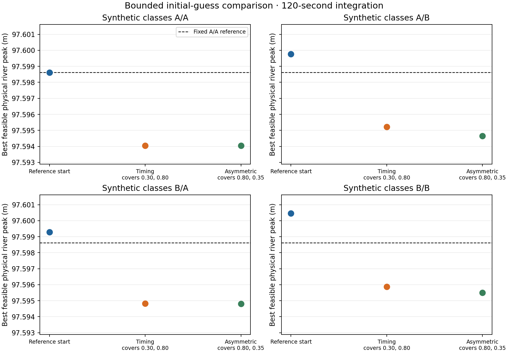
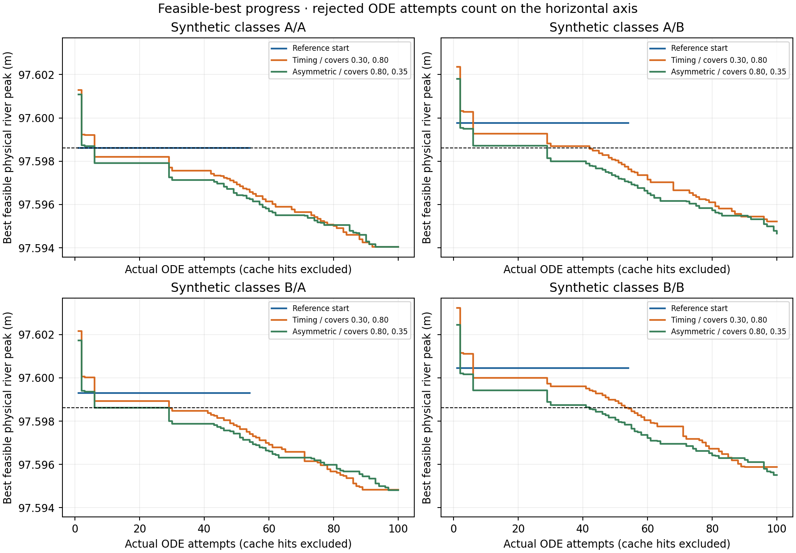

# Controlled B.2 initial-guess and scaling check

**Historical study scope:** numerical proposals, gate schedules, approvals and results below describe the earlier exploratory/joint study at the time recorded. They are not the final fixed-gate wetland-only configuration. Use [the current B guide](../README.md), [active parameter record](../data_sources_and_assumptions.md#active-parameter-provenance) and [final optimization report](12_wetland_only_optimization.md) for accepted values. Hydraulic-source discussion remains relevant only within its stated applicability.

This bounded study retains the approved hypothetical engineered system, eight-state equations, gate hydraulics, G1–G6 assumptions, B.1 objective and constraints, forcing, initial storages, physical bounds and control-knot times. A/B remain synthetic hydraulic/ET response classes. The reference remains the previously accepted A/A replacement schedule at 0.1 times the original gate openings; it was not retuned.

Completed 12 OPT runs after 12 full-event starting-candidate checks; 0 screened candidates were rejected. Each category received the feasible starts recorded in the [summary CSV](../tables/multistart_summary.csv).

The lowest feasible 120-second physical peak in this batch is **97.594037220 m**, from A/A, `early_retention_cover_30_80`. Its reduction from the unchanged fixed reference (97.598612281 m) is **4.5751 mm**. These are physical river levels, separate from the penalized solver objective.

The optimizer made 1016 callbacks: 0 cache hits and 1016 actual ODE attempts. Separate work comprised 12 screening attempts, 2 initialization-probe attempts and 6 fixed-design timestep reevaluations. An ODE attempt can stop at its first hydraulic violation. Terminations: {'stalled': 4, 'evaluation_budget': 8}. Rejection counts by callback: {'HydraulicApplicabilityFailure': 252}; hydraulically invalid callbacks: 252; valid trajectories that failed a constraint: 0.

Declared caps: 100 callbacks/180 s per run, 1,200 callbacks overall, 1,250 total ODE attempts and 25 minutes. Settings are identical: `tol_x=1e-4`, `tol_f=1e-6`, feasibility tolerance `1e-6`. Stagnation means no strict augmented-best improvement for over 20% of the evaluation budget; first-feasible stopping is disabled. Official convergence requires more than 676 iterations and is impossible under this small callback budget.

The 4 reference-start runs rejected 212 of their 216 callbacks for gate applicability; their only valid callback was the feasible first point. This explains their early stagnation. Other starts explored more valid candidates without changing the constraints.

## Starting-point dependence

| Classes | Final peak range across starts (mm) | Largest gate-knot difference between final designs | Final cover-1 range | Final cover-2 range |
|---|---:|---:|---|---|
| A/A | 4.5751 | 0.025842 | 0.3093–0.8052 | 0.3784–0.7995 |
| A/B | 5.1172 | 0.033476 | 0.3166–0.8048 | 0.3338–0.8115 |
| B/A | 4.4826 | 0.033198 | 0.2851–0.8125 | 0.3698–0.8053 |
| B/B | 4.9469 | 0.032721 | 0.2810–0.8070 | 0.3347–0.8113 |

For example, the closest same-category pair (A/A, Timing / covers 0.30, 0.80 versus Asymmetric / covers 0.80, 0.35) differs by only 0.006845 mm in its 120-second peak, while its largest gate-knot difference is 0.014821 and its covers are (0.309296, 0.799502) versus (0.805232, 0.378357). Thus near-equal objectives conceal different designs. This near-tied pair is not itself a complete two-design refinement comparison; no precise ranking of all near-tied starts is claimed.

The CSV contains every requested, first-evaluated and final physical vector, both covers, physical margins and best feasible results. These results are separate from the solver’s penalized return point.

## Verified OPT interface and numerical remedy

The decision vector contains 12 independent gate-1 knot values, 12 independent gate-2 knot values and two independent covers. All 26 physical bounds remain [0,1]. The unchanged official adapter passes native bounds [−1,1] to the pinned `multivarious` NMS implementation. Its initial normalized point is clipped internally to [−0.8,0.8]. With the old affine full-box map, requested gate openings below 0.1 are therefore moved to 0.1; the two explicit probes recorded the resulting collapse. This is an initialization effect, not evidence that the requested starts were infeasible.

This batch uses one fixed gate map, `g = 0.04 q / (0.96 (1−q) + 0.04 q)`, with `q∈[0,1]`; covers remain affine. The map is a monotone bijection onto the full physical [0,1] interval and is identical for every start and category. All selected starts map inside the official initialization clip. It changes numerical search geometry, and its effect must not be attributed to a pure comparison with the previous affine search. It does not narrow physical bounds or modify the official solver. The official 27-vertex simplex perturbs all native coordinates by 0.03423609 and one coordinate by 0.24636812 for each added vertex. Individual gates and covers can all vary.

Each actual first physical callback was checked against its requested design (maximum component difference 2.78e-17); all were required to be feasible. The run JSON’s `optimizer_coordinate_settings` vectors/history are q-space; `physical_callback_log` and `best_design` contain physical openings/covers. The pinned official revision is `06d7aed5b541ec7fe26a6dc69be6aa7fb610aa02`.

## Constraint scaling and stopping resolution

Scaling is unchanged; no before/after scaling run was needed. Residual ≤0 means satisfied. Water levels use `(H−H_limit)/1 m`: a fixed depth scale comparable with the allowable 1.20 m pool and 0.90 m wetland depths, not an absolute-elevation divisor. Nonnegative storages use the eight fixed positive initial-storage scales. Soil capacity retains `(S_m−120000 m³)/90000 m³`; this is a valid fixed scale. Using capacity instead would reduce that residual by 0.75, change its physical tolerance from 0.09 to 0.12 m³, and alter its isolated squared penalty by a factor of 1/1.7778. That optional rescaling was deliberately not mixed with initial-guess changes. G5 uses the fixed 1 m length scale. Residuals are never clipped to [−1,1].

The unchanged official penalty is `F = f + 100 [sum(g_i for g_i > 1e-6)]²`, with `f=(physical H_peak−97 m)/1 m`. This is the square of a sum, and uses the full violating residual. Invalid hydraulic candidates receive finite numerical sentinels and diagnostics; no physical river peak is assigned to an incomplete trajectory. The relative objective-spread tolerance corresponds to about 0.0006 mm near these feasible peaks, which can distinguish 1.44 mm nominally. It is not an integration-error bound or a convergence certificate.

All returned reporting nodes, including the final time, enter the audit. Existing G5 and hard hydraulic-geometry checks also execute at every official RK stage. Ordinary safety/storage constraints and the additional 0.001 m geometry margin are audited at reporting nodes; they are not claimed to be checked at every intermediate RK state. Finite-time checks do not prove continuous-time feasibility. G5 is a strict runtime condition even though its reported row includes the nominal 1e-6 m audit tolerance.

All 28 residual rows for the new batch best at 120 seconds

Physical margin = −physical residual. The first 20 rows are supplied to the penalty interface; the remaining eight rows independently audit native/reconstructed bounds.

| Constraint / physical expression | Units | Physical residual | Scale | Scaled residual | Physical tolerance | Physical margin |
|---|---|---:|---:|---:|---:|---:|
| `nonnegative_S_u`: -S_u | m3 | -2.42525e-34 | 600 | -4.042084e-37 | 0.0006 | 2.42525e-34 |
| `nonnegative_S_m`: -S_m | m3 | -74566.37 | 90000 | -0.8285152 | 0.09 | 74566.37 |
| `nonnegative_S_w1`: -S_w1 | m3 | -488.695 | 3000 | -0.1628983 | 0.003 | 488.695 |
| `nonnegative_S_w2`: -S_w2 | m3 | -454.4871 | 2500 | -0.1817949 | 0.0025 | 454.4871 |
| `nonnegative_S_d1`: -S_d1 | m3 | -338.1774 | 3000 | -0.1127258 | 0.003 | 338.1774 |
| `nonnegative_S_d2`: -S_d2 | m3 | -158.6513 | 2400 | -0.0661047 | 0.0024 | 158.6513 |
| `nonnegative_S_g`: -S_g | m3 | -409600 | 409600 | -1 | 0.4096 | 409600 |
| `nonnegative_S_r`: -S_r | m3 | -3098.041 | 7000 | -0.4425773 | 0.007 | 3098.041 |
| `soil_capacity`: S_m - C_m | m3 | -30000 | 90000 | -0.3333333 | 0.09 | 30000 |
| `H_d1_safe`: H_d1 - H_limit | m | -0.02280497 | 1 | -0.02280497 | 1e-06 | 0.02280497 |
| `H_d2_safe`: H_d2 - H_limit | m | -0.02301423 | 1 | -0.02301423 | 1e-06 | 0.02301423 |
| `H_w1_safe`: H_w1 - H_limit | m | -0.2175164 | 1 | -0.2175164 | 1e-06 | 0.2175164 |
| `H_w2_safe`: H_w2 - H_limit | m | -0.1447364 | 1 | -0.1447364 | 1e-06 | 0.1447364 |
| `groundwater_geometry`: H_g - (applicable_limit - 0.001 m) | m | -0.4844848 | 1 | -0.4844848 | 1e-06 | 0.4844848 |
| `groundwater_soil`: H_g - (applicable_limit - 0.001 m) | m | -2.584485 | 1 | -2.584485 | 1e-06 | 2.584485 |
| `groundwater_wetland_bed`: H_g - (applicable_limit - 0.001 m) | m | -0.4844848 | 1 | -0.4844848 | 1e-06 | 0.4844848 |
| `river_geometry`: H_r - (applicable_limit - 0.001 m) | m | -1.404963 | 1 | -1.404963 | 1e-06 | 1.404963 |
| `integration_status`: -1 for completed numerically valid integration; invalid trajectory uses explicit failure sentinel | 1 | -1 | 1 | -1 | 1e-06 | 1 |
| `gate1_head_opening`: 1.25 * a - H when open, wet and forward-flowing; else 0 | m | -0.01981825 | 1 | -0.01981825 | 1e-06 | 0.01981825 |
| `gate2_head_opening`: 1.25 * a - H when open, wet and forward-flowing; else 0 | m | -0.003529539 | 1 | -0.003529539 | 1e-06 | 0.003529539 |
| `gate1_lower`: -gate1 | 1 | -0.02800606 | 1 | -0.02800606 | 1e-06 | 0.02800606 |
| `gate1_upper`: gate1 - 1 | 1 | -0.9241576 | 1 | -0.9241576 | 1e-06 | 0.9241576 |
| `cover1_lower`: -cover1 | 1 | -0.3092957 | 1 | -0.3092957 | 1e-06 | 0.3092957 |
| `cover1_upper`: cover1 - 1 | 1 | -0.6907043 | 1 | -0.6907043 | 1e-06 | 0.6907043 |
| `gate2_lower`: -gate2 | 1 | -0.03685641 | 1 | -0.03685641 | 1e-06 | 0.03685641 |
| `gate2_upper`: gate2 - 1 | 1 | -0.9252225 | 1 | -0.9252225 | 1e-06 | 0.9252225 |
| `cover2_lower`: -cover2 | 1 | -0.7995022 | 1 | -0.7995022 | 1e-06 | 0.7995022 |
| `cover2_upper`: cover2 - 1 | 1 | -0.2004978 | 1 | -0.2004978 | 1e-06 | 0.2004978 |

## Fixed-design timestep check

The fixed reference, previous best and new batch best were reevaluated without reoptimization, removing duplicate designs. Refinement interpolates the same original 120-second forcing knots and unchanged gate histories. Rainfall and solar energy are not reinterpreted at finer steps.

| Fixed design | Step (s) | Peak (m) | Reduction from same-step fixed reference (mm) | Max balance residual (m³) | Relative balance residual | Feasible |
|---|---:|---:|---:|---:|---:|---|
| fixed_reference | 120 | 97.598612281 | 0.0000 | 0.087831 | 9.15880969360225e-07 | True |
| fixed_reference | 60 | 97.598612259 | 0.0000 | 0.021958 | 2.2897257801668327e-07 | True |
| previous_best | 120 | 97.597168833 | 1.4434 | 0.085633 | 8.929574485897795e-07 | True |
| previous_best | 60 | 97.597170751 | 1.4415 | 0.021408 | 2.2324210555933455e-07 | True |
| new_batch_best | 120 | 97.594037220 | 4.5751 | 0.077833 | 8.116230244584576e-07 | True |
| new_batch_best | 60 | 97.594037199 | 4.5751 | 0.019459 | 2.0291016741714028e-07 | True |

Across these runs, integrated rainfall is 145.300000 mm (maximum spread 0 m) and solar energy is 21166.810000 Wh/m² (maximum spread 3.64e-12 Wh/m²). These checks preserve the prepared observation/grid/transfer assumptions.

The comparison below uses 120 versus 60 seconds. Thirty seconds was not required by the recorded 120/60-second screen.

| Difference (second design minus first) | Coarser difference (mm) | Finer difference (mm) | Sum of individual grid changes (mm) | Resolution screen |
|---|---:|---:|---:|---|
| previous_best − fixed_reference | -1.443448 | -1.441508 | 0.001940 | Stable at tested steps |
| new_batch_best − fixed_reference | -4.575061 | -4.575059 | 0.000042 | Stable at tested steps |
| new_batch_best − previous_best | -3.131613 | -3.133552 | 0.001938 | Stable at tested steps |

“Stable at tested steps” requires unchanged ranking, feasible fixed-design runs and summed grid changes below 10% of the compared peak difference. This is an empirical resolution screen, not a rigorous error bound. Unresolved comparisons must not support precise millimeter-scale improvement claims. Multiple starts assess this bounded search only; they neither prove global optimality nor calibrate the regional hypothetical model.

Reproduce from the project root using the existing environment: `python3 -B -m B.multistart_check --screen`, then `python3 -B -m B.multistart_check --run`. The driver refuses to overwrite a completed batch. For the existing completed batch, `python3 -B -m B.multistart_check --report` regenerates only these reports/figures. Existing results and raw callback logs are local under `B/results/multistart/`; approved configuration, A.2 and previous B.2 outputs are preserved. No Git publication is part of this check.
