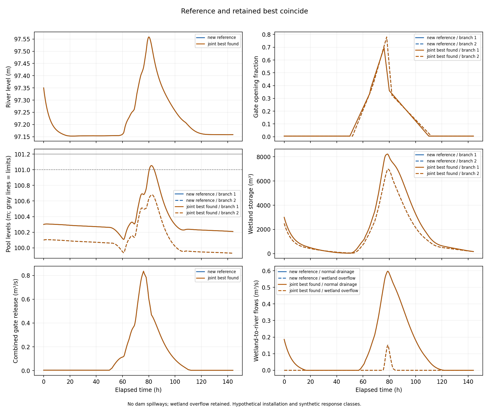
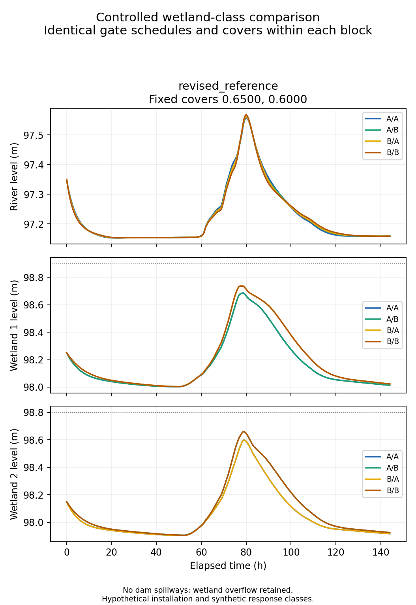
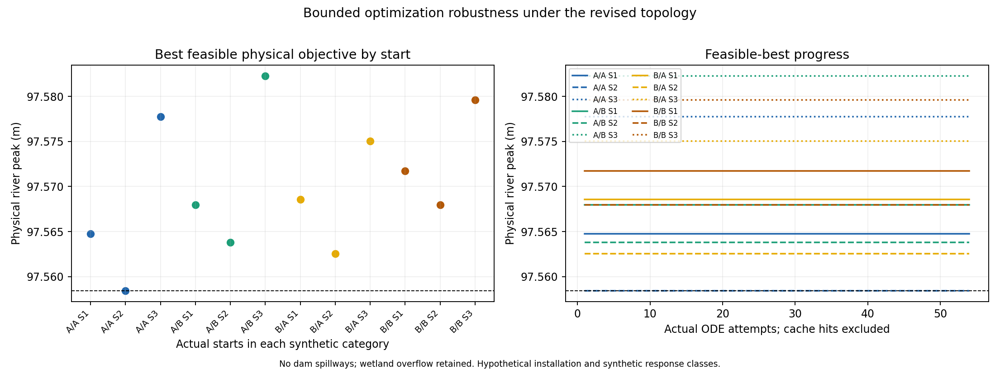

# B.2 revision without dam spillways

**Study scope:** this preserved report covers the no-spillway joint gate-plus-wetland search. The accepted fixed gate schedule was selected here, but the current wetland-only results and settings are in [the final optimization report](12_wetland_only_optimization.md) and [active parameter record](../data_sources_and_assumptions.md#active-parameter-provenance). The joint-search benefit is not the current wetland-only benefit.

This new study removes the two pool-to-wetland dam spillways from B.2. Each pool releases to its wetland through its gate only. Wetland overflow to the river, normal wetland drainage, the direct upland-to-river bypass, soil and groundwater pathways remain. There is no replacement emergency spill, automatic gate control or water-level clipping. The unchanged safety limits and hydraulic-applicability constraints determine feasibility. A.2 and all historical B.2 results are separate and preserved.

The installation remains hypothetical and uncalibrated, with regional event weather and synthetic A/B vegetation-response classes. Read [data sources and assumptions](../data_sources_and_assumptions.md) for the active topology, unchanged provenance, design assumptions and interpretation limits. Older studies with dam spillways cannot supply numerical results for this topology.

## Reference selection and joint optimization

Reference-selection method: First fully feasible candidate in the declared ordered finite pool; open-loop reference feasibility search, not optimization and not the original baseline.. Selected label: `retention_storm_seed_x1.2`. Tested candidates: 8. The complete search outcomes and first failure diagnostics are in [reference_search.csv](../tables/no_spillway_revision/reference_search.csv).

The unchanged previous small-opening reference was first rerun under the **new** topology. It completed the hydraulic integration but exceeded pool safety limits; those values were not clipped. First reporting-grid exceedances are shown below, rather than interpreted as exact continuous-time crossing times.

| Pool | First violating time (h) | Level (m) | Limit (m) | Residual (m) | Maximum exceedance (m) |
|---|---:|---:|---:|---:|---:|
| 1 | 72.300000 | 101.204601942 | 101.20 | 0.004601942 | 1.757996 |
| 2 | 72.566667 | 101.001094658 | 101.00 | 0.001094658 | 1.673548 |

A distinct failed candidate, `previous_reference_storm_knots_x4`, stopped at its first invalid gate evaluation: branch 2, 55.516667 h, depth 0.029478288 m, opening height 0.023673214 m and G5 residual +0.000113229 m. It is hydraulically invalid, unlike the complete but unsafe old reference.

The newly evaluated reference (A/A, covers 0.6500/0.6000) has physical river peak **97.558441514 m** at 80.0333 h on its 120-second grid; feasibility: **True**. It is identified by its selection method above, not relabeled as the original baseline.

The best feasible joint design found is A/A, covers 0.650000/0.600000, with physical river peak **97.558441514 m**. Its same-study reference reduction is **0.0000 mm** on the saved reporting grid. This joint change can include gate operations, covers and category choices; it is not a vegetation-only effect.

**No improvement over the new reference was found.** The best feasible design retained by the bounded optimizer is the same reference design (up to coordinate round-trip precision), so their trajectories coincide. This is a completed search attempt with a zero-improvement outcome, not a newly improved operating policy.

**The selected joint candidate originated at OPT evaluation 1**, the already screened `revised_reference` initial design. This run retained that point rather than improving it. Its difference from the new reference is evidence about that candidate design; it must not be reported as an objective reduction produced by successful OPT steps.

| Classes | Start | Final covers | Physical peak (m) | Reduction from new reference (mm) | ODE attempts | Termination |
|---|---|---|---:|---:|---:|---|
| A/A | asymmetric_cover_80_35 | 0.8000/0.3500 | 97.564760003 | -6.3185 | 54 | stalled |
| A/A | revised_reference | 0.6500/0.6000 | 97.558441514 | 0.0000 | 54 | stalled |
| A/A | timing_cover_30_80 | 0.3000/0.8000 | 97.577762706 | -19.3212 | 54 | stalled |
| A/B | asymmetric_cover_80_35 | 0.8000/0.3500 | 97.567957957 | -9.5164 | 54 | stalled |
| A/B | revised_reference | 0.6500/0.6000 | 97.563789264 | -5.3477 | 54 | stalled |
| A/B | timing_cover_30_80 | 0.3000/0.8000 | 97.582268566 | -23.8271 | 54 | stalled |
| B/A | asymmetric_cover_80_35 | 0.8000/0.3500 | 97.568560821 | -10.1193 | 54 | stalled |
| B/A | revised_reference | 0.6500/0.6000 | 97.562564886 | -4.1234 | 54 | stalled |
| B/A | timing_cover_30_80 | 0.3000/0.8000 | 97.575022773 | -16.5813 | 54 | stalled |
| B/B | asymmetric_cover_80_35 | 0.8000/0.3500 | 97.571709774 | -13.2683 | 54 | stalled |
| B/B | revised_reference | 0.6500/0.6000 | 97.567961000 | -9.5195 | 54 | stalled |
| B/B | timing_cover_30_80 | 0.3000/0.8000 | 97.579577069 | -21.1356 | 54 | stalled |
12 of 12 runs retained their initial physical design as their best feasible point; 12 had no feasible callback after evaluation 1. This distinguishes a search that retained screened starts from an optimizer that found additional feasible improvements.

The recorded hydraulic rejections occurred at 56.5667–60.4167 h, with branch counts {1: 556, 2: 80}. These first-invalid times identify where the trial trajectories leave the gate-applicability domain; they are distinct from a complete-event safety failure or a demonstrated global feasibility boundary.

The study used **676 actual ODE attempts**: 8 reference-search, 12 start-screening, 648 optimizer, 4 distinct fixed-design timestep and 4 controlled-class runs. Reused identical-design rows are explicitly labeled and are not additional integrations. Unit-test calls are separate from these study simulations.


Optimizer counts: 648 callbacks, 0 cache hits, 648 ODE attempts. Terminations: {'stalled': 12}. Rejected callbacks by diagnostic: {'HydraulicApplicabilityFailure': 636}. Full designs, requested/first-evaluated starts, physical margins and counts are in [optimization_summary.csv](../tables/no_spillway_revision/optimization_summary.csv). An invalid hydraulic evaluation stops that candidate; it has no complete physical peak. A valid trajectory exceeding a safety limit is separately infeasible.

Recorded batch status: `bounded_batch_finished`. Declared optimizer settings: `{'max_evals': 100, 'max_seconds': 180, 'tol_x': 0.0001, 'tol_f': 1e-06, 'feasibility_tol': 1e-06, 'penalty': 100.0, 'penalty_exponent': 2.0, 'display': 0}`. Screening records: 12, accepted starts: 12. Budget/stagnation termination is not convergence or global optimality; the official 26-dimensional NMS convergence test additionally requires more than 676 iterations. Multiple starts provide evidence about this bounded search only.

The decision vector remains 24 independently variable gate knots and two covers. The official native bounds are [−1,1], mapped onto the full physical [0,1] box. The official initial-point clip is addressed with one fixed map for this entire new batch: `g = q³ / [q³ + (1−q)³]`, while cover equals q. This bijection accommodates both small dry-period openings and larger storm releases without narrowing physical bounds. Requested and first-evaluated physical designs are recorded separately; the transformation changes search conditioning and is not a physical model parameter. It differs from the historical low-opening study’s rational map, so cross-topology optimizer outcomes are not a controlled coordinate-map comparison.

## Routing mechanisms and conservation

The following diagnostics use complete simulated trajectories. Centroid time is the first temporal moment of release, not a water-parcel residence time. Volumes and moments use reporting-grid trapezoidal quadrature.

| Design | Gate volume (m³) | Gate centroid (h) | Wetland normal-drainage volume (m³) | Wetland overflow volume (m³) | River peak time (h) | Δ total storage (m³) | Max external-balance residual (m³) |
|---|---:|---:|---:|---:|---:|---:|---:|
| new_reference | 60479.486 | 77.7861 | 57041.519 | 2194.918 | 80.0333 | -92.559 | 0.070371 |
| joint_best_found | 60479.486 | 77.7861 | 57041.519 | 2194.918 | 80.0333 | -92.559 | 0.070371 |
For `new_reference`, river rising at the final time: **True**; event peak near the horizon: **False**. The six-day horizon remains fixed; a rising endpoint warrants that scope limitation even when the recorded maximum occurred earlier.
For `joint_best_found`, river rising at the final time: **True**; event peak near the horizon: **False**. The six-day horizon remains fixed; a rising endpoint warrants that scope limitation even when the recorded maximum occurred earlier.

Branch-specific gate volumes/centroids/peak times, wetland peak storage and timing, normal drainage, overflow, seepage, ET and final-storage changes are in [mechanism_metrics.csv](../tables/no_spillway_revision/mechanism_metrics.csv). Dam-spillway outputs are verified identically zero for every reported complete trajectory. Wetland overflow remains in the model even when its simulated event volume happens to be zero.

Whole-system conservation uses only `P_total + Q_ext + Q_gx − Q_out − E_tot`. Gate releases, wetland drainage/overflow, upland bypass and internal soil/groundwater transfers cancel and are not counted again as external water. A change in final storage indicates redistribution within the finite event; it does not establish reduced discharge over an indefinitely extended horizon.

## Controlled wetland-class comparisons

Within each block, every gate-knot value, both vegetation covers, initial conditions, forcing and fixed parameters are held identical. Only A/A, A/B, B/A or B/B changes. This separates the synthetic class package effect from joint gate/cover optimization. A second block, if present, uses the joint-best gates/covers and remains distinct from the reference block. All four class combinations are checked independently; an invalid or unsafe comparison is not silently replaced.

| Fixed-control block | Classes | Covers | Status / feasible | Physical peak (m) | Peak change from block A/A (mm) | Normal drainage (m³) | Wetland overflow (m³) |
|---|---|---|---|---:|---:|---:|---:|
| revised_reference | A/A | 0.6500/0.6000 | valid / True | 97.558441845 | 0.0000 | 57041.511 | 2194.918 |
| revised_reference | A/B | 0.6500/0.6000 | valid / True | 97.563789250 | 5.3474 | 54530.450 | 4294.794 |
| revised_reference | B/A | 0.6500/0.6000 | valid / True | 97.562567457 | 4.1256 | 53833.727 | 4863.492 |
| revised_reference | B/B | 0.6500/0.6000 | valid / True | 97.567962743 | 9.5209 | 51323.052 | 6963.920 |

For block `revised_reference`, the feasible class-substitution peak range is 9.5209 mm (A/A lowest; B/B highest). The range in integrated gate release is 0 m³ despite fixed openings; the table records the resulting drainage/overflow differences rather than assigning the entire joint benefit to vegetation.

**Mechanism in `revised_reference` (A/A versus B/B, fixed gates and covers):** the maximum pointwise difference in either gate discharge is 0 m³/s, and the common gate-release volume is 60479.482 m³ with centroid 77.7861 h. Thus this comparison changes the downstream wetland response while holding the modeled release histories fixed.

Changing A/A to B/B raises the branch-1 peak wetland storage from 8226.77 to 8846.43 m³ and branch 2 from 6984.35 to 7608.22 m³. Normal-drainage volume changes from 57041.51 to 51323.05 m³, while retained wetland overflow changes from 2194.92 to 6963.92 m³.

Normal-drainage peak decreases from 0.597181 to 0.467238 m³/s, but the overflow peak increases from 0.151715 to 0.310488 m³/s. Consequently the combined wetland-to-river peak increases from 0.748895 to 0.777726 m³/s. The stronger synthetic resistance/ET package therefore does not automatically reduce the event river maximum; the overflow pathway offsets the reduction in normal drainage.

The combined wetland outflow peak time shifts from 78.8500 to 78.8333 h, while its centroid shifts from 79.2675 to 80.7844 h, and its total event volume changes from 59236.43 to 58286.97 m³. Nevertheless, the river maximum changes by +9.5209 mm and its time shifts from 80.0500 to 79.9500 h. A later event-volume centroid and a smaller integrated volume do not imply a smaller or later instantaneous river peak. These are model-specific class-package responses, not a general species ranking.

Duplicate controlled blocks were omitted because their gates and covers matched an already evaluated block: `[{"block": "joint_best", "identical_to": "revised_reference", "reason": "All gates and covers match within 3e-15 coordinate-roundtrip tolerance; same four class comparisons reused."}]`. Their absence does not represent an unreported comparison.

The class package changes the existing resistance and ET endpoints together, with consequent wetland storage, drainage, overflow and groundwater responses. It does not identify a separate causal effect of resistance alone, a real species response or a Milwaukee vegetation recommendation. See [controlled_comparisons.csv](../tables/no_spillway_revision/controlled_comparisons.csv) for all outcomes and diagnostics.

## Constraints and numerical resolution

The unchanged optimizer receives 20 scaled residuals, with eight further rows independently auditing native/reconstructed gate and cover bounds. Water-level and G5 residuals are physical level differences divided by a fixed 1 m scale. Nonnegative storages use the eight frozen positive storage scales; soil capacity remains `(S_m−120000 m³)/90000 m³`. No absolute elevation is used as a divisor, and large residuals are not clipped. The audit tolerance of 1e-6 corresponds to 1e-6 m for level rows and 0.09 m³ for soil capacity; strict runtime domain checks may be stronger.

The callback objective remains `(physical H_peak−97 m)/1 m`; the separate penalty is `100 × [sum(g_i for g_i>1e-6)]²`. The relative objective tolerance `tol_f=1e-6` has a nominal feasible-objective spread of about 0.00056 mm near the current river peak. That stopping scale is much smaller than a millimeter but does not supply numerical integration accuracy or establish convergence. Physical peaks and feasible designs, not penalty scores, are reported here.

Safety levels remain 101.20/101.00 m for pools and 98.90/98.80 m for contained wetland units. Physical residual ≤0 denotes satisfaction; scales and physical-unit tolerances are recorded in [constraint_residuals.csv](../tables/no_spillway_revision/constraint_residuals.csv). G5 gate applicability is a strict integration-stage restriction; finite infeasible penalties are not physical river peaks. The inherited A.2 state checks already reject any negative storage or soil storage above capacity at every RHS/RK evaluation. G5 and hard geometry limits also execute at those stages. The four design safety limits and the extra 0.001 m geometry margin are audited at reporting nodes, including final time. This corrects the earlier report’s overly broad statement that ordinary storage constraints were reporting-node-only; historical files are preserved. These finite checks do not establish continuous-time safety or site certification.

| Fixed design | Step (s) | Physical peak (m) | Feasible | Max balance residual (m³) | Relative balance residual | Execution |
|---|---:|---:|---|---:|---:|---|
| revised_reference | 120 | 97.558441514 | True | 0.070371 | 7.33808289095133e-07 | ODE evaluated |
| revised_reference | 60 | 97.558441845 | True | 0.017592 | 1.834490460306459e-07 | ODE evaluated |
| joint_best | 120 | 97.558441514 | True | 0.070371 | 7.33808289095133e-07 | reused: revised_reference |
| joint_best | 60 | 97.558441845 | True | 0.017592 | 1.834490460306459e-07 | reused: revised_reference |
| historical_design_recomputed | 120 | 97.350000000 | False | 0.053752 | 5.605071126807809e-07 | ODE evaluated |
| historical_design_recomputed | 60 | 97.350000000 | False | 0.013438 | 1.4012820110859932e-07 | ODE evaluated |

`historical_design_recomputed` means the previous saved decision vector was simulated again under this new no-spillway model. It is not a historical output relabeled as current, and an unsafe recomputed design is not an admissible performance comparator. A stable grid result for an unsafe design establishes neither feasibility nor a usable improvement.


Fixed-design input checks: rainfall 145.300000 mm (spread 0 m), solar energy 21166.810000 Wh/m² (spread 3.64e-12 Wh/m²). The same underlying prepared forcing knots and gate functions are used at each step, with no reoptimization.

| Difference / grid comparison | Coarser difference (mm) | Finer difference (mm) | Summed grid changes (mm) | Resolution screen |
|---|---:|---:|---:|---|
| joint_best − revised_reference / 120/60 s; identical design, exact zero comparison | 0.000000 | 0.000000 | 0.000662 | Stable at tested steps |
| historical_design_recomputed − revised_reference / 120/60 s | -208.441514 | -208.441845 | 0.000331 | Stable at tested steps |

Thirty-second check requested by the recorded screen: False. The comparison is an empirical timestep check, not a rigorous error bound. If a reported difference is comparable with discretization discrepancies or changes rank, its millimeter-scale magnitude/ranking is unresolved. The controlled-class table uses its declared 60-second grid; near-tied class rankings are not automatically validated by a timestep check of different joint designs.

The recorded test run passed **77 tests**, including **10 structural tests** for this revision: gate-only pool routing, retained wetland overflow, original units/output schema, absence of safety clipping and internal/external conservation checks. These software tests verify implementation properties; they do not calibrate or physically certify the model. The original A.2 checks and historical B.2 tests are included in the preserved suite.

The accepted new reference uses covers 0.65/0.60 and the existing gate knots. Its full opening vector is recorded in `reference_search.json` and the optimization CSV; the non-storm value is 0.005, with larger releases only at existing storm knots. The exact schedule is reproduced below.

| Gate | Existing knot hours | Opening fractions |
|---|---|---|
| 1 | `[0, 17, 18, 26, 28, 50, 65, 66, 76, 80, 110, 144]` | `[0.005, 0.005, 0.005, 0.005, 0.005, 0.005, 0.336, 0.384, 0.696, 0.36, 0.005, 0.005]` |
| 2 | `[0, 18, 20, 27, 30, 52, 66, 68, 78, 82, 112, 144]` | `[0.005, 0.005, 0.005, 0.005, 0.005, 0.005, 0.36, 0.42, 0.78, 0.324, 0.005, 0.005]` |

## Reproduction

Use the existing project Python environment and pinned official `multivarious` checkout. From the project root:

```sh
python3 -B -m B.work.no_spillway_reference_search
python3 -B -m B.no_spillway_study --screen
python3 -B -m B.no_spillway_study --run
python3 -B -m B.no_spillway_study --compare
python3 -B -m B.no_spillway_study --report
```

Completed execution stages refuse to overwrite their existing results. For this completed case, the `--report` command regenerates reports only and does not run the ODE or optimizer. Preserve the recorded configuration lock and source checksums; a fresh numerical study requires a separate output location rather than deleting or relabeling this one.







All new artifacts belong to the no-spillway revision folders. Historical A.2/B.2 files and results, approved event-data provenance and the official solver implementation are preserved. No Git commit or publication is part of this study.
