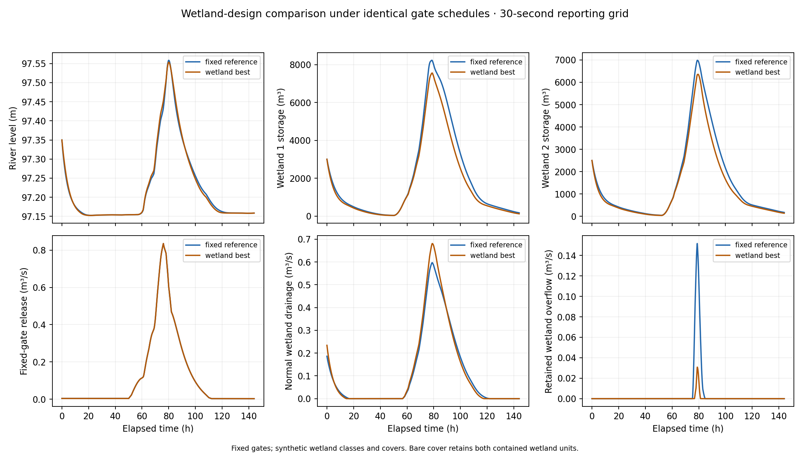
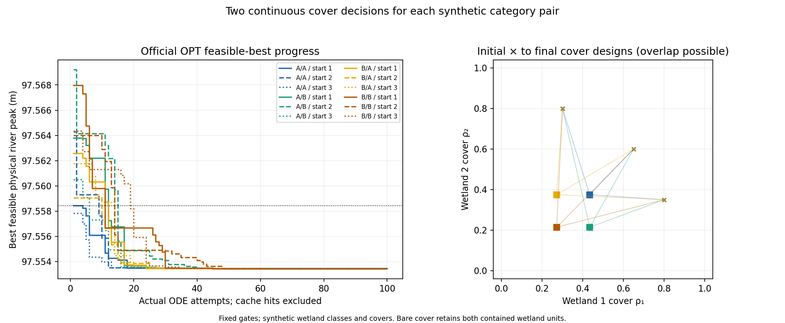

# B.2 wetland-design optimization with fixed gates

This is the user-authorized wetland-design-only analysis. It preserves the latest no-dam-spillway hydraulic model and fixes every one of the 24 gate-knot openings to the newly accepted admissible reference schedule. The continuous OPT decision vector is **[ρ₁, ρ₂] only**; synthetic category pairs A/A, A/B, B/A and B/B are enumerated separately. Initial states, regional event weather, geometry, coefficients, the six-day horizon, physical safety limits and wetland-overflow routing remain unchanged.

The previous joint gate-and-wetland optimization remains a historical study. This comparison measures changes in wetland response-class and cover design under fixed operations; it does **not** compare wetland presence with wetland absence or establish a real-species recommendation. A permitted cover of ρ=0 denotes a bare contained wetland with its storage, drainage, seepage and overflow still present; it does not delete the wetland.

## Physical result

The fixed reference is A/A with covers 0.65/0.60. Its 30-second physical river peak is **97.558442514 m** in the assumed model datum.

The best feasible design selected by the 120-second search is **B/B, ρ₁=0.27141176, ρ₂=0.21412792**, with physical river peak **97.553430505 m**. The reduction from the same fixed reference is **5.0120 mm** on the 30-second grid. The physical objective is `min max_t H_r(t)`; neither a penalty score nor a discharge/volume objective is substituted.

| Synthetic pair | Start covers | Final covers | Physical peak at 120 s (m) | Reference reduction (mm) | ODE attempts | Termination |
|---|---|---|---:|---:|---:|---|
| A/A | 0.65/0.60 | 0.434193/0.374662 | 97.553436411 | 5.0051 | 100 | simplex_converged |
| A/A | 0.30/0.80 | 0.434184/0.374659 | 97.553436411 | 5.0051 | 100 | evaluation_budget |
| A/A | 0.80/0.35 | 0.434186/0.374653 | 97.553436411 | 5.0051 | 93 | simplex_converged |
| A/B | 0.65/0.60 | 0.434201/0.214119 | 97.553433803 | 5.0077 | 94 | simplex_converged |
| A/B | 0.30/0.80 | 0.434200/0.214109 | 97.553433803 | 5.0077 | 100 | evaluation_budget |
| A/B | 0.80/0.35 | 0.434196/0.214127 | 97.553433803 | 5.0077 | 93 | simplex_converged |
| B/A | 0.65/0.60 | 0.271405/0.374659 | 97.553431701 | 5.0098 | 95 | simplex_converged |
| B/A | 0.30/0.80 | 0.271407/0.374639 | 97.553431701 | 5.0098 | 100 | simplex_converged |
| B/A | 0.80/0.35 | 0.271406/0.374646 | 97.553431701 | 5.0098 | 100 | evaluation_budget |
| B/B | 0.65/0.60 | 0.271413/0.214095 | 97.553429093 | 5.0124 | 100 | evaluation_budget |
| B/B | 0.30/0.80 | 0.271423/0.214076 | 97.553429094 | 5.0124 | 100 | evaluation_budget |
| B/B | 0.80/0.35 | 0.271412/0.214128 | 97.553429093 | 5.0124 | 98 | simplex_converged |

The 12 searches made 1173 callbacks, including 0 cache hits and 1173 actual ODE attempts. Study total: 1201 ODE attempts (1 reference, 12 start checks, 1173 OPT attempts and 15 fixed-design reevaluations). Terminations: {'simplex_converged': 7, 'evaluation_budget': 5}. Invalid-candidate diagnostics: {}. Full requested, first-evaluated and final covers, fixed gate vectors, physical residual margins and counts are in [optimization_summary.csv](../tables/wetland_only/optimization_summary.csv).

| Pair | Range of final peaks across starts (mm) | Final cover-1 range | Final cover-2 range |
|---|---:|---|---|
| A/A | 0.000000 | 0.434184–0.434193 | 0.374653–0.374662 |
| A/B | 0.000000 | 0.434196–0.434201 | 0.214109–0.214127 |
| B/A | 0.000000 | 0.271405–0.271407 | 0.374639–0.374659 |
| B/B | 0.000001 | 0.271412–0.271423 | 0.214076–0.214128 |

| Best retained candidate by category | Covers ρ₁/ρ₂ | Effective R₁/R₂ (s/m²) | Effective K₁/K₂ |
|---|---|---|---|
| A/A | 0.434193/0.374662 | 1.668385/1.749324 | 1.043419/1.037466 |
| A/B | 0.434201/0.214119 | 1.668402/1.749416 | 1.043420/1.053530 |
| B/A | 0.271405/0.374659 | 1.668496/1.749317 | 1.067851/1.037466 |
| B/B | 0.271412/0.214128 | 1.668518/1.749448 | 1.067853/1.053532 |

Effective coefficients are derived from the unchanged interpolation `R_i=(1−ρ_i) R_bare,i + ρ_i R_class,i` and `K_i=(1−ρ_i) K_bare,i + ρ_i K_class,i`; they are not new measured properties. Different class/cover combinations can yield nearly the same effective resistance, while their paired ET multipliers still differ. Similar river peaks therefore need not imply the same covers or identify a preferred real species. The summary CSV includes these effective coefficients.


These ranges measure starting-point sensitivity of this bounded search. Similar objectives can accompany different covers. Multiple starts do not prove a global optimum.

## Interface, constraints and model validity

The verified official solver revision is `06d7aed5b541ec7fe26a6dc69be6aa7fb610aa02`. Both cover bounds remain [0,1]; the adapter passes native bounds [−1,1]. The three requested interior starts avoid the official normalized initial-point clip. Maximum observed requested-to-first cover shift was 0. The two-dimensional initial simplex has three vertices; both covers can vary. Unlike the historical 26-variable joint search, the official convergence check here requires more than **four iterations**, together with its design/objective tests. Budget, stagnation and convergence statuses remain distinct.

Identical settings across runs: `{"max_evals": 100, "max_seconds": 180, "tol_x": 0.0001, "tol_f": 1e-06, "feasibility_tol": 1e-06, "penalty": 100.0, "penalty_exponent": 2.0, "display": 0}`. Declared study caps: 1250 ODE attempts and 25 minutes for the batch. First-feasible stopping is disabled. The recorded best feasible physical design is distinguished from any penalized solver-returned point.

**Exactly 18 residuals are passed to OPT.** They retain nonnegative storage, soil capacity, four fixed upstream safety limits, model-geometry conditions and numerical integration status. The two G5 head/opening rows are excluded from the optimizer vector as authorized for fixed-gate design; their unchanged strict RHS/RK applicability guard remains active in every simulation. Fixed gate-bound checks are input validation, while four cover-bound rows record the native two-variable box. Every row in [constraint_audit.csv](../tables/wetland_only/constraint_audit.csv) states its role: `supplied_to_OPT_residual_vector=True` identifies the 18 residual rows, `native_OPT_bound=True` identifies the four enforced cover-bound rows, and `optimizer_active=True` covers both groups. G5 and fixed-gate bound-validation rows have false optimizer flags; their model/input validation remains enforced.

The fixed schedule was validated before optimization. Safety-feasible wetland surfaces remain below the two gate sills, so wetland-induced gate submergence is excluded under the retained tailwater assumption. A candidate that violates hydraulic applicability still stops immediately. Its generic integration-status sentinel rejects the invalid model evaluation; the other returned placeholder zeros are **uncomputed entries**, not observed physical residuals or evidence of satisfaction. No physical peak is assigned to that incomplete trajectory.

Residual convention remains physical residual / fixed positive scale ≤0. Level and G5 audit scales are 1 m; soil capacity is `(S_m−120000 m³)/90000 m³`; nonnegative storages use the frozen positive storage scales. Residuals are not divided by absolute elevation or changing water depth, and are not clipped. The scaled feasibility tolerance is 1e-6 (1e-6 m for level rows, 0.09 m³ for soil capacity); strict runtime guards can be stronger. The callback objective `(H_peak−97 m)/1 m` and penalty `100 [sum(g_i for g_i>1e-6)]²` are numerical quantities separate from the reported river level.

Storage admissibility, G5 and hard geometry checks run at all existing RHS/RK evaluations. The four safety levels and extra 0.001 m geometry margin are audited on all reporting nodes, including final time. These finite checks are not continuous-time safety certification.

## Wetland mechanisms under fixed operations

Maximum pointwise gate-opening difference is 0; maximum gate-discharge difference is 0 m³/s. The gate-release volume is 60479.482 m³ for the reference and 60479.482 m³ for the best wetland design. These checks separate wetland design effects from changed gate operations.

Here the routing change is consistent with lower effective drainage resistance: R₁/R₂ fall from 2.1000/2.2000 to 1.6685/1.7494 s/m². More water leaves through normal drainage before high wetland levels produce a concentrated overflow contribution. Both wetland storage peaks fall, and the reduction in overflow peak is larger than the increase in normal-drainage peak, reducing the simultaneous combined inflow peak to the river. The total wetland-to-river event volume actually increases by 586.344 m³ and wetland ET falls by 12.401 m³. The lower river maximum therefore reflects changed routing and flow concentration in this event, rather than greater total water removal or greater peak wetland storage. This interpretation concerns the coupled synthetic design response, not resistance in isolation.

| Quantity | Fixed reference | Best wetland design |
|---|---:|---:|
| Wetland 1 peak storage (m³) | 8226.768 | 7558.433 |
| Wetland 2 peak storage (m³) | 6984.349 | 6358.098 |
| Wetland 1 storage-peak time (h) | 78.6000 | 78.8417 |
| Wetland 2 storage-peak time (h) | 78.9000 | 79.3417 |
| Normal drainage volume (m³) | 57041.508 | 59587.321 |
| Wetland overflow volume (m³) | 2194.918 | 235.449 |
| Normal drainage peak (m³/s) | 0.597181 | 0.681093 |
| Wetland overflow peak (m³/s) | 0.151715 | 0.030836 |
| Combined wetland-to-river peak (m³/s) | 0.748895 | 0.711929 |
| Combined wetland outflow centroid (h) | 79.2675 | 78.2038 |
| Combined wetland outflow peak time (h) | 78.8500 | 78.8667 |
| River peak time (h) | 80.0417 | 80.0500 |
| Total final-storage change (m³) | -92.556 | -625.650 |
| Max external-balance residual (m³) | 0.004398 | 0.003753 |

At the same gate releases, normal-drainage volume changes by +2545.813 m³ and retained wetland-overflow volume by -1959.469 m³. Their separate peaks change by +0.083912 and -0.120879 m³/s; the actual combined wetland-to-river peak changes by -0.036966 m³/s. The combined peak is calculated from the simultaneous summed time series, not by adding peaks that may occur at different times.

Wetland peak storages change by -668.335 / -626.251 m³ in branches 1/2. Combined wetland ET changes from 358.470 to 346.069 m³. The wetland outflow centroid shifts by -1.0638 h, while the river peak time shifts by +0.0083 h. These differences quantify the routing and water-balance changes that accompany the reported physical objective change.


Changing cover/class changes the existing paired drainage-resistance and ET response, with consequent storage, seepage and overflow changes. The table separates normal drainage from retained wetland overflow; a larger stored volume or later release centroid does not by itself establish a smaller or later river peak. These are model-specific synthetic response packages, not isolated resistance effects or field-measured vegetation benefits.

All branch volumes, release centroids and peaks are in [mechanism_metrics.csv](../tables/wetland_only/mechanism_metrics.csv). Centroids are temporal first moments, not parcel residence times. The whole-system balance uses only `P_total + Q_ext + Q_gx − Q_out − E_tot`; internal gates, wetland drainage/overflow and soil/groundwater transfers are not counted twice. Dam-spillway columns remain zero; wetland overflow remains active.

## Fixed-design timestep check

Reference and best designs were frozen and reevaluated with the same forcing reconstruction and gate functions; no refinement optimization or weather reinterpretation was performed.

| Design | Step (s) | Physical peak (m) | Feasible | Max balance residual (m³) | Relative balance residual |
|---|---:|---:|---|---:|---:|
| fixed_reference | 120 | 97.558441514 | True | 0.070371 | 7.33808289095133e-07 |
| fixed_reference | 60 | 97.558441845 | True | 0.017592 | 1.834490460306459e-07 |
| wetland_best | 120 | 97.553429093 | True | 0.060043 | 6.261095615309292e-07 |
| wetland_best | 60 | 97.553430506 | True | 0.015011 | 1.5652904302312893e-07 |
| category_best_type_a_type_a | 120 | 97.553436411 | True | 0.060038 | 6.260644176349944e-07 |
| category_best_type_a_type_a | 60 | 97.553437814 | True | 0.015010 | 1.5651773743627485e-07 |
| category_best_type_a_type_b | 120 | 97.553433803 | True | 0.060040 | 6.260823989194087e-07 |
| category_best_type_a_type_b | 60 | 97.553435212 | True | 0.015010 | 1.5652225291083562e-07 |
| category_best_type_b_type_a | 120 | 97.553431701 | True | 0.060041 | 6.260882429098699e-07 |
| category_best_type_b_type_a | 60 | 97.553433105 | True | 0.015010 | 1.5652369906602243e-07 |
| fixed_reference | 30 | 97.558442514 | True | 0.004398 | 4.586221674327648e-08 |
| wetland_best | 30 | 97.553430505 | True | 0.003753 | 3.9132352228768097e-08 |
| category_best_type_a_type_a | 30 | 97.553437813 | True | 0.003752 | 3.9129526533869085e-08 |
| category_best_type_a_type_b | 30 | 97.553435211 | True | 0.003753 | 3.9130642987979627e-08 |
| category_best_type_b_type_a | 30 | 97.553433104 | True | 0.003753 | 3.913101775692825e-08 |

| Step comparison | Reference reduction, coarser (mm) | Reference reduction, finer (mm) | Sum of grid changes (mm) | Resolution screen |
|---|---:|---:|---:|---|
| 120 / 60 s | 5.012422 | 5.011339 | 0.001744 | Stable at tested steps |
| 60 / 30 s | 5.011339 | 5.012009 | 0.000670 | Stable at tested steps |

The best saved design from each synthetic category pair was also frozen for timestep checks. This compares those actual finite-search candidates, not exact category optima. Fine differences between category outcomes are assessed separately from the larger reduction relative to the reference.

| Fixed category-candidate comparison | Steps (s) | Peak difference, coarser (mm) | Peak difference, finer (mm) | Sum of grid changes (mm) | Resolution screen |
|---|---|---:|---:|---:|---|
| category_best_type_a_type_b − category_best_type_a_type_a | 120/60 | -0.002608 | -0.002602 | 0.002813 | Magnitude/ranking unresolved |
| category_best_type_b_type_a − category_best_type_a_type_a | 120/60 | -0.004710 | -0.004709 | 0.002808 | Magnitude/ranking unresolved |
| wetland_best − category_best_type_a_type_a | 120/60 | -0.007318 | -0.007308 | 0.002817 | Magnitude/ranking unresolved |
| category_best_type_b_type_a − category_best_type_a_type_b | 120/60 | -0.002102 | -0.002107 | 0.002814 | Magnitude/ranking unresolved |
| wetland_best − category_best_type_a_type_b | 120/60 | -0.004710 | -0.004706 | 0.002823 | Magnitude/ranking unresolved |
| wetland_best − category_best_type_b_type_a | 120/60 | -0.002608 | -0.002599 | 0.002817 | Magnitude/ranking unresolved |
| category_best_type_a_type_b − category_best_type_a_type_a | 60/30 | -0.002602 | -0.002602 | 0.000002 | Stable at tested steps |
| category_best_type_b_type_a − category_best_type_a_type_a | 60/30 | -0.004709 | -0.004709 | 0.000002 | Stable at tested steps |
| wetland_best − category_best_type_a_type_a | 60/30 | -0.007308 | -0.007308 | 0.000002 | Stable at tested steps |
| category_best_type_b_type_a − category_best_type_a_type_b | 60/30 | -0.002107 | -0.002107 | 0.000002 | Stable at tested steps |
| wetland_best − category_best_type_a_type_b | 60/30 | -0.004706 | -0.004706 | 0.000002 | Stable at tested steps |
| wetland_best − category_best_type_b_type_a | 60/30 | -0.002599 | -0.002599 | 0.000002 | Stable at tested steps |

At the finest tested grid for each category comparison, 0 of 6 comparisons remain unresolved by the declared screen. A small category difference must not be described as a precise class ranking when this screen fails; the reference-to-design reduction has its own separate check.

The entire best-candidate category spread at 30 seconds is 0.007308 mm. The verified ordering concerns these finite-search numerical candidates only; such a small synthetic-model difference is not a local engineering or vegetation recommendation.


Integrated rain is 145.300000 mm (spread 0 m); solar energy is 21166.810000 Wh/m² (spread 3.64e-12 Wh/m²). Both preserve the existing prepared observations, gridded estimate and accepted spatial/subinterval assumptions.

The resolution screen requires feasible fixed-design runs, unchanged improvement sign and summed grid changes below 10% of the peak reduction. It is not a rigorous error bound. A comparable discrepancy or changed ranking must be reported as unresolved; convergence of OPT alone does not resolve integration error.

`fixed_reference`: river rising at the end = True; peak near the horizon = False. The six-day event scope remains fixed.

`wetland_best`: river rising at the end = True; peak near the horizon = False. The six-day event scope remains fixed.

The recorded software suite passed **86 tests**, including **nine new wetland-only tests**. These check the two-cover decision interface, fixed-gate preservation, the 18-row optimizer view and separate G5/model-validity handling alongside existing model tests. They verify software behavior; they are not field calibration or an engineering-safety certificate.

## Reproduction and scope

The configuration `B/wetland_only_config.json` records the fixed-gate source path and checksum; the saved study plan contains all 24 numerical gate openings. The numerical gate schedule is the accepted new reference, not the obsolete original control values. G1–G6 provenance and the eight-state no-spillway equations remain as documented in [data sources and assumptions](../data_sources_and_assumptions.md).

Current file locations are under `B/`; the shared official solver is under `A/work/multivarious/`. Saved numerical outputs and configuration/provenance JSON retain their original values, hashes and path labels. [project_paths.py](../project_paths.py) resolves those labels to the current locations; the local relocation manifest records import/path-only source edits.

From the project root in the existing Python environment with the pinned official solver:

```sh
python3 -B -m B.wetland_only_study --run
python3 -B -m B.wetland_only_study --compare
python3 -B -m B.wetland_only_study --report
```

Completed numerical stages refuse to overwrite their saved results. `--report` regenerates these reports and figures only. Results are local under `B/results/wetland_only/`; all earlier joint-study and A.2 files remain historical and unchanged. This analysis is hypothetical and uncalibrated, with no claim of local engineering certification, species recommendation or global optimality. The source, documentation, figures and selected tables are published; numerical arrays and raw working records remain local.




