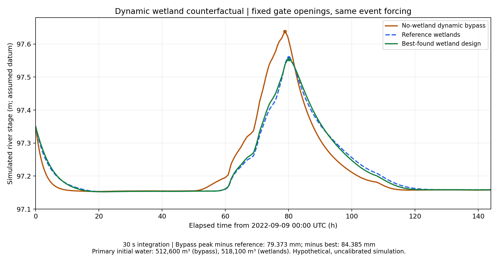

# B.2 six-state no-wetland dynamic counterfactual

This is one new **fixed dynamic control case**, with two existing wetland designs and one small initialization sensitivity. It is not a new optimization. All three primary cases use the current no-dam-spillway formulation and the same prescribed gate openings, regional event weather, shared geometry, boundaries and non-wetland parameters.

## Peak comparison

| Quantity | No-wetland dynamic bypass | Reference wetlands | Best-found wetland design |
|---|---:|---:|---:|
| Design | N/A | A/A; covers 0.65000000000000002/0.59999999999999998 | B/B; covers 0.27141176241872322/0.21412791931880959 |
| States | 6 | 8 | 8 |
| Physical river peak (m) | 97.637815 | 97.558443 | 97.553431 |
| Peak time (h) | 78.850000 | 80.041667 | 80.050000 |
| Bypass minus case peak (mm) | 0.000000 | 79.372579 | 84.384588 |
| Status | valid_feasible | valid_feasible | valid_feasible |

Results above use the 30-second grid. The reference A/A covers are 0.65/0.60; the best-found B/B covers were loaded from `batch_best.npz` at full precision: **0.27141176241872322, 0.21412791931880959**. Positive differences indicate lower peak with wetlands. No percentage uses the arbitrary absolute level datum.

- ΔH_reference = H_peak,case1 − H_peak,case2 = **79.372579 mm**.
- ΔH_best = H_peak,case1 − H_peak,case3 = **84.384588 mm**.
- ΔH_design = H_peak,case2 − H_peak,case3 = **5.012009 mm**.

Only the last difference is the additional saved wetland-design optimization improvement. The bypass-to-best difference is a structural counterfactual comparison, not another OPT gain.



The [complete readable comparison table](../tables/wetland_counterfactual/comparison.md) includes physical levels, constraints, initial/final water, all external balance components, solver completion and the initialization diagnostic. [comparison.csv](../tables/wetland_counterfactual/comparison.csv) contains all 15 case/timestep rows. No new observations, coefficients or safety thresholds were added.

## Structural definition and six-state balances

Case 1 is a reduced **six-state ODE**, ordered `S_u, S_m, S_d1, S_d2, S_g, S_r` (m³). Both gates discharge directly into the river. There are no dummy wetland states, wetland drainage, overflow, seepage or wetland ET. Cases 2 and 3 remain eight-state dynamic models with those wetland processes retained. No case has an independent dam spillway.

```text
dS_u/dt  = P A_u − Q_inf − Q_ud1 − Q_ud2 − Q_ur
dS_m/dt  = Q_inf − Q_mg − E_m
dS_d1/dt = P A_d1 + Q_ud1 − Q_G1 − E_d1
dS_d2/dt = P A_d2 + Q_ud2 − Q_G2 − E_d2
dS_g/dt  = Q_mg + Q_gx − Q_gr
dS_r/dt  = P (A_r+A_w1+A_w2) + Q_ur + Q_G1 + Q_G2 + Q_gr + Q_ext − Q_out − E_r
```

Retained constitutive fluxes reuse the accepted helpers and parameter values. The six-state derivative and diagnostic indices are separate from eight-state positions. The aquifer remains 640,000 m². Rainfall over the former 22,000 m² wetland footprint immediately enters the river: **3196.600 m³**. This is an explicitly adopted instantaneous bypass assumption, not calibrated replacement land cover. River storage–stage/evaporation area remains **20,000 m²**, while its rainfall-receiving footprint is 42,000 m². Upland area is unchanged. Total rainfall footprint is 660,000 m² in every case, with no aquifer rainfall double count.

All modeled wetland mechanisms—storage, routing, seepage and ET—change together in Case 1. This does not isolate storage alone. Removing wetland seepage changes groundwater evolution and its exchange with the river/exterior; it does not remove the common aquifer.

## Hydraulics, constraints and feasibility

The existing hydraulic law computes every gate discharge. Wetland cases use their internal H_wi; the bypass uses **internal H_r**, never external h_d, zero tailwater or replayed discharge. The maximum tested pointwise opening difference is 0; maximum actual release difference is **1.72e-15 m³/s**; maximum absolute branch release-volume difference is **1.92e-12 m³** across comparisons/steps (floating-point roundoff). These are numerical findings, not hard-coded equalities.

Under the retained river applicability ceiling, H_r < 99.0 m < gate sills 99.8/100.0 m. The finest bypass integration recorded minimum all-stage tailwater clearances of **2.362175/2.162175 m**. All 69121 RHS evaluations used free-flow gates. Wetland-case tailwaters are also below their sills; shared upstream state histories and free releases agree numerically. Changes in downstream storage and groundwater remain possible despite identical gates.

| Quantity | No-wetland dynamic bypass | Reference wetlands | Best-found wetland design |
|---|---:|---:|---:|
| Maximum pool 1 (m) | 101.052895 | 101.052895 | 101.052895 |
| Pool 1 safety margin (m) | 0.147105 | 0.147105 | 0.147105 |
| Maximum pool 2 (m) | 100.679964 | 100.679964 | 100.679964 |
| Pool 2 safety margin (m) | 0.320036 | 0.320036 | 0.320036 |
| Wetland 1 safety margin (m) | N/A | 0.214436 | 0.270131 |
| Wetland 2 safety margin (m) | N/A | 0.201565 | 0.264190 |
| G5 branch 1 node margin (m) | 0.016458 | 0.016458 | 0.016458 |
| G5 branch 2 node margin (m) | 0.051657 | 0.051657 | 0.051657 |

All 15 case/timestep records are numerically and hydraulically valid and pass all applicable constraints, including strict node residual signs. The six-state audit has **19 meaningful rows**; wetland nonnegativity, wetland maximum levels, wetland-bed separation and wetland cover bounds are N/A. The inherited **H_g_valid_max=97.9 m** stays unchanged despite its original lowest-wetland-bed rationale; thus removing the duplicated wetland-bed row does not relax the common groundwater ceiling. Soil-bottom and river limits, the 0.001 m node audit margin, fixed physical limits and positive scaling volumes are unchanged.

Nonnegative storage, soil capacity, common hard geometry and G5 are checked within every existing official RHS/RK stage, including the accepted final point. G5 remains applicability validation for fixed operations; there is no active optimizer in this task. The bypass minimum all-stage G5 margins are **0.016457149/0.051656190 m**. Node safety maxima include the final time. These finite checks are not continuous-time engineering certification. No storage clipping or safety-limit adjustments occur. The implementation distinguishes an invalid integration from a completed trajectory violating safety.

## Water accounting and initial conditions

| Quantity | No-wetland dynamic bypass | Reference wetlands | Best-found wetland design |
|---|---:|---:|---:|
| Initial total water (m³) | 512600.000000 | 518100.000000 | 518100.000000 |
| Final total water (m³) | 509927.995730 | 518007.443792 | 517474.350051 |
| Event storage change (m³) | -2672.004270 | -92.556208 | -625.649949 |
| Rainfall (m³) | 95898.000000 | 95898.000000 | 95898.000000 |
| External surface inflow (m³) | 0.000000 | 0.000000 | 0.000000 |
| Total ET (m³) | 9895.757754 | 10254.560734 | 10242.007012 |
| Signed external groundwater exchange (m³) | -2435.259600 | -3016.227754 | -2987.889198 |
| River outlet volume (m³) | 86238.990966 | 82719.770268 | 83293.755886 |
| Final integrated balance residual (m³) | 0.004050 | 0.002547 | 0.002146 |
| Maximum absolute integrated residual (m³) | 0.006306 | 0.004398 | 0.003753 |

The approved wetland initial storages are 3,000/2,500 m³. Case 1 has no such compartments and starts with **5,500 m³ less total water**, while every shared initial state is identical. This water is not transferred into the river at t=0.

For the bypass, the checked identity is:

```text
dS_total/dt = P A_rain + Q_ext + Q_gx − Q_out − (E_m + E_d1 + E_d2 + E_r)
```

The maximum bypass derivative cancellation error at any recorded RHS/RK stage is **1.33e-15 m³/s**. Its maximum integrated residual at 30 seconds is **0.006306 m³**, relative 6.58e-08. Whole-system balance sums only external terms; gate discharge, normal drainage, overflow and seepage are internal transfers and are not added as external inputs. Signed groundwater exchange is positive into the modeled aquifer. The independent final balance also recomputes each integral separately. Trapezoidal diagnostic integration and RK state integration have small, timestep-dependent residuals; no correction water is inserted.

## Mechanism and timing

| Quantity | No-wetland dynamic bypass | Reference wetlands | Best-found wetland design |
|---|---:|---:|---:|
| Gate 1 release volume (m³) | 33255.471828 | 33255.471828 | 33255.471828 |
| Gate 2 release volume (m³) | 27224.009738 | 27224.009738 | 27224.009738 |
| Combined gate release centroid (h) | 77.786149 | 77.786149 | 77.786149 |
| Combined gate peak time (h) | 76.000000 | 76.000000 | 76.000000 |
| Wetland normal drainage (m³) | N/A | 57041.508298 | 59587.321094 |
| Wetland overflow (m³) | N/A | 2194.917522 | 235.448539 |
| Wetland seepage (m³) | N/A | 9236.919799 | 8752.033915 |
| Wetland ET (m³) | N/A | 358.470007 | 346.069387 |
| Wetland 1 peak storage (m³) | N/A | 8226.767768 | 7558.432818 |
| Wetland 2 peak storage (m³) | N/A | 6984.348570 | 6358.097631 |
| Wetland 1 storage change (m³) | N/A | -2829.880115 | -2881.997806 |
| Wetland 2 storage change (m³) | N/A | -2325.853371 | -2362.792785 |
| Wetland 1 final storage (m³) | N/A | 170.119885 | 118.002194 |
| Wetland 2 final storage (m³) | N/A | 174.146629 | 137.207215 |
| Former-footprint rain directly to river (m³) | 3196.600000 | N/A | N/A |
| Simultaneous branch contribution peak (m³/s) | 0.904788 | 0.748895 | 0.711929 |
| Branch contribution peak time (h) | 76.000000 | 78.850000 | 78.866667 |
| Branch contribution centroid (h) | 77.495256 | 79.267520 | 78.203764 |
| Branch contribution at river peak (m³/s) | 0.775485 | 0.696710 | 0.685569 |
| Gates at own river peak (m³/s) | 0.713067 | 0.600613 | 0.600166 |
| Former-footprint rain to river at own peak (m³/s) | 0.062418 | N/A | N/A |
| Normal drainage at own river peak (m³/s) | N/A | 0.582524 | 0.668428 |
| Overflow at own river peak (m³/s) | N/A | 0.114186 | 0.017140 |
| Groundwater inflow at own river peak (m³/s) | 0.000000 | 0.000000 | 0.000000 |

“Branch contribution” means Q_G1+Q_G2+former-footprint rain for the bypass, and simultaneous Q_wr1+Q_wr2+Q_wsp1+Q_wsp2 for wetland cases. Gate inputs are therefore not added again to wetland drainage. Values “at river peak” use each case's own reported peak time. Centroids are temporal first moments, not measured parcel travel times. [mechanisms.csv](../tables/wetland_counterfactual/mechanisms.csv) includes branch volumes/timing, all remaining state water, and both zero-initial-storage diagnostics.

The wetland module changes the concentration and timing of downstream inflow. The bypass river peaks at 78.8500 h, versus 80.0417/80.0500 h with wetlands. The branch-inflow peak is 0.904788 m³/s without wetlands and 0.748895/0.711929 m³/s with them. Storage, normal routing, retained wetland overflow, seepage and ET all contribute to the differences; the external accounting above discloses total water effects. The best design's improvement over reference accompanies reduced overflow concentration, not a claim that greater wetland storage always gives a lower peak.

## Equal-initial-water sensitivity

| Quantity | No-wetland dynamic bypass | Reference wetlands; zero initial wetland storage | Best-found wetland design; zero initial wetland storage |
|---|---:|---:|---:|
| Initial total water (m³) | 512600.000000 | 512600.000000 | 512600.000000 |
| Peak (m) | 97.637815 | 97.558155 | 97.553209 |
| Bypass−case peak (mm) | 0.000000 | 79.660076 | 84.606255 |
| Status | valid_feasible | valid_feasible | valid_feasible |

Only wetland initial storages were set to zero; all shared initial water, gate functions, forcing, geometry and limits were retained. These two additional fixed configurations were run at all three timesteps without optimization. All six diagnostic integrations are valid and feasible. This is a sensitivity condition, not an observed antecedent state or replacement for the approved primary case.

Zeroing initial wetland water lowers the reference peak by **0.287497 mm** and best-design peak by **0.221668 mm**. The bypass comparisons become **79.660076/84.606255 mm**; reference-to-best design difference is **4.946179 mm**. The direction and approximate magnitude of the modeled wetland comparison persist. The numerical differences do depend slightly on initial water; this diagnostic does not remove other assumption sensitivity or supply calibration.

## Time resolution, provenance and remaining storage

| Step (s) | Bypass peak (m) | Reference peak (m) | Best peak (m) | Bypass−reference (mm) | Bypass−best (mm) | Reference−best (mm) |
|---:|---:|---:|---:|---:|---:|---:|
| 120 | 97.637744822 | 97.558441514 | 97.553429093 | 79.303307 | 84.315729 | 5.012422 |
| 60 | 97.637815093 | 97.558441845 | 97.553430506 | 79.373248 | 84.384587 | 5.011339 |
| 30 | 97.637815093 | 97.558442514 | 97.553430505 | 79.372579 | 84.384588 | 5.012009 |

The 120/60/30-second checks retain the identical 120-second weather reconstruction and original gate-knot functions. Rain depth is 145.300000 mm (95,898 m³), and solar energy is 21166.810000 Wh/m² in every case. All tested difference signs persist; every comparison passes the existing empirical screen (sum of peak grid changes below 10% of the difference). The largest sum of 60→30-second peak changes among primary pairs is 0.000670 mm. This is a resolution diagnostic, not a rigorous error bound.

The event is **2022-09-09 00:00 through 2022-09-15 00:00 UTC**. NOAA rainfall intervals end at actual report times; meteorology interpolation/spatial transfer, five trace-zero lower bounds and unresolved subinterval timing remain as approved. POWER solar values are gridded estimates, with the retained start-of-hour timestamp assumption and energy-preserving reconstruction. No local gauge discharge is inserted into the boundary inputs. Assumed initial water and boundary heads are not observations.

| Quantity | No-wetland dynamic bypass | Reference wetlands | Best-found wetland design |
|---|---:|---:|---:|
| Final river stage (m) | 97.157811 | 97.158568 | 97.158451 |
| River rising at final step | Yes | Yes | Yes |
| Peak in last 5% of interval | No | No | No |

The relevant simulated maxima are interior to the selected six-day window; however, every case has a small end-step rise and substantial remaining storage. The fixed window does **not** establish complete recession or exclude a later maximum beyond it. Remaining stored water is not permanently removed flood volume. Final compartment storages and outlet volumes are available in the mechanism and comparison tables; no warm-up or extended scenario was added.

## Execution, preservation and interpretation

The actual official `ode4u` implementation is multivarious 1.2.1, pinned revision `06d7aed5b541ec7fe26a6dc69be6aa7fb610aa02`. There were **11 new completed integrations**: 3 bypass runs, 6 zero-initial-wetland runs, and 2 exact 120-second reproductions of saved primary wetland trajectories. **Six compatible primary wetland trajectories were reused** after checksum, full design/x0/forcing, all accepted-node flux and constraint-audit checks. The two fresh reproductions matched saved time, state, inputs, outputs and balance arrays exactly. All integrations completed the full horizon. OPT was not run.

The software suite passed **96 tests**, including 10 targeted counterfactual tests for six-state conservation, rainfall routing, internal river tailwater, an actual official RK-stage G5 rejection, and valid but unsafe uncapped pools. These tests verify implementation, not field calibration.

The new modules are [wetland_counterfactual.py](../wetland_counterfactual.py) and [wetland_counterfactual_reporting.py](../wetland_counterfactual_reporting.py), with focused tests in [test_wetland_counterfactual.py](../test_wetland_counterfactual.py). Source hashes, exact numerical designs, forcing provenance and solver revision are recorded in `B/results/wetland_counterfactual/configuration_and_provenance.json`; that directory also holds new trajectories, per-run diagnostics and preservation records. Old primary NPZs are referenced in place and never overwritten. The source/assumption document gains only a counterfactual scope section.

Current file locations are under `B/`; the shared official solver is under `A/work/multivarious/`. Saved numerical outputs and configuration/provenance JSON retain their original values, hashes and path labels. [project_paths.py](../project_paths.py) resolves those labels to the current locations; the local relocation manifest records import/path-only source edits.

From the project root with the existing pinned solver/environment:

```sh
MPLCONFIGDIR=B/work/mpl-cache python3 -B -m B.wetland_counterfactual --run --report
```

`--run` refuses to overwrite completed comparison results. To regenerate only these new tables/figure/report:

```sh
MPLCONFIGDIR=B/work/mpl-cache python3 -B -m B.wetland_counterfactual --report
```

Case 1 is a six-state dynamic instantaneous-bypass counterfactual, not a static calculation or calibrated land-cover alternative. Cases 2 and 3 are eight-state dynamic systems. All are simulated through time under identical prescribed external forcing and gate histories, with the disclosed primary initial-water difference. Differences include the full represented wetland module and any hydraulic feedback; equal releases here are verified for this case only. Results are conditional simulated differences, not measured Milwaukee flood reductions, local design certification, universal wetland benefits or proof of a global optimum. This comparison introduced no new observational data and did not change the historical models/results. The source, documentation, figures and selected tables are published; raw working data and numerical arrays remain local.
