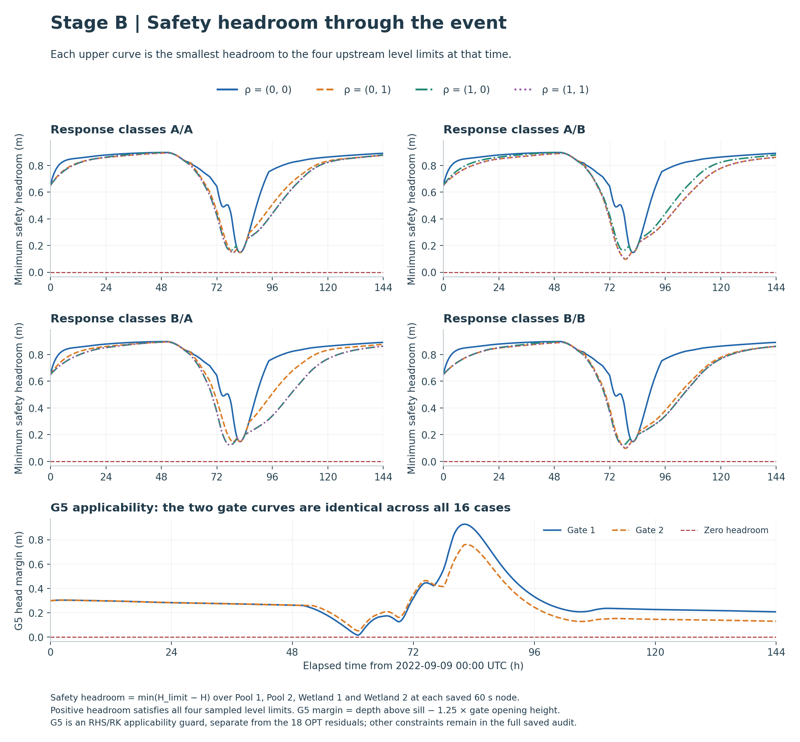
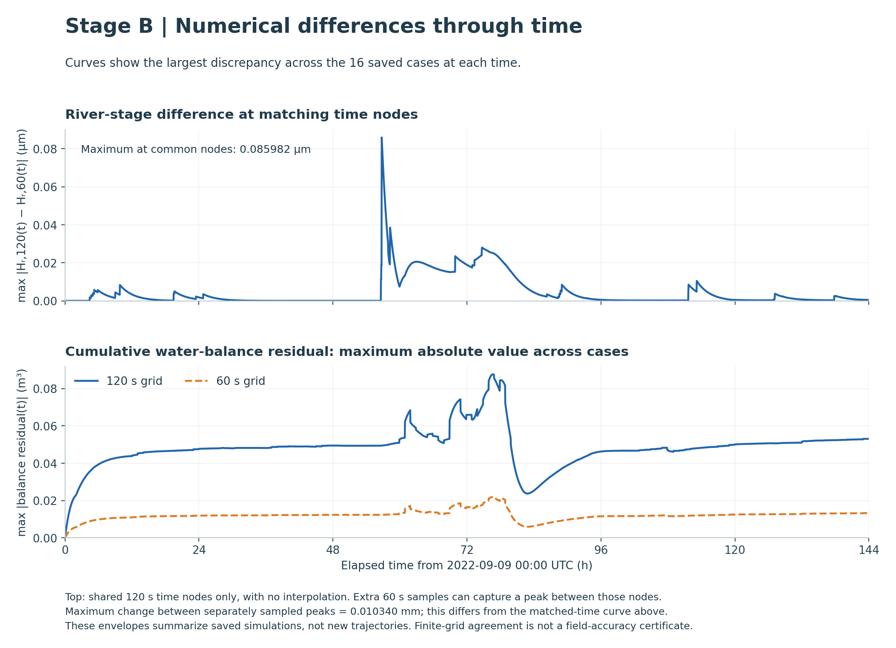

# Stage B analysis function and design-bound verification

The final study fixes gate operations and varies only wetland designs. Each category pair is held in the constants; the continuous vector is `v=[rho1,rho2]`. The four synthetic pairs A/A, A/B, B/A and B/B are enumerated outside the continuous search. This validation follows the professor's recommendation to call the analysis on distinct and extreme designs and check the design bounds. Testing all four two-dimensional corners is this project's explicit coverage choice.

## Callable analysis

The implementation is [wetland_only_study.py](../wetland_only_study.py). Both standalone calls and the optimizer callback use `analysis(v,c)` with the same simulation and constraint implementation. No optimizer algorithm was added.

```python
from B.wetland_only_study import make_analysis_constants, analysis
c = make_analysis_constants(("type_a", "type_b"))
f, g = analysis([0.0, 1.0], c)
print(f, g)  # dimensionless scalar and 1-D array of 18 residuals
print(c.last_evaluation["physical_peak_m"])
print(c.last_evaluation["valid"], c.last_evaluation["feasible"])
```

`c` contains the fixed model configuration, readonly copy of the gate schedule, category pair, forcing and timestep refinement. `last_evaluation` is diagnostic output replaced on every call; it is not a simulation input. The call does not run OPT or write files.

The physical objective is `max_t H_r(t)` in metres, evaluated after ODE integration. The returned objective is the unchanged numerical conditioning `f=(H_peak-97 m)/(1 m)`. Thus `f` and all 18 entries of `g` are dimensionless. Water flows remain m³/s, storage m³ and time s; volume constraints use their fixed m³ scales and level constraints their fixed 1 m scale. These numerical scales do not change physical safety levels. Native cover bounds remain [0,1]. G5 stays an RHS/RK applicability check outside `g`.

A valid but unsafe simulation returns its actual physical peak and positive violated-constraint residuals. An invalid hydraulic/numerical evaluation returns the pre-existing finite failure sentinel with positive integration-status residual; it has no physical peak or complete trajectory. The sentinel is never reported as a physical river level. Programming/configuration errors propagate rather than being converted into design outcomes.

## Actual dynamic checks

The four corners `[0,0]`, `[0,1]`, `[1,0]`, `[1,1]` were evaluated for all four category pairs. There were **32 boundary integrations** plus **2 exact reproductions** of the saved reference and best-design trajectories, for **34 official ODE attempts**. No OPT search was performed.

Boundary outcomes: **32 valid complete trajectories**, **32 feasible**, **0 valid but constraint-infeasible**, and **0 invalid evaluations**.

The prescribed 120/60 s comparisons use the same event, forcing knots, initial states, geometry, coefficients and gates. The existing numerical peak-grid tolerance is 0.001 m; it is a diagnostic threshold, not a safety allowance. A 30 s check is triggered only by changed validity/feasibility or a larger peak change. Maximum comparable 120-to-60 s peak change: 0.010340 mm.

The full [boundary table](../tables/analysis_checks/boundary_checks.md) reports every case, constraint failure and balance residual. Passing these finite checks does not establish stability for every interior point, continuous-time constraint satisfaction, calibration or a global optimum.

Both reference and best-design calls exactly reproduce the saved time, state, input, output and balance arrays, as well as the prior conditioned objective and all 18 residuals. The checks verify reuse of the existing hydraulic model; they do not introduce a new baseline or new optimized result.

## Reproduction and evidence

Run from the project root in the existing environment:

```sh
python3 -B -m B.wetland_analysis_checks --run --report
# Once results exist, regenerate figures and documentation only:
python3 -B -m B.wetland_analysis_checks --report
```

The driver refuses to overwrite existing checks. Numerical results, complete valid trajectories, frozen configuration, actual source hashes, diagnostics and preservation checks are local under `B/results/analysis_checks/`. The retained `executed_check_driver.py` matches the driver hash recorded in the run plan; subsequent report wording is separate from numerical execution. Earlier results and scientific inputs are checked byte-for-byte and left intact. A and all previous optimized results remain unchanged.

Coverage 0 means an unvegetated wetland compartment; 1 means complete coverage by the selected synthetic class. Neither endpoint removes wetland storage or routing. The [source and assumption document](../data_sources_and_assumptions.md) distinguishes the assumed resistance/ET endpoints and their interpolation from observed weather, sourced hydraulic concepts and numerical settings. These tests add no observational support for the assumed coefficients.

[Final Stage B guide](../README.md) · [Optimization results](12_wetland_only_optimization.md)

## Boundary verification figures

All three figures use elapsed simulation time on the horizontal axis and read only saved trajectories. River-stage panels show the four coverage corners for each synthetic class pair. Upper safety panels show, for each case, the smallest headroom to the four upstream level limits at each time; the lower panel shows the shared G5 histories. Numerical panels show maximum discrepancies across the cases: river-stage differences at common time nodes and cumulative water-balance residuals. Matched-time differences are distinct from differences between independently sampled peak values. No lines interpolate across coverage or class choices. The complete audit and exact peaks remain in the table and saved records.





