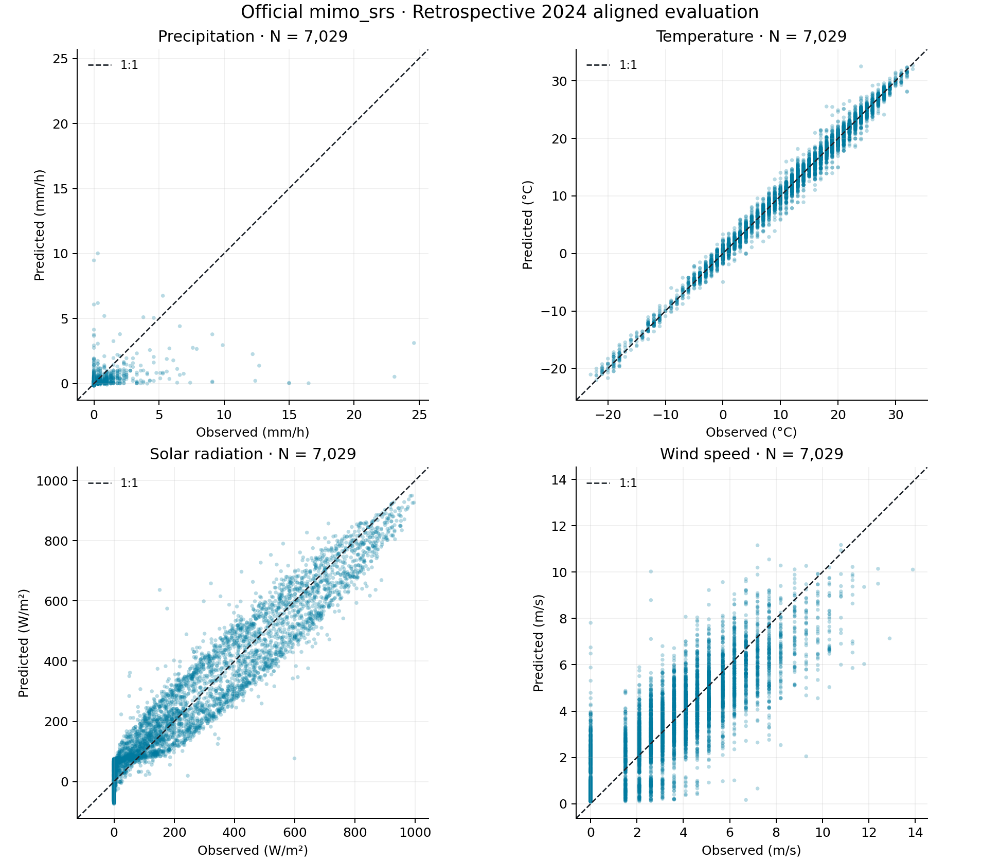
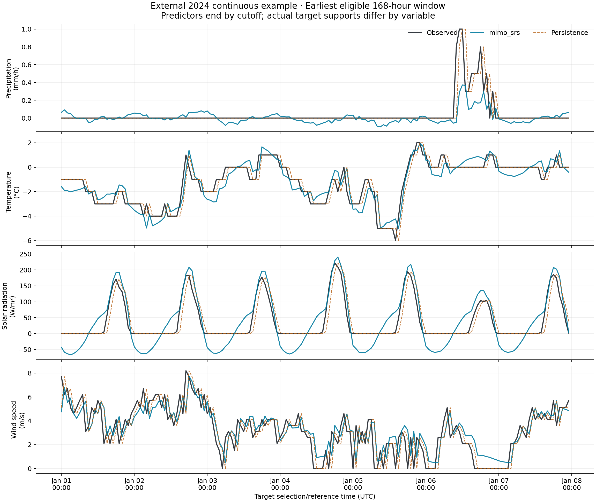
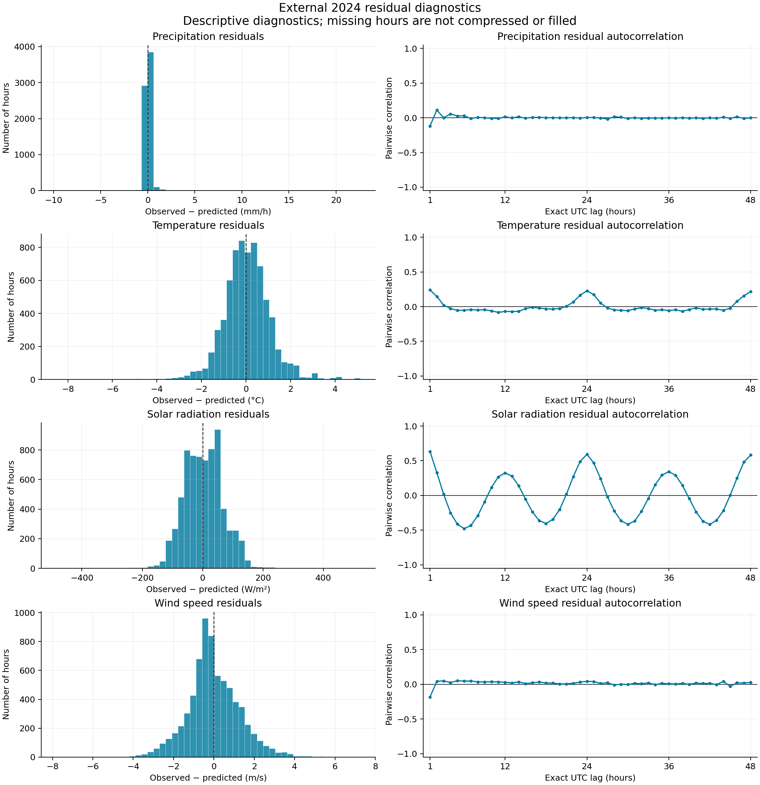

# Stage C: Meteorological fitting and diagnostics

[Project overview](../README.md) · [Stage A](../A/README.md) · [Stage B](../B/README.md)

**Focused final submission: [HW C.2 official FIT report](docs/c2_fit_summary.md).** The original four-output, first-order `mimo_srs` application is the main result. Rainfall-history, squared-feature and penalty experiments are supplementary comparisons; marginal-distribution, Copula/VAR and block-bootstrap work is supplementary weather diagnostics. These are separate studies, not interchangeable models.

Official FIT application and diagnostic outputs are implemented; known statistical, physical and numerical limitations remain. The full assignment rubric is unavailable, so this status does not assert satisfaction of every grading requirement. C runs independently of A/B and contains no active downstream ODE propagation or wetland-benefit calculation.

## Main C.2 result

The original eight-input fit uses **41,924 development pairs from target-reference UTC years 2019–2023**. The official seeded random split uses **29,346 coefficient-training / 12,578 diagnostic pairs**. External evaluation compares all four responses and persistence on the same **7,029 eligible 2024 timestamps**. Initial L1 is 1.0; the internal penalty adapts, and the original effective final penalty was not recorded. Independent stationarity/convergence is **not assessed** for this main model.

The inputs are the latest completed native-hour rainfall, recent temperature and wind reports, completed-hour solar radiation, and annual/diurnal sine and cosine terms. Outputs are P (mm/h), T (°C), Rs (W/m²), and W (m/s). NOAA station observations and NASA POWER grid estimates have different spatial support; [data sources and QC](docs/data_sources.md) identify them.

Prediction cutoff `c` precedes the target selection reference by one hour. Rainfall typically uses `(c−68 min,c−8 min]` as its input and `(c−8 min,c+52 min]` as its target. Solar interval bounds depend on an explicit hour-start assumption, and instrument averaging windows/publication delays are not fully known. This is retrospective observation-time-aligned fitting, **not a demonstrated operational or exact future-clock-hour forecast**. [Alignment examples](tables/mimo_srs/alignment_examples.csv) preserve actual support differences.

All four RMSEs are lower than persistence, but rainfall and wind MAEs are higher. Rainfall R² is only 0.127916; intense rainfall is severely underestimated. The original fit retains 2,352 negative rainfall predictions, 1,781 negative solar predictions, nonzero nighttime solar predictions and structured residuals. It has no negative wind predictions. No predictions were clipped. These unconstrained responses are not automatically physically admissible hydrologic forcing.

### Three original figure groups

**1. Observed versus predicted.** Original four-output fit, external 2024; proximity to the 1:1 line shows descriptive agreement. This is not a numerical convergence test.



**2. Continuous comparison.** Observations, official fit and persistence over January 1–7, 2024 UTC, the earliest complete eligible 168-hour window. Selection uses coverage only; negative predictions remain visible.



**3. Residual diagnostics.** Observed-minus-predicted distributions and exact-UTC-lag autocorrelation. Missing hours are not compressed. Solar and temperature retain daily error structure.



Main tables: [external metrics and persistence](tables/mimo_srs/external_evaluation.csv), [sample counts](tables/mimo_srs/sample_counts.csv), [coefficients](tables/mimo_srs/coefficients.csv), [affine scaling](tables/mimo_srs/affine_scaling.csv), [physical prediction checks](tables/mimo_srs/physical_prediction_diagnostics.csv), [nighttime radiation](tables/mimo_srs/night_radiation.csv), and [residual ACF](tables/mimo_srs/residual_acf.csv). [Model specification](tables/mimo_srs/model_specification.json) records the original features/settings. The [execution provenance extract](tables/mimo_srs/execution_provenance.json) records verified source hashes, settings, alignment, splits and execution status; this public metadata extract is included with the report.

## Supplementary material

| Material | Existing report and figures | Distinct scope |
| --- | --- | --- |
| Rain history | [Report](docs/c2_rain_history_comparison.md), [scatter](plots/mimo_rain_history/observed_vs_predicted.png), [week](plots/mimo_rain_history/continuous_example.png), [rain diagnostics](plots/mimo_rain_history/rainfall_diagnostics.png) | Original eight inputs versus two added completed rain hours, refitted on common 2019–2022 rows |
| Squared rain | [Report](docs/c2_rain_square_comparison.md), [scatter](plots/mimo_rain_square/observed_vs_predicted.png), [week](plots/mimo_rain_square/continuous_example.png), [rain diagnostics](plots/mimo_rain_square/rainfall_diagnostics.png) | One added physical P² input; first order in the expanded inputs, initial L1=1.0 |
| Initial penalty | [Report](docs/c2_rain_penalty_comparison.md), [comparison](plots/mimo_rain_penalty/penalty_comparison.png), [rain and iterations](plots/mimo_rain_penalty/rainfall_and_iterations.png), [solver table](tables/mimo_rain_penalty/solver_diagnostics.csv) | Same squared-feature model with initial L1=1.0, 0.1, 0.01; output-specific stationarity diagnostics |
| Weather distributions | [Methods](docs/weather_method.md), [retained execution report](docs/execution_report.md), [tables](tables/weather_validation/), [figures](plots/weather_validation/) | Original standardized 2019–2023 weather and 2024 generated-calendar diagnostics; not FIT prediction scores |

The rainfall comparisons use 33,412 fit-pool pairs (23,388/10,024 internal split), 8,078 validation pairs in 2023, and 6,951 evaluation pairs in 2024. The [main report's supplementary section](docs/c2_fit_summary.md#e-supplementary-comparisons) links the separate comparison reports, which retain their metrics and numerical diagnostics. The main submission table compares only the original official fit with persistence. Do not rank their scores against the original main model's different evaluation sample. Repeated examination of 2024 makes later comparisons exploratory, not fresh blind tests. The 0.1 penalty case passes the rainfall stationarity check but fails temperature's check; it does not replace the original main result.

Copula/VAR retains four failed held-out screens. Bootstrap passes twelve held-out screens but fails its separate training block-length persistence check. These diagnostics do not establish reliable flood probabilities or wetland effectiveness.

## Reproduction

Run commands from the project repository root. The commands below describe the existing workflow; **no fitting, weather generation, package installation or data download was run during this documentation finalization**. Experiment commands overwrite their generated reports, figures, tables and run folders. Preserve a copy/version of the curated documentation before rerunning; embedded report writers still generate the earlier narrative. No reporting-code change is included here.

### Dependency setup in a fresh environment

Use Python 3.11 or newer; the existing runs used Python 3.13.5. Ordinary dependencies are in [C/requirements.txt](requirements.txt). The official loader requires a source checkout at `A/work/multivarious`; installing a package with pip alone does not create this path. The verified source is `hpgavin/multivarious`, version 1.2.1, revision `06d7aed5b541ec7fe26a6dc69be6aa7fb610aa02`.

These instructions are **for a fresh environment where the checkout does not exist**, not for modifying/resetting the current shared checkout:

```sh
python3 -m venv .venv
. .venv/bin/activate
python3 -m pip install -r C/requirements.txt
mkdir -p A/work
git clone https://github.com/hpgavin/multivarious.git A/work/multivarious
git -C A/work/multivarious checkout --detach 06d7aed5b541ec7fe26a6dc69be6aa7fb610aa02
```

The loader imports the exact file `A/work/multivarious/multivarious/fit/mimo_srs.py` and rejects a different import location. The original example is `A/work/multivarious/examples/mimo_srs_example.py`. Both are external dependency files, intentionally excluded from this project repository. Source revision/hashes were checked against the existing checkout; fresh cloning and environment installation were **not tested during this task**. No fallback package or replacement regression is used.

### Level 1: Read the published artifacts

A fresh public clone can display the existing reports, PNGs and CSV/JSON tables without running Python. They are under `C/docs/`, `C/plots/` and `C/tables/`. The finalized narrative and compact provenance extract are included alongside those artifacts. Raw data and full numerical run archives are not included.

### Level 2: Reproduce using existing local processed data and saved artifacts

The focused saved-result checks replay predictions from stored coefficients/scaling and verify sample alignment without refitting:

```sh
python3 -B -m unittest C.tests.test_mimo_fit C.tests.test_mimo_history C.tests.test_mimo_square C.tests.test_mimo_penalty -v
```

These checks require the corresponding local artifacts and official checkout; saved-artifact tests can skip when files are absent. Their results are not a clean-clone reproduction certificate. With the full original local input cache available, the historical original-fit command is:

```sh
python3 -B -m C.run_fitting mimo
```

This command **always rebuilds FIT alignment from the cached NOAA/POWER sources and `C/data/processed/weather_hourly.csv`, then fits**. There is no current CLI action that refits the original model from only a processed CSV. To regenerate the supplementary comparisons, the existing order is:

```sh
python3 -B -m C.run_fitting mimo-history
python3 -B -m C.run_fitting mimo-square
python3 -B -m C.mimo_penalty
```

History needs the original aligned FIT cache and saved original predictions; square needs history cohorts and the fitted one-hour comparator; penalty needs square artifacts. All use their saved common-sample design. The optional custom-weather command `python3 -B -m C.run_fitting all` means **weather fit plus validation**, not official FIT, and requires standardized local data. It is not needed to read or replay the main FIT results.

### Level 3: Rebuild inputs from source data

Without the local caches, source preparation is required before fitting:

```sh
python3 -B -m C.run_fitting prepare
python3 -B -m C.run_fitting mimo
```

`prepare` uses [configs/fitting.json](configs/fitting.json) and [uncertainty/data.py](uncertainty/data.py), reuses verified caches where present, or requests NOAA station history, twelve station-year CSVs, and six NASA POWER yearly responses. It creates standardized weather and QC records. `mimo` then creates the separate FIT-only alignment; it does not overwrite the standardized inputs. Network/source availability and the dependency setup above are prerequisites. Revised upstream observations may not reproduce the archived bytes; compare hashes to the saved provenance. No download or clean-environment rebuild was tested in this finalization. A fresh clone alone cannot reproduce the historical numerical results offline.

### Artifact availability and local-only outputs

| Artifact group | Availability in the inspected repository | Existing generator |
| --- | --- | --- |
| Main/supplementary PNGs, CSV/JSON tables, source, configs, reports | Present and tracked | Existing experiment commands above; no figures/results regenerated here |
| `C/tables/mimo_srs/execution_provenance.json` | Included public metadata extract | Documentation-only extract of verified existing records; no new experiment |
| `C/data/raw/`, `C/data/processed/weather_hourly.csv`, QC | Present locally; excluded by `.gitignore` | `python3 -B -m C.run_fitting prepare` |
| `C/results/mimo_srs/` alignment, arrays, predictions, source audit and execution logs | Present locally; excluded | `python3 -B -m C.run_fitting mimo` |
| `C/results/mimo_rain_history/`, `mimo_rain_square/`, `mimo_rain_penalty/` | Present locally; excluded | Respective supplementary commands above |
| `C/data/processed/weather_model.json`, `C/results/weather_validation/` | Present locally; excluded | `python3 -B -m C.run_fitting all` (`fit` then `validate`) |
| Test logs and earlier preservation manifests | Present locally; excluded; historical records | Earlier test/finalization invocations; full run commands do not recreate every historical check record |
| `A/work/multivarious/` | Present locally; excluded external dependency | Fresh-environment clone instructions above |

Local-only artifacts are described as code paths rather than public hyperlinks throughout the C documents. No linked artifact was actually missing at inspection. The compact provenance extract replaces the need to publish all logs or prediction archives; broad `C/data/` and `C/results/` ignore rules remain unchanged.

## Finalization checks and remaining gaps

On 2026-11-03, the 24 focused tests listed under Level 2 ran in the existing environment: **24 passed, zero skipped**. They checked source imports/fingerprints, source-time alignment, saved prediction replay, sample preservation, feature construction and numerical-diagnostic logic; no fitting experiment or weather generation ran. Relative links/heading anchors, documented CLI names, saved-table values and metadata were checked. Protected-file SHA-256 comparison is recorded as part of the finalization verification; the finalized documentation does not constitute clean-environment reproduction.

No A/B files, C scientific code/configuration, original data/QC, official source, fitted coefficients, saved predictions, evaluation splits, PNGs or existing numerical result values were changed. The existing model-specification metadata changes only two descriptive source paths to repository-relative paths. Remaining gaps are source availability for a fresh rebuild, unresolved observation/solar support and publication latency, the original model's unassessed stationarity, and the unavailable full assignment rubric.
