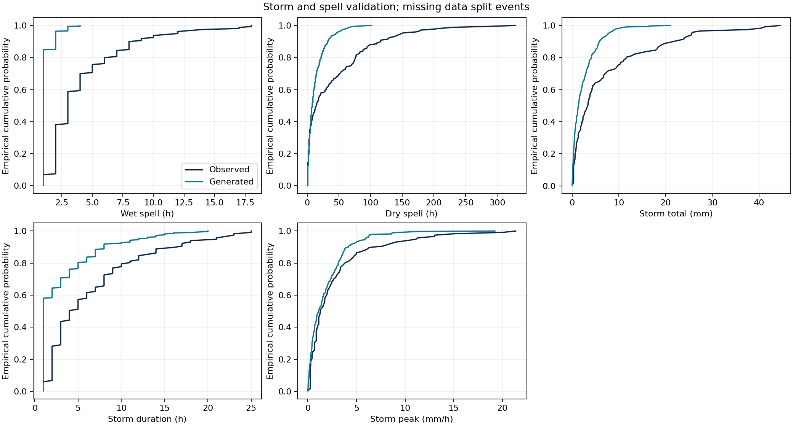
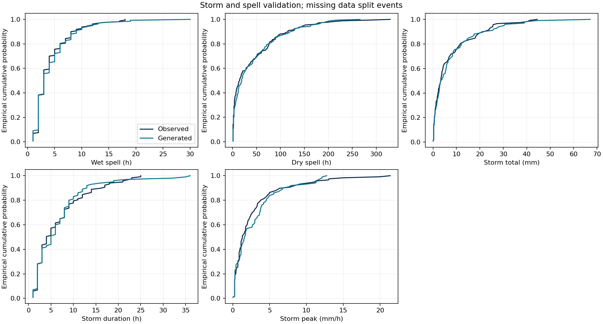

# Stage C: Meteorological fitting and diagnostics

[Project overview](../README.md) · [Stage A](../A/README.md) · [Stage B](../B/README.md)

The current assignment scope is **HW C.2: apply FIT / mimo srs; figures & tables**. This folder retains meteorological preparation, existing statistical fitting, weather-only examples and diagnostic figures/tables. It runs independently of the A/B dynamic models.

**The official FIT/mimo_srs application has now run on real project data**, with a separately prepared observation-time alignment and retrospective external 2024 evaluation. The focused result is documented in [C.2 fit summary](docs/c2_fit_summary.md). Detailed original assignment/grading instructions remain unavailable, so this status does not assert completion of every course requirement. The retained marginal/Copula/VAR/bootstrap work remains a separate component.

## Official FIT application

```sh
cd /Users/zhangjiaxuan/Documents/Codex/Modeling
/opt/miniconda3/bin/python3 -B -m C.run_fitting mimo
```

This command reads existing cached observations; it does not download or overwrite them. The original hourly precipitation redistribution contained target-hour source support in its nominal lag. Following explicit user approval, the new FIT-only dataset uses hourly UTC availability cutoffs and backward-only source selection. Per-variable source timestamps, actual rain intervals and ages are retained. The completed native rain predictor is named `P_completed_1h_at_cutoff`, not `P(t−1)`. Targets have different physical supports: the native rain target typically covers cutoff−8 to cutoff+52 minutes, not the exact next clock hour. Solar bounds remain conditional on the inherited hour-start interpretation because the cached responses do not specify an interval anchor; T/W instrument averaging windows are also not supplied. This retrospective evaluation does not establish operational availability or an exact one-hour rainfall forecast. See the [pre-pairing alignment definition](results/mimo_srs/alignment_definition.json) and [cutoff/source/target examples](tables/mimo_srs/alignment_examples.csv).

The actual official order-one power-basis fit retained all **41,924** supplied development pairs from 2019–2023. Its random internal diagnostic split used **29,346** coefficient-training and **12,578** diagnostic samples. External evaluation uses **7,029** aligned pairs under the documented solar-support assumption from 2024. All four RMSEs improve over persistence; precipitation and wind MAEs worsen. Negative predictions and night radiation remain visible.

### Original four-disturbance fit: figures

These three figures show the **original eight-input, first-order official fit**, using the **2019–2023 development pool and external 2024 evaluation**, with initial **L1=1.0** and **no squared-rain input**. All four outputs use the same 7,029 eligible external timestamps. These are the original results, separate from the later 2019–2022 fits and their 2023 validation. The [full original report](docs/c2_fit_summary.md) retains the equations, metrics, time-alignment assumptions and limitations.

**Figure 1. Observed versus predicted precipitation, temperature, solar radiation and wind speed.** Points on the dashed 1:1 line represent exact agreement. Temperature and solar radiation lie closer to the line than rainfall; large rainfall observations are frequently underestimated. Wind predictions are more dispersed. These are descriptive prediction comparisons, not a numerical convergence certificate.


**Figure 2. A continuous 168-hour comparison.** Black denotes observations, blue the official fitted response, and dashed orange persistence (the preceding-cutoff observation). Each estimate uses observed pre-cutoff inputs. The window is January 1–7, 2024 UTC, selected as the earliest complete eligible week using timestamp coverage only. Rainfall peaks are damped in this example; negative rainfall and solar-radiation predictions remain visible, exposing limitations of the unconstrained fitted response. The plotted times are observation-selection references; actual target intervals differ by variable.


**Figure 3. Residual distributions and temporal dependence.** Residuals are observed minus predicted, so positive values indicate underprediction. The left column shows error distributions; the right shows residual autocorrelation at exact UTC lags. Solar radiation retains marked periodic error structure, and temperature also shows daily structure. Missing hours are not compressed or filled, and these diagnostics do not establish independent errors.


- [External metrics](tables/mimo_srs/external_evaluation.csv), [coefficients](tables/mimo_srs/coefficients.csv), [scaling](tables/mimo_srs/affine_scaling.csv), [model specification](tables/mimo_srs/model_specification.json)
- [Timestamped predictions](results/mimo_srs/external_predictions.csv), [execution and source hashes](results/mimo_srs/run_status.json)

The smoke check and full fit both called the unchanged professor implementation in `A/work/multivarious`; no replacement regression was used. Source revision and SHA256, initial positive L1 setting, adaptive internal penalty behavior, supplied/retained counts and limitations are recorded in the summary. All **32 tests pass**, including saved-prediction replay. No A/B model, original weather data or existing weather-generator result was changed.

## Controlled rainfall-history comparison

The [one- versus three-hour rainfall-history comparison](docs/c2_rain_history_comparison.md) preserves the historical official fit above. It refits the original eight-input specification and a ten-input candidate on the **same 33,412 eligible 2019-2022 rows**, validates on **8,078 rows from 2023**, freezes the choice and coefficients, then evaluates **6,951 common 2024 rows**. Only two older completed native-hour rainfall accumulations are added. The official first-order power basis, initial positive L1=1.0 and seeded internal 70/30 diagnostic split remain the same. No 2023 refit or parameter search is performed.

**The added history did not demonstrate an overall improvement.** The one-hour comparator wins the predefined 2023 rainfall-RMSE criterion (0.542387 versus 0.545317 mm/h). In 2024, three-hour RMSE is only 0.06% lower, while MAE is 8.62% higher and negative rainfall predictions increase from 3,172 to 5,170. The frozen choice therefore remains one-hour. This controlled comparator is a new fit of the original specification, not the unchanged historical 2019-2023 fit. Existing 2024 historical results had already been inspected; the comparison is not presented as a newly untouched blind test.

```sh
/opt/miniconda3/bin/python3 -B -m C.run_fitting mimo-history
```

This command requires the existing separate FIT-only aligned cache. It downloads no data and leaves A/B and the original FIT artifacts untouched. Additional source intervals must be genuinely consecutive; no missing history is filled or source timestamp shifted. The original retrospective timing and solar-support caveats still apply.

- [Matched scatter comparison](plots/mimo_rain_history/observed_vs_predicted.png)
- [Matched continuous week](plots/mimo_rain_history/continuous_example.png)
- [Rainfall residuals and observed maximum](plots/mimo_rain_history/rainfall_diagnostics.png)
- [All validation/external metrics](tables/mimo_rain_history/evaluation.csv), [rain strata](tables/mimo_rain_history/rain_strata.csv), [event diagnostics](tables/mimo_rain_history/rain_event_summary.csv)
- [Frozen validation decision](results/mimo_rain_history/frozen_validation_decision.json), [actual execution](results/mimo_rain_history/run_status.json)

Comparison code is in `mimo_history.py` and `mimo_history_figures.py`. Numerical artifacts, tables and figures are kept separately under the corresponding `mimo_rain_history/` folders. The original `mimo_srs/` folders remain unchanged.

## One added squared-rain feature

The [squared-rain feature trial](docs/c2_rain_square_comparison.md) uses exactly the same 33,412 / 8,078 / 6,951 fit, validation and external rows as the history comparison. It reuses the unchanged one-hour comparator and adds only the square of the most recent completed native-hour rain to the original eight inputs. The official call remains order one in the expanded inputs, with the same initial L1, seed and internal split; the candidate family permits a restricted quadratic response in original rain. No older rain lags are used.

**The official fit returned an exactly zero coefficient for the squared feature in all four outputs.** Thus the fitted functions remain affine in the original inputs. The small score changes come from refitted intercepts and original coefficients, not demonstrated rainfall curvature. The candidate wins the predeclared 2023 rainfall-RMSE criterion (0.539811 versus 0.542387 mm/h), but in 2024 its RMSE decreases only 0.28% while MAE increases 10.44%. Negative rain predictions decrease from 3,172 to 1,296 and mean bias is smaller, but positive predictions at zero/trace observations increase. Temperature fitting worsens, and the largest observed rainfall remains severely underestimated. This is a documented exploratory tradeoff, not a replacement presented as a generally improved weather model.

```sh
/opt/miniconda3/bin/python3 -B -m C.run_fitting mimo-square
```

No final refit uses 2023, and no 2024-based tuning occurs. Both years had already been inspected in earlier work, so this is not a new blind test. The existing one-hour model, original FIT and three-hour results remain unchanged. All source-time and physical limitations remain visible.

- [Matched scatter](plots/mimo_rain_square/observed_vs_predicted.png), [continuous week](plots/mimo_rain_square/continuous_example.png), [rainfall diagnostics](plots/mimo_rain_square/rainfall_diagnostics.png)
- [Validation/external metrics](tables/mimo_rain_square/evaluation.csv), [actual coefficients](tables/mimo_rain_square/coefficients.csv), [rain strata](tables/mimo_rain_square/rain_strata.csv)
- [Frozen validation decision](results/mimo_rain_square/frozen_validation_decision.json), [execution record](results/mimo_rain_square/run_status.json)

Code is in `mimo_square.py` and `mimo_square_figures.py`; outputs are separate under `results/`, `tables/` and `plots/mimo_rain_square/`.

## Initial L1 penalty comparison

The [bounded regularization comparison](docs/c2_rain_penalty_comparison.md) keeps the same squared-feature inputs, samples, scales and official implementation, varying only the initial positive penalty: **1.0, 0.1, 0.01**. Read-only iteration tracing shows that the original square coefficient reaches zero on its first accepted update. Initial 0.1 retains the term and passes the rainfall stationarity diagnostic; 1.0 and 0.01 fail that diagnostic. The 0.1 case is selected using 2023, with the decision frozen before the new 2024 evaluation. This does not certify the complete four-output fit: temperature still fails its numerical diagnostic.

Against the previous squared-feature case at 1.0, the 0.1 case reduces 2024 rainfall RMSE by **0.616%** and MAE by **2.967%**. Against the original one-hour comparator, RMSE improves **0.895%**, but MAE worsens **7.166%**. Negative rainfall predictions remain, and the largest observed 24.6 mm/h target is predicted as only 3.886739 mm/h. The improvement is limited and exploratory; no old model is overwritten.

```sh
/opt/miniconda3/bin/python3 -B -m C.mimo_penalty
```

- [Error and coefficient comparison](plots/mimo_rain_penalty/penalty_comparison.png), [rain event and iteration histories](plots/mimo_rain_penalty/rainfall_and_iterations.png).
- [Metrics](tables/mimo_rain_penalty/evaluation.csv), [solver diagnostics](tables/mimo_rain_penalty/solver_diagnostics.csv), [frozen decision](results/mimo_rain_penalty/frozen_validation_decision.json).

The original 1.0 fit was reproduced exactly to recover its missing history; all prior study artifacts remain unchanged. Code and outputs are isolated in `mimo_penalty.py`, `mimo_penalty_figures.py` and the respective `mimo_rain_penalty/` directories. The report records stationarity failures and the unchanged timing limitations; these already-inspected years are not a new blind test.

## Data and existing statistical work

NOAA ISD KMKE `72640014839` supplies precipitation, KMWC `72640594869` supplies temperature/wind, and NASA POWER supplies gridded solar radiation at 43.0547222° N, −88.0461111° E. The standardized 2019–2024 calendar has 52,608 hourly UTC bins, including missing observations. Training uses 2019–2023; 2024 is the chronological holdout. Civil-time features use `America/Chicago`.

The [source and QC report](docs/data_sources.md) preserves station identifiers, source links, timestamp meanings, flags, trace treatment, missingness and acquisition metadata. Raw data, standardized observations and QC records are retained locally. They were not refreshed during this cleanup.

The retained statistical work includes:

- Seasonal marginal selection with zero masses, temperature seasonal/diurnal harmonics and daylight-conditioned radiation.
- Physical and latent correlations, Cholesky innovation covariance and stable VAR(1) temporal modeling.
- Joint 48-hour block-bootstrap weather benchmark.
- One generated held-out calendar per method for observed-versus-generated diagnostics, with the same missingness support as observations.

These weather-only examples support statistical checks. The twenty downstream-run forcing files and downstream ODE propagation extension have been removed from the active project. The existing package name `uncertainty` is retained to avoid unnecessary import reorganization; it now contains only weather/data/statistical modules.

## Reproduce the retained fitting and figures

Use the existing environment from the repository root:

```sh
cd /Users/zhangjiaxuan/Documents/Codex/Modeling
/opt/miniconda3/bin/python3 -B -m C.run_fitting all
/opt/miniconda3/bin/python3 -B -m unittest discover -s C/tests -v
```

`all` runs the existing fitting and weather validation/plotting on the available standardized data. It does not download data or invoke an ODE solver. The individual stages are:

```sh
python3 -B -m C.run_fitting fit
python3 -B -m C.run_fitting validate
```

`python3 -B -m C.run_fitting prepare` is the separate existing acquisition/QC command, for an intentional source-data preparation or refresh. It uses verified caches when available. The active configuration is [`configs/fitting.json`](configs/fitting.json). Statistical settings, chronological split, random seeds and acceptance tolerances were preserved; hydrologic and ensemble options were removed.

Use Python 3.11 or later for the official FIT entry point (tested here with Python 3.13.5). Ordinary dependencies are listed in [`requirements.txt`](requirements.txt). A fresh environment can install them with `python3 -m pip install -r C/requirements.txt`; this installation step was not executed during cleanup. The retained custom fitting workflow does not require the official ODE solver. The professor's original [FIT implementation](../A/work/multivarious/multivarious/fit/mimo_srs.py) and [example](../A/work/multivarious/examples/mimo_srs_example.py) remain untouched in the shared checkout and are now used by the `mimo` action. The existing checkout must remain at that path; see [Stage A dependency setup](../A/README.md). No package installation was needed or tested in this run.

## Files and outputs

```text
C/
├── README.md
├── run_fitting.py               Existing actions plus the official mimo action
├── mimo_fit.py                  Official fitting, evaluation and reporting
├── mimo_causal_data.py          Isolated causal source-time alignment
├── mimo_source_audit.py         Original hourly-source timing audit
├── mimo_figures.py              Three official-fit figure groups
├── requirements.txt
├── configs/fitting.json
├── uncertainty/
│   ├── data.py
│   ├── marginals.py
│   ├── weather_generator.py
│   └── validation.py
├── tests/                       Data, weather and fitting-provenance tests
├── docs/                        Sources, statistical methods, execution status
├── data/raw/                    Original source responses and request metadata
├── data/processed/              Standardized observations, QC and fitted model
├── results/mimo_srs/            Causal data, actual fit arrays, predictions and logs
├── tables/mimo_srs/             Specification, coefficients, scales and metrics
├── plots/mimo_srs/              Three external fit/residual figure groups
├── results/weather_validation/  Detailed weather diagnostics and two examples
├── results/logs/                Fitting execution log
├── tables/weather_validation/   Numerical checks and summaries
└── plots/weather_validation/    Six figures per method
```

`data/processed/weather_model.json` contains fitted marginal parameters, empirical support, selection scores, correlation matrices, VAR parameters and source hashes. Twelve figures remain: marginals, autocorrelation, seasonal pattern, diurnal pattern, storms/spells and cross-correlations for each method. Tables and figures are reproduced by `validate`.

The [statistical methods](docs/weather_method.md) and [actual fitting status](docs/execution_report.md) explain the retained work. No model parameters or methods were retuned during cleanup. Copula/VAR still fails four held-out precipitation-persistence checks; bootstrap passes the held-out screens but fails its 48-hour training-persistence check. Those limitations remain visible.

The fitting-only command has been executed successfully, and all 21 retained tests pass. Fitted parameters, validation examples/check tables and all 12 figures reproduce the retained pre-cleanup outputs byte-for-byte.





## Assignment boundary

The requested official FIT application, coefficients, external evaluation and three figure groups have been executed. These are proposed project-specific predictors, not a claimed instructor-approved specification. The detailed original assignment text was unavailable. No ODE propagation, Monte Carlo ensemble, wetland-benefit probability calculation or new weather-generation method was added. Existing weather diagnostics and their limitations remain separate from this conditional-response fit.
