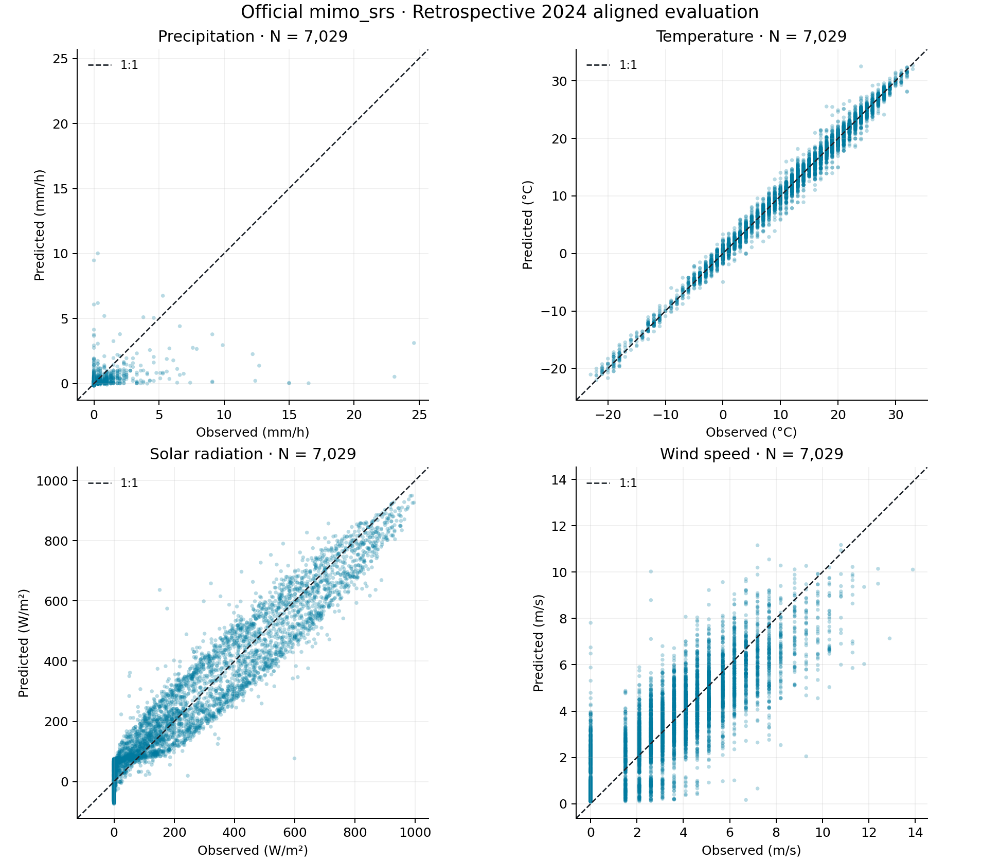
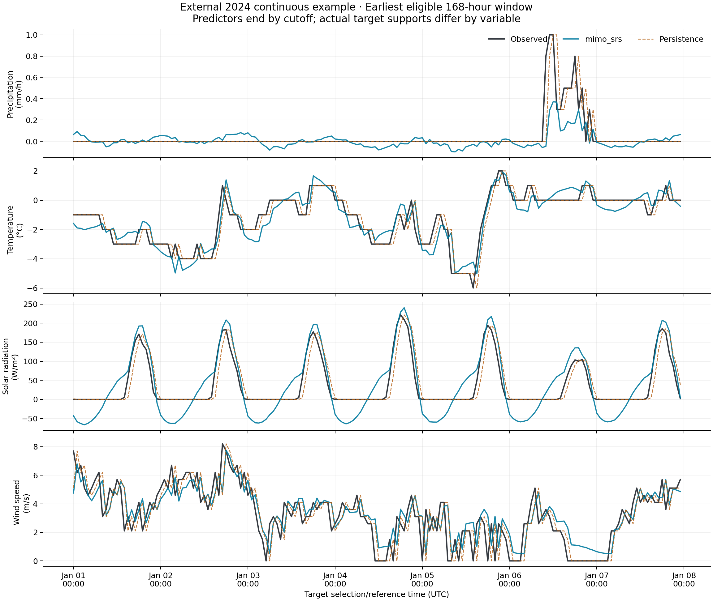

# HW C.2: Official FIT / mimo_srs conditional meteorological response

[Stage C guide](../README.md)

## A. Purpose and scope

How well does a first-order conditional response estimate the observations selected at the next hourly reference time, compared with persistence? This is retrospective, observation-time-aligned evaluation; it is not an exact forecast of four uniform future clock-hour quantities. This is a project-specific application of the professor's tool, not a predictor specification claimed to be instructor-approved. The statistical X/Y labels do not change weather's role as uncontrollable disturbances in A/B.

Let the prediction cutoff be `c` and the next target reference time be `t=c+1 hour`. `Y(t)` contains the four observations selected at t, with their actual supports retained. `X(c) = [P_completed_1h_at_cutoff, T_latest_at_cutoff, Rs_completed_clock_hour, W_latest_at_cutoff, sin(annual_t), cos(annual_t), sin(diurnal_t), cos(diurnal_t)]`. The completed native rainfall accumulation is **not named P(t−1)** because it does not cover the preceding clock hour. Units are mm/h, °C, W/m² and m/s. There is one fitted response surface with nine power-basis terms per output. There is no hydrologic propagation or recursive weather generation.

The original four-output, first-order official fit is the **main C.2 result**. Rain-history, squared-feature and penalty comparisons are supplementary; custom weather generators are separate supplementary diagnostics. Statistical predictors and responses are neither controllable ODE decisions nor downstream hydrologic outputs.

## B. Data and time alignment

The source and QC definitions are retained in [data sources](data_sources.md). P is NOAA ISD KMKE `72640014839` precipitation in mm/h (native one-hour depth divided by one hour); T and W are KMWC `72640594869` station observations in °C and m/s. Rs is NASA POWER `ALLSKY_SFC_SW_DWN` at 43.0547222° N, −88.0461111° E: hourly energy in Wh/m² converted to hourly mean W/m². The stations and solar grid have different spatial support; they are regional evidence, not four colocated instruments.

The FIT-only aligned data have the following missingness, from the saved causal-alignment manifest. These are **not** the standardized weather-generator completeness counts in the source report. Missing-by-variable counts can overlap.

| Target-reference period | Hourly rows | Joint complete rows | Eligible adjacent pairs | Missing P / T / Rs / W |
| --- | ---: | ---: | ---: | --- |
| Development, 2019–2023 | 43,824 | 42,473 | 41,924 | 650 / 671 / 1 / 682 |
| External evaluation, 2024 | 8,784 | 7,195 | 7,029 | 743 / 187 / 0 / 1,058 |

The original standardized weather remains unchanged. Auditing its source intervals revealed that every otherwise eligible lagged precipitation value used a report ending 52 minutes inside its target UTC hour: 41,801 development pairs and 6,949 external pairs would violate a strict no-future-source rule. The concrete example at 2019-01-01 02:00 UTC has lag rainfall 0.04 = (8/60)×0.3 and response rainfall 0.26 = (52/60)×0.3 from the same 02:52 report. This is shared target-period source support, not just publication delay. See the original source-time audit (`C/results/mimo_srs/source_time_audit/source_time_audit.json`, local only).

The user approved a separate FIT-only causal alignment from existing cached observations. The causal data (`C/results/mimo_srs/causal_weather_hourly.csv`, local only) and alignment manifest (`C/results/mimo_srs/causal_alignment.json`, local only) preserve each source time, support and age. At hourly UTC **selection/reference time t**, P is the latest accepted native one-hour accumulation ending within the preceding hour; its interval is not split between artificial UTC bins. T and W are the latest valid station reports at or before t, with age no greater than 60 minutes. The 60-minute freshness limit is an explicit eligibility choice; values are neither interpolated nor extrapolated. Rs is the previously standardized solar energy interpreted as covering the completed UTC interval (t−1 h,t], numerically equal to its one-hour mean flux. Each used solar value is preserved exactly; no energy is redistributed.

Thus the components have different physical supports: each native P window usually ends eight minutes before its own selection/reference time, T/W have recorded observation ages, and Rs represents the just-completed UTC hour. The evaluation estimates the next **observation-selection vector**, at a reference time one hour after the predictor cutoff. The reference-time separation does not establish a one-hour physical forecast horizon. It must not be described as four perfectly simultaneous point measurements or uniformly aligned hour averages. Station report times and rainfall accumulation ends are checked against the prediction cutoff c=t−1 h. The solar check remains conditional on the declared hour-start interval interpretation. T/W source start=end records a nominal report timestamp; the cache does not give instrument averaging-window bounds. Operational data-publication latency is unknown, particularly for retrospective NASA POWER grid estimates; this is an offline one-step evaluation, not a demonstrated real-time forecast service. The inherited POWER hour-start support assumption remains explicit and unresolved by cached interval-bound metadata. The [official hourly API description](https://power.larc.nasa.gov/docs/services/api/temporal/hourly/) identifies hourly averages; it does not replace missing bounds in the cached responses.

Missing values stay missing, trace precipitation remains a flagged quantified-zero lower bound, and negative temperatures are valid. No storms or negative predictions are removed. Exact UTC adjacency is required before row pairing. All four outputs and persistence use the same external timestamps. The pair audit (`C/results/mimo_srs/hourly_pair_eligibility.csv`, local only) gives mutually exclusive primary exclusion reasons and separate variable-validity flags.

### Explicit cutoff and actual source intervals

The alignment definition (`C/results/mimo_srs/alignment_definition.json`, local only) is saved before rebuilding pairs. Predictors use only records ending by **c**; observations after c may enter targets selected at **t=c+1 hour**. Native rain is not redistributed. The nominal next clock window (c,t] is retained for reference, separately from each actual target support.

In 48,952 retained pairs, the rain predictor covers **(c−68 min,c−8 min]**, with an 8-minute age. One development pair has a 9-minute age and covers **(c−69 min,c−9 min]**; its original timestamp is retained. The rain target covers **(c−8 min,c+52 min]**. Its first 8 minutes precede c. The cached native accumulations therefore cannot provide an exact total over (c,c+1 hour] without an additional redistribution assumption, which this application does not introduce. Results must not be described as an exact one-hour rainfall forecast.

Every pair and prediction CSV now includes `prediction_cutoff_utc`, `target_reference_time_utc`, nominal clock-window bounds, and actual source-specific predictor/target bounds, ages and target end offsets. Four deterministic examples are shown below; [alignment_examples.csv](../tables/mimo_srs/alignment_examples.csv) includes T/W report times and interpreted solar intervals for the same rows. T/W zero-duration entries mean report timestamps, not independently known instrument averaging windows. Solar bounds in that table are **assumed**, not observed bounds.

| example | prediction_cutoff_utc | predictor_start_utc | predictor_end_utc | predictor_age_minutes | target_start_utc | target_end_utc |
| --- | --- | --- | --- | --- | --- | --- |
| first_development | 2019-01-01 01:00:00+00:00 | 2018-12-31 23:52:00+00:00 | 2019-01-01 00:52:00+00:00 | 8 | 2019-01-01 00:52:00+00:00 | 2019-01-01 01:52:00+00:00 |
| first_2024_cutoff | 2024-01-01 00:00:00+00:00 | 2023-12-31 22:52:00+00:00 | 2023-12-31 23:52:00+00:00 | 8 | 2023-12-31 23:52:00+00:00 | 2024-01-01 00:52:00+00:00 |
| first_at_or_after_DST_transition | 2024-03-10 08:00:00+00:00 | 2024-03-10 06:52:00+00:00 | 2024-03-10 07:52:00+00:00 | 8 | 2024-03-10 07:52:00+00:00 | 2024-03-10 08:52:00+00:00 |
| first_nonmodal_rain_predictor_age | 2019-02-10 22:00:00+00:00 | 2019-02-10 20:51:00+00:00 | 2019-02-10 21:51:00+00:00 | 9 | 2019-02-10 21:52:00+00:00 | 2019-02-10 22:52:00+00:00 |

For retrospective selection, station observations are assumed usable at their reported observation/accumulation end and POWER values at the assumed hour end. No publication-delay or operational availability model is added. The original raw and standardized data remain unchanged. No exact clock-hour rainfall or fully verified solar-interval forecast is claimed.

### Calendar features and separation

Target reference timestamps are converted to `America/Chicago`. Let h be fractional local civil hour, d be local day of year and L be 365 or 366 for that local calendar year. Annual phase = `2π(d−1+h/24)/L`; diurnal phase = `2πh/24`. Leap days are included. Repeated fall-back civil hours share calendar features, and spring-forward features jump; UTC adjacency still requires exactly one elapsed hour.

Target-reference UTC years 2019–2023 form the development pool; target reference year 2024 is external. An external row may use its observed lag from late 2023; no 2024 response is supplied to fitting, scaling or the internal split. The first 2019 row has no preceding cached solar hour and remains missing. The last solar hour beginning in 2024 would end in 2025, so it is outside the 2024 target-reference-year evaluation. Each external prediction uses observed lagged inputs, never previous model predictions.

### Sample eligibility

| period | hourly_rows | eligible_adjacent_finite_pairs | no_exact_previous_hour | missing_or_nonfinite_response | missing_or_nonfinite_lag | future_source_exclusions | eligible_aligned_pairs |
| --- | --- | --- | --- | --- | --- | --- | --- |
| development | 43824 | 41924 | 1 | 1350 | 549 | 0 | 41924 |
| external_2024 | 8784 | 7029 | 0 | 1589 | 166 | 0 | 7029 |

The exclusion columns are sequential, mutually exclusive primary reasons. Source-time checks follow finite, exact-adjacent pairing. Sample selection is unrelated to response magnitude or model errors. `eligible_aligned_pairs` counts samples passing the station report-time checks and the explicitly conditional solar interval check; it does not certify unknown instrument or upstream satellite averaging supports.

## C. Official method

Actual source: `A/work/multivarious/multivarious/fit/mimo_srs.py`. Package version `1.2.1`, checkout revision `06d7aed5b541ec7fe26a6dc69be6aa7fb610aa02`, source SHA256 `36c56bf25006bcc0b9f3af1092c3c0eff07fce150f589341443ab5b1e8ccf38b`. The shared implementation and professor's example were read and remain unchanged.

With seed `6902026`, the actual call is:

```python
mimo_srs(X_scaled, Y_scaled, max_order=1, pTrain=70,
         scaling=np.array([0, 0]), L1_pnlty=1.0, basis_fctn='P',
         var_names={'X': PREDICTORS, 'Y': OUTPUTS})
```
 Power basis P gives an intercept and eight linear terms. The initial positive L1 penalty 1.0 is a single declared numerical choice, not selected using 2024 or a search. The official L1 routine adapts its penalty internally; it is not described as a certified fixed-penalty solution.

External affine scaling uses development minima/maxima: `z=(value−midpoint)/divisor`, with development range mapped to [−0.9,0.9]. Constant columns would use divisor 1. Scales are reversible and saved. All external values use the same scales without clipping. Official internal scaling is disabled. The official outlier criterion is `0.8+0.4 ln(N)`, rather than simply ±1; bounded development inputs avoid triggering removal. The function printed **41,924 supplied and 41,924 retained**. Actual matrix shapes were X `[8, 41924]` and Y `[4, 41924]`; coefficient shape `[9, 4]`. Its seeded random split used **29,346** samples for coefficient fitting and **12,578** for internal diagnostics. This is not an independent time-series holdout. The returned test arrays were checked against the exact seeded permutation.

A small real-development interface call preceded the full call; smoke execution (`C/results/mimo_srs/smoke/execution.json`, local only) and full execution (`C/results/mimo_srs/fit/execution.json`, local only) record actual status, arguments, shapes and hashes. Both called the official implementation. It returned finite arrays but exposes no convergence flag; no certified convergence is asserted. Built-in training/testing plots use scaled units and are retained only inside the run folders. Their internal R² is not used here because its denominator differs from the requested observed-data definition.

**Execution and convergence are separate claims.** The original official function executed; independent stationarity/convergence is **not assessed** for each of its four outputs. Its effective final penalty and per-output stopping histories were not saved. The printed initial `alpha=1.0` is not evidence of a final fixed penalty. The later squared-feature KKT checks do not apply to this original fit. Scaling uses the whole development pool before the random internal split, so the internal diagnostic subset is also not independent of scale selection.

The [public execution provenance](../tables/mimo_srs/execution_provenance.json) is a compact, sanitized extract of saved records, included as public metadata for this finalization. It preserves source hashes, execution arguments, sample counts and experiment-specific status without bundling the official checkout or local logs. [Dependency and reproduction instructions](../README.md#reproduction) give the exact required checkout layout.


## D. Main results

All rows below use the same **7,029 eligible 2024 timestamps** for the original fit and persistence. Values are read from the saved [external evaluation table](../tables/mimo_srs/external_evaluation.csv), rounded for presentation.

| Variable (unit) | FIT RMSE | Persistence RMSE | FIT MAE | Persistence MAE | FIT R² | Persistence R² |
| --- | ---: | ---: | ---: | ---: | ---: | ---: |
| P (mm/h) | 0.724479 | 0.887513 | 0.140924 | 0.120672 | 0.127916 | -0.308747 |
| T (°C) | 1.043630 | 1.264945 | 0.775372 | 0.841798 | 0.989626 | 0.984760 |
| Rs (W/m²) | 64.587830 | 85.775066 | 51.791657 | 56.209960 | 0.937301 | 0.889419 |
| W (m/s) | 1.304868 | 1.400097 | 0.987756 | 0.982288 | 0.714916 | 0.671786 |

Metrics are independently calculated in physical units. Mean prediction error is predicted minus observed; residuals in the CSV and figures are observed minus predicted. `R² = 1 − Σ(predicted−observed)² / Σ(observed−mean(observed))²`. Persistence predicts each variable's observed preceding-cutoff value. Neither missing samples nor failures are silently removed differently between methods.

All four external RMSE values are lower than persistence, but improvement is not uniform across metrics: precipitation and wind MAEs are higher. Precipitation R² is only 0.127916. Solar residuals retain substantial diurnal structure; high R² does not establish independent residuals or physical validity.

### Three existing figure groups and supporting tables

The example rule is: Select the earliest 168 consecutive eligible UTC hourly timestamps. Selection uses timestamp coverage only, never fit quality. The selected window is **2024-01-01T00:00:00+00:00 through 2024-01-07T23:00:00+00:00**, 168 hours. Selection never uses prediction error.

**Figure 1.** Physical-unit observed versus predicted values for all four outputs. Agreement with the 1:1 line is descriptive, not a convergence test.



**Figure 2.** Observations, official fit and persistence over the earliest eligible week. The window is selected by timestamp coverage, not prediction quality.



**Figure 3.** Observed-minus-predicted residual distributions and exact-UTC-lag autocorrelation. Gaps are not compressed or filled.


- [Evaluation table](../tables/mimo_srs/external_evaluation.csv), [coefficient table](../tables/mimo_srs/coefficients.csv), [affine scales](../tables/mimo_srs/affine_scaling.csv), [model specification](../tables/mimo_srs/model_specification.json).
- Timestamped predictions and residuals (`C/results/mimo_srs/external_predictions.csv`, local only), development rows and actual split (`C/results/mimo_srs/development_pairs.csv`, local only), saved official arrays (`C/results/mimo_srs/fit/official_model.npz`, local only).
- Complete execution status (`C/results/mimo_srs/run_status.json`, local only), official log (`C/results/mimo_srs/fit/official_stdout_stderr.log`, local only), [residual ACF and pair counts](../tables/mimo_srs/residual_acf.csv).


## E. Supplementary comparisons

All supplementary year splits use target-reference UTC years. The fits use a **2019–2022 pool of 33,412 common eligible pairs**, a seeded internal split of **23,388 coefficient-training / 10,024 diagnostic pairs**, **2023 validation (N=8,078)** and **2024 evaluation (N=6,951)**. There is no final refit on 2023. Even one-hour and squared-input candidates use the stricter three-hour-history common mask. This removes 372 fit, 62 validation and 78 external rows relative to one-hour eligibility.

**These are not the main result's training years or evaluation sample. Do not rank their scores against the main result as a controlled comparison.** Within the table, each model and persistence use identical timestamps. Rainfall RMSE and MAE are in mm/h; the two year columns show **RMSE / MAE**. The common split and N above apply to every row.

| Supplementary model | Feature set / initial L1 | 2023, N=8,078: RMSE / MAE | 2024, N=6,951: RMSE / MAE | Applicable numerical status | Main limitation |
| --- | --- | ---: | ---: | --- | --- |
| `one_hour` | Eight original inputs, refitted; 1.0 | 0.542387 / 0.109520 | 0.714260 / 0.127153 | Independent stationarity not assessed | Different fit/sample design from the main original result |
| `three_hour` | Eight inputs + two older completed rain hours; 1.0 | 0.545317 / 0.123061 | 0.713809 / 0.138120 | Independent stationarity not assessed | Worse 2023 RMSE and 2024 MAE than matched one-hour comparator |
| `rain_square` / `l1_1` | Eight inputs + physical P²; 1.0 | 0.539811 / 0.120499 | 0.712254 / 0.140433 | Later exact replay: P/T/Rs fail; W passes | P² coefficient is zero in all outputs; no retained curvature |
| `l1_0p1` | Same nine inputs; 0.1 | 0.534257 / 0.117094 | 0.707866 / 0.136265 | P/Rs/W pass; T fails | Small rainfall RMSE benefit, higher MAE than comparator; severe peaks missed |
| `l1_0p01` | Same nine inputs; 0.01 | 0.535954 / 0.110200 | 0.709509 / 0.126946 | P/T fail; Rs/W pass | Rainfall stops after one update; large stationarity residual |
| `persistence` | Latest observed source-aligned values | 0.612392 / 0.091656 | 0.865578 / 0.110775 | Optimization not applicable | Low MAE does not imply accurate intense-rain prediction |

Sources: [history metrics](../tables/mimo_rain_history/evaluation.csv), [square metrics](../tables/mimo_rain_square/evaluation.csv), [penalty metrics](../tables/mimo_rain_penalty/evaluation.csv) and [per-output solver diagnostics](../tables/mimo_rain_penalty/solver_diagnostics.csv). The checks in the last three fitted cases are study-added stationarity checks at tolerance 1e−6 for scaled SSE + alpha × L1 (including intercept), evaluated at the last accepted-step alpha. They are not convergence flags from the professor's function. The initial 1.0 squared fit was reproduced exactly in that earlier penalty experiment; this supports applying its replay diagnostics to `rain_square`, but not to the main original model or `one_hour`.

The rainfall last-accepted penalties were 0.2131336306, 0.1113638220 and 0.01 for initial values 1.0, 0.1 and 0.01. Corresponding stationarity residuals were 0.7033928, 1.0244e−8 and 82.98584. All twelve output/case calls in the penalty study stopped using the official update-size/split-feasibility criterion. An official stop therefore did not guarantee stationarity. No such effective-penalty history was saved for the main original fit.

The history trial selected `one_hour` by 2023 rain RMSE; the square trial selected `rain_square`; the penalty trial provisionally selected `l1_0p1` using 2023 rain RMSE among passing rain diagnostics. The latter still fails its temperature check. Each decision was saved before its corresponding 2024 evaluation, but earlier work had already examined 2023/2024. These follow-ups are **exploratory comparisons, not fresh blind tests**. They do not replace the original main C.2 result.

Detailed reports retain the existing figures and findings: [rain history](c2_rain_history_comparison.md), [squared rain](c2_rain_square_comparison.md), and [initial penalty](c2_rain_penalty_comparison.md).

The separate [weather methods](weather_method.md) and [weather execution report](execution_report.md) describe marginal-distribution, Copula/VAR and block-bootstrap diagnostics on the original standardized data (2019–2023 fitting, 2024 generated-calendar comparison). Copula/VAR failed four of twelve held-out screens. Bootstrap passed those twelve screens but failed the separate 48-hour training-persistence check. These weather-distribution diagnostics are not timestamp forecast scores and are not interchangeable with FIT.


## F. Limitations and conclusions

| variable | units | N | negative_predictions | minimum | maximum |
| --- | --- | --- | --- | --- | --- |
| P | mm/h | 7029 | 2352 | -0.159814 | 10.0132 |
| T | degC | 7029 | 997 | -22.0213 | 32.6691 |
| Rs | W/m2 | 7029 | 1781 | -73.5199 | 949.699 |
| W | m/s | 7029 | 0 | 0.0848552 | 11.172 |

For 2,786 astronomical night target intervals, predicted Rs has mean **-9.38161 W/m²**, minimum **-73.5199**, maximum **74.3863**, and **1,079 positive predictions**. Night classification reuses the existing approximate solar-geometry helper for the completed interval; it is a diagnostic, not a constraint. Predictions remain unchanged.

Lag-one residual correlations, using exact UTC time separation:

| variable | pair_count | autocorrelation |
| --- | --- | --- |
| P | 6882 | -0.1183 |
| T | 6882 | 0.240423 |
| Rs | 6882 | 0.63514 |
| W | 6882 | -0.183027 |

These descriptive residuals are not assumed independent. The original fit has negative rainfall and radiation predictions, but **zero negative wind predictions**. Negative temperatures are physically permissible. Negative P/Rs and nonzero night radiation reveal the limitations of an unconstrained affine conditional response. Weak rainfall skill is reported without adding a hurdle model, log transform, tuning campaign or weather generator. The fit does not establish dry-hour probabilities, precipitation tails or a complete joint weather distribution. Station observations and gridded radiation have different spatial support. Source-time alignment does not establish local calibration or operational publication availability.

The retained marginal-distribution, Copula/VAR and bootstrap work is a separate component. Its parameters, results and existing failed diagnostic checks were not altered by this fit. A conditional response cannot replace marginal or distributional evaluation.


For the largest observed rainfall target in the original saved evaluation, at **2024-06-29 07:00 UTC**, the observation is **24.6 mm/h**, the original fit predicts **3.125237 mm/h**, and persistence predicts **7.6 mm/h**. This is a descriptive extreme example selected by observed magnitude, not a new fit or a threshold-based sample exclusion. Rainfall skill remains weak despite lower overall RMSE. The supplementary 0.1 case also severely underpredicts that target (3.886739 mm/h on its own common sample).

Solar residual autocorrelation remains 0.592801 at 24 hours and 0.582640 at 48 hours; temperature retains 0.227958 at 24 hours. These patterns, missing observations, mixed spatial/time support, and the lack of original independent numerical convergence assessment limit interpretation. All existing predictions, including difficult observations and negative outputs, remain unaltered.

**Unconstrained fitted predictions are not automatically physically admissible inputs to a hydrologic model.** This work does not establish a full joint weather distribution, operational forecasting, rare-event accuracy, or whether wetlands are effective or ineffective. No downstream hydrologic conclusion follows from these meteorological fits.

Official FIT application and diagnostic outputs are implemented; known statistical, physical and numerical limitations remain. The original fit is the main submission narrative for clarity of scope, not because it has been proven numerically superior or scientifically validated. The full assignment rubric is unavailable, so this report does not assert that every grading requirement is satisfied.

For public artifacts, local-only files and the three reproduction levels, see the [Stage C guide](../README.md#reproduction). This finalization changes documentation and public provenance only and performs no fitting or data download. Existing scientific code, raw/QC records, fitted coefficients, predictions, splits, figures and numerical result values are preserved.
