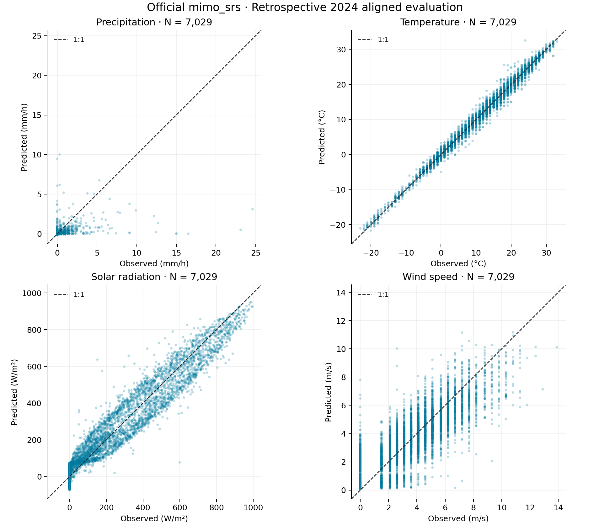
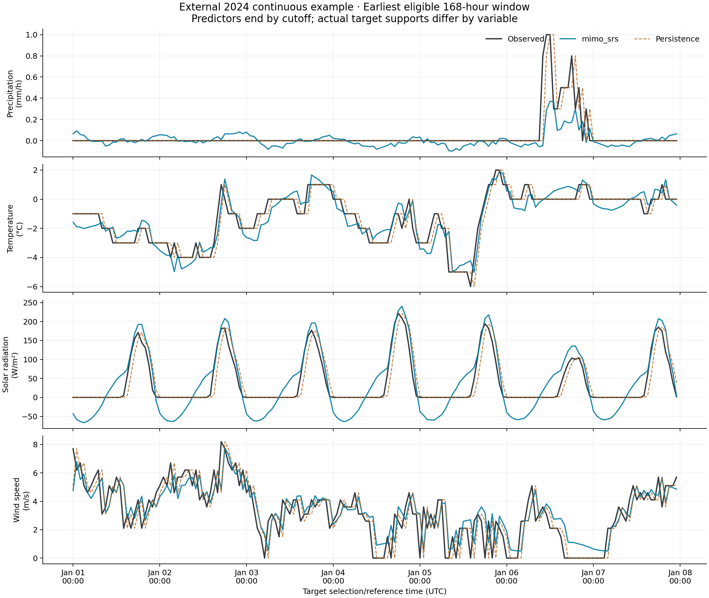
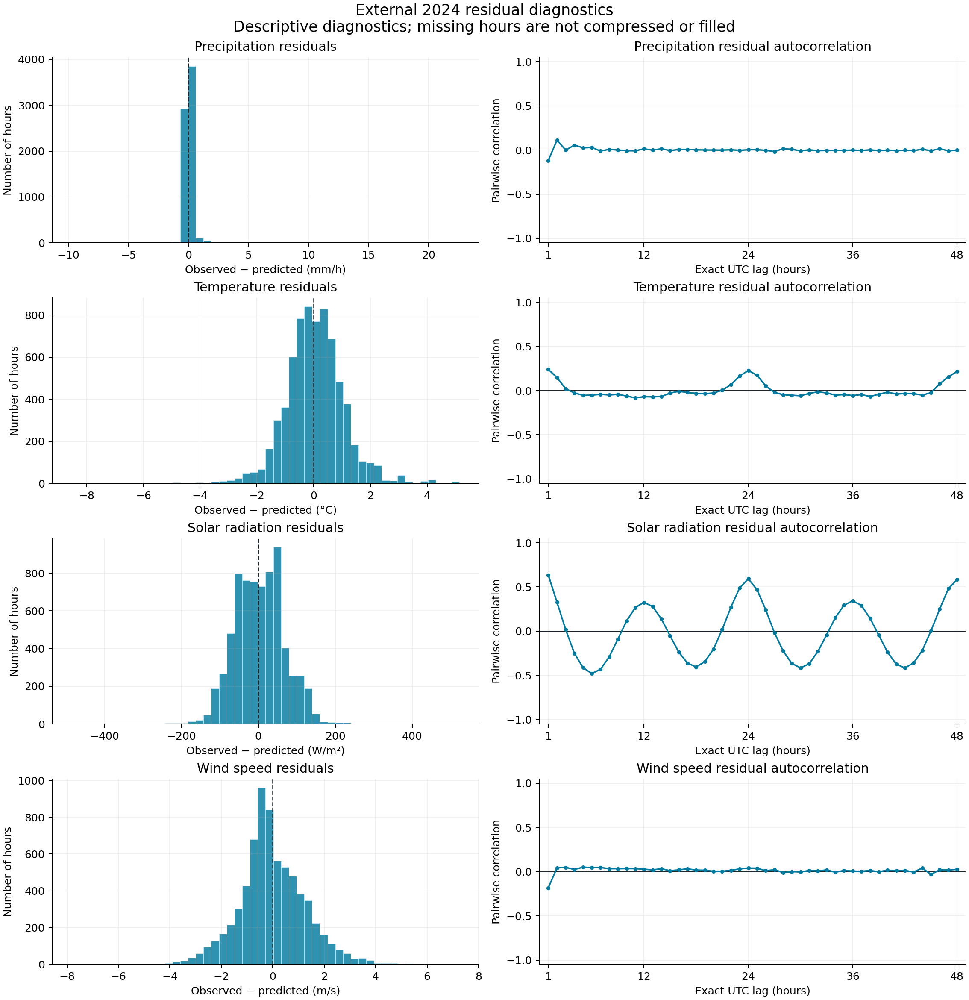

# HW C.2: Official FIT / mimo_srs conditional meteorological response

## Question and scope

How well does a first-order conditional response estimate the observations selected at the next hourly reference time, compared with persistence? This is retrospective, observation-time-aligned evaluation; it is not an exact forecast of four uniform future clock-hour quantities. This is a project-specific application of the professor's tool, not a predictor specification claimed to be instructor-approved. The statistical X/Y labels do not change weather's role as uncontrollable disturbances in A/B.

Let the prediction cutoff be `c` and the next target reference time be `t=c+1 hour`. `Y(t)` contains the four observations selected at t, with their actual supports retained. `X(c) = [P_completed_1h_at_cutoff, T_latest_at_cutoff, Rs_completed_clock_hour, W_latest_at_cutoff, sin(annual_t), cos(annual_t), sin(diurnal_t), cos(diurnal_t)]`. The completed native rainfall accumulation is **not named P(t−1)** because it does not cover the preceding clock hour. Units are mm/h, °C, W/m² and m/s. There is one fitted response surface with nine power-basis terms per output. There is no hydrologic propagation or recursive weather generation.

## Causal alignment approved for this application

The original standardized weather remains unchanged. Auditing its source intervals revealed that every otherwise eligible lagged precipitation value used a report ending 52 minutes inside its target UTC hour: 41,801 development pairs and 6,949 external pairs would violate a strict no-future-source rule. The concrete example at 2019-01-01 02:00 UTC has lag rainfall 0.04 = (8/60)×0.3 and response rainfall 0.26 = (52/60)×0.3 from the same 02:52 report. This is shared target-period source support, not just publication delay. See the [original source-time audit](../results/mimo_srs/source_time_audit/source_time_audit.json).

The user approved a separate FIT-only causal alignment from existing cached observations. The [causal data](../results/mimo_srs/causal_weather_hourly.csv) and [alignment manifest](../results/mimo_srs/causal_alignment.json) preserve each source time, support and age. At hourly UTC **selection/reference time t**, P is the latest accepted native one-hour accumulation ending within the preceding hour; its interval is not split between artificial UTC bins. T and W are the latest valid station reports at or before t, with age no greater than 60 minutes. The 60-minute freshness limit is an explicit eligibility choice; values are neither interpolated nor extrapolated. Rs is the previously standardized solar energy interpreted as covering the completed UTC interval (t−1 h,t], numerically equal to its one-hour mean flux. Each used solar value is preserved exactly; no energy is redistributed.

Thus the components have different physical supports: each native P window usually ends eight minutes before its own selection/reference time, T/W have recorded observation ages, and Rs represents the just-completed UTC hour. The evaluation estimates the next **observation-selection vector**, at a reference time one hour after the predictor cutoff. The reference-time separation does not establish a one-hour physical forecast horizon. It must not be described as four perfectly simultaneous point measurements or uniformly aligned hour averages. Station report times and rainfall accumulation ends are checked against the prediction cutoff c=t−1 h. The solar check remains conditional on the declared hour-start interval interpretation. T/W source start=end records a nominal report timestamp; the cache does not give instrument averaging-window bounds. Operational data-publication latency is unknown, particularly for retrospective NASA POWER grid estimates; this is an offline one-step evaluation, not a demonstrated real-time forecast service. The inherited POWER hour-start support assumption remains explicit and unresolved by cached interval-bound metadata. The [official hourly API description](https://power.larc.nasa.gov/docs/services/api/temporal/hourly/) identifies hourly averages; it does not replace missing bounds in the cached responses.

Missing values stay missing, trace precipitation remains a flagged quantified-zero lower bound, and negative temperatures are valid. No storms or negative predictions are removed. Exact UTC adjacency is required before row pairing. All four outputs and persistence use the same external timestamps. The [pair audit](../results/mimo_srs/hourly_pair_eligibility.csv) gives mutually exclusive primary exclusion reasons and separate variable-validity flags.

## Explicit cutoff and actual source intervals

The [alignment definition](../results/mimo_srs/alignment_definition.json) is saved before rebuilding pairs. Predictors use only records ending by **c**; observations after c may enter targets selected at **t=c+1 hour**. Native rain is not redistributed. The nominal next clock window (c,t] is retained for reference, separately from each actual target support.

In 48,952 retained pairs, the rain predictor covers **(c−68 min,c−8 min]**, with an 8-minute age. One development pair has a 9-minute age and covers **(c−69 min,c−9 min]**; its original timestamp is retained. The rain target covers **(c−8 min,c+52 min]**. Its first 8 minutes precede c. The cached native accumulations therefore cannot provide an exact total over (c,c+1 hour] without an additional redistribution assumption, which this application does not introduce. Results must not be described as an exact one-hour rainfall forecast.

Every pair and prediction CSV now includes `prediction_cutoff_utc`, `target_reference_time_utc`, nominal clock-window bounds, and actual source-specific predictor/target bounds, ages and target end offsets. Four deterministic examples are shown below; [alignment_examples.csv](../tables/mimo_srs/alignment_examples.csv) includes T/W report times and interpreted solar intervals for the same rows. T/W zero-duration entries mean report timestamps, not independently known instrument averaging windows. Solar bounds in that table are **assumed**, not observed bounds.

| example | prediction_cutoff_utc | predictor_start_utc | predictor_end_utc | predictor_age_minutes | target_start_utc | target_end_utc |
| --- | --- | --- | --- | --- | --- | --- |
| first_development | 2019-01-01 01:00:00+00:00 | 2018-12-31 23:52:00+00:00 | 2019-01-01 00:52:00+00:00 | 8 | 2019-01-01 00:52:00+00:00 | 2019-01-01 01:52:00+00:00 |
| first_2024_cutoff | 2024-01-01 00:00:00+00:00 | 2023-12-31 22:52:00+00:00 | 2023-12-31 23:52:00+00:00 | 8 | 2023-12-31 23:52:00+00:00 | 2024-01-01 00:52:00+00:00 |
| first_at_or_after_DST_transition | 2024-03-10 08:00:00+00:00 | 2024-03-10 06:52:00+00:00 | 2024-03-10 07:52:00+00:00 | 8 | 2024-03-10 07:52:00+00:00 | 2024-03-10 08:52:00+00:00 |
| first_nonmodal_rain_predictor_age | 2019-02-10 22:00:00+00:00 | 2019-02-10 20:51:00+00:00 | 2019-02-10 21:51:00+00:00 | 9 | 2019-02-10 21:52:00+00:00 | 2019-02-10 22:52:00+00:00 |

For retrospective selection, station observations are assumed usable at their reported observation/accumulation end and POWER values at the assumed hour end. No publication-delay or operational availability model is added. The original raw and standardized data remain unchanged. No exact clock-hour rainfall or fully verified solar-interval forecast is claimed.

## Calendar features and separation

Target reference timestamps are converted to `America/Chicago`. Let h be fractional local civil hour, d be local day of year and L be 365 or 366 for that local calendar year. Annual phase = `2π(d−1+h/24)/L`; diurnal phase = `2πh/24`. Leap days are included. Repeated fall-back civil hours share calendar features, and spring-forward features jump; UTC adjacency still requires exactly one elapsed hour.

Target reference years 2019–2023 form the development pool; target reference year 2024 is external. An external row may use its observed lag from late 2023; no 2024 response is supplied to fitting, scaling or the internal split. The first 2019 row has no preceding cached solar hour and remains missing. The last solar hour beginning in 2024 would end in 2025, so it is outside the 2024 target-reference-year evaluation. Each external prediction uses observed lagged inputs, never previous model predictions.

## Official implementation and numerical settings

Actual source: `/Users/zhangjiaxuan/Documents/Codex/Modeling/A/work/multivarious/multivarious/fit/mimo_srs.py`. Package version `1.2.1`, checkout revision `06d7aed5b541ec7fe26a6dc69be6aa7fb610aa02`, source SHA256 `36c56bf25006bcc0b9f3af1092c3c0eff07fce150f589341443ab5b1e8ccf38b`. The shared implementation and professor's example were read and remain unchanged.

The exact call is `mimo_srs(X_scaled, Y_scaled, max_order=1, pTrain=70, scaling=np.array([0,0]), L1_pnlty=1.0, basis_fctn='P', var_names=...)`, seed `6902026`. Power basis P gives an intercept and eight linear terms. The initial positive L1 penalty 1.0 is a single declared numerical choice, not selected using 2024 or a search. The official L1 routine adapts its penalty internally; it is not described as a certified fixed-penalty solution.

External affine scaling uses development minima/maxima: `z=(value−midpoint)/divisor`, with development range mapped to [−0.9,0.9]. Constant columns would use divisor 1. Scales are reversible and saved. All external values use the same scales without clipping. Official internal scaling is disabled. The official outlier criterion is `0.8+0.4 ln(N)`, rather than simply ±1; bounded development inputs avoid triggering removal. The function printed **41,924 supplied and 41,924 retained**. Actual matrix shapes were X `[8, 41924]` and Y `[4, 41924]`; coefficient shape `[9, 4]`. Its seeded random split used **29,346** samples for coefficient fitting and **12,578** for internal diagnostics. This is not an independent time-series holdout. The returned test arrays were checked against the exact seeded permutation.

A small real-development interface call preceded the full call; [smoke execution](../results/mimo_srs/smoke/execution.json) and [full execution](../results/mimo_srs/fit/execution.json) record actual status, arguments, shapes and hashes. Both called the official implementation. It returned finite arrays but exposes no convergence flag; no certified convergence is asserted. Built-in training/testing plots use scaled units and are retained only inside the run folders. Their internal R² is not used here because its denominator differs from the requested observed-data definition.

## Samples and external results

| period | hourly_rows | eligible_adjacent_finite_pairs | no_exact_previous_hour | missing_or_nonfinite_response | missing_or_nonfinite_lag | future_source_exclusions | eligible_aligned_pairs |
| --- | --- | --- | --- | --- | --- | --- | --- |
| development | 43824 | 41924 | 1 | 1350 | 549 | 0 | 41924 |
| external_2024 | 8784 | 7029 | 0 | 1589 | 166 | 0 | 7029 |

The exclusion columns are sequential, mutually exclusive primary reasons. Source-time checks follow finite, exact-adjacent pairing. Sample selection is unrelated to response magnitude or model errors. `eligible_aligned_pairs` counts samples passing the station report-time checks and the explicitly conditional solar interval check; it does not certify unknown instrument or upstream satellite averaging supports.

| variable | units | method | N | MAE | RMSE | mean_prediction_error | R_squared |
| --- | --- | --- | --- | --- | --- | --- | --- |
| P | mm/h | official_mimo_srs | 7029 | 0.140924 | 0.724479 | -0.0428086 | 0.127916 |
| P | mm/h | persistence | 7029 | 0.120672 | 0.887513 | 0.00423958 | -0.308747 |
| T | degC | official_mimo_srs | 7029 | 0.775372 | 1.04363 | -0.0413038 | 0.989626 |
| T | degC | persistence | 7029 | 0.841798 | 1.26494 | -0.0425381 | 0.98476 |
| Rs | W/m2 | official_mimo_srs | 7029 | 51.7917 | 64.5878 | -3.20053 | 0.937301 |
| Rs | W/m2 | persistence | 7029 | 56.21 | 85.7751 | 0.478712 | 0.889419 |
| W | m/s | official_mimo_srs | 7029 | 0.987756 | 1.30487 | 0.0246078 | 0.714916 |
| W | m/s | persistence | 7029 | 0.982288 | 1.4001 | -0.00886328 | 0.671786 |

Metrics are independently calculated in physical units. Mean prediction error is predicted minus observed; residuals in the CSV and figures are observed minus predicted. `R² = 1 − Σ(predicted−observed)² / Σ(observed−mean(observed))²`. Persistence predicts each variable's observed preceding-cutoff value. Neither missing samples nor failures are silently removed differently between methods.

All four external RMSE values are lower than persistence, but improvement is not uniform across metrics: precipitation and wind MAEs are higher. Precipitation R² is only 0.127916. Solar residuals retain substantial diurnal structure; high R² does not establish independent residuals or physical validity.

## Residual and physical limitations

| variable | units | N | negative_predictions | minimum | maximum |
| --- | --- | --- | --- | --- | --- |
| P | mm/h | 7029 | 2352 | -0.159814 | 10.0132 |
| T | degC | 7029 | 997 | -22.0213 | 32.6691 |
| Rs | W/m2 | 7029 | 1781 | -73.5199 | 949.699 |
| W | m/s | 7029 | 0 | 0.0848552 | 11.172 |

For 2,786 astronomical night target intervals, predicted Rs has mean **-9.38161 W/m²**, minimum **-73.5199**, maximum **74.3863**, and **1,079 positive predictions**. Night classification reuses the existing approximate solar-geometry helper for the completed interval; it is a diagnostic, not a constraint. Predictions remain unchanged.

Lag-one residual correlations, using exact UTC time separation:

| variable | pair_count | autocorrelation |
| --- | --- | --- |
| P | 6882 | -0.1183 |
| T | 6882 | 0.240423 |
| Rs | 6882 | 0.63514 |
| W | 6882 | -0.183027 |

These descriptive residuals are not assumed independent. Negative rainfall/radiation/wind and nonzero night radiation reveal the limitations of an unconstrained affine conditional response. Weak rainfall skill is reported without adding a hurdle model, log transform, tuning campaign or weather generator. The fit does not establish dry-hour probabilities, precipitation tails or a complete joint weather distribution. Station observations and gridded radiation have different spatial support. Source-time alignment does not establish local calibration or operational publication availability.

The retained marginal-distribution, Copula/VAR and bootstrap work is a separate component. Its parameters, results and existing failed diagnostic checks were not altered by this fit. A conditional response cannot replace marginal or distributional evaluation.

## Figures and reproducible artifacts

The example rule is: Select the earliest 168 consecutive eligible UTC hourly timestamps. Selection uses timestamp coverage only, never fit quality. The selected window is **2024-01-01T00:00:00+00:00 through 2024-01-07T23:00:00+00:00**, 168 hours. Selection never uses prediction error.







- [Evaluation table](../tables/mimo_srs/external_evaluation.csv), [coefficient table](../tables/mimo_srs/coefficients.csv), [affine scales](../tables/mimo_srs/affine_scaling.csv), [model specification](../tables/mimo_srs/model_specification.json).
- [Timestamped predictions and residuals](../results/mimo_srs/external_predictions.csv), [development rows and actual split](../results/mimo_srs/development_pairs.csv), [saved official arrays](../results/mimo_srs/fit/official_model.npz).
- [Complete execution status](../results/mimo_srs/run_status.json), [official log](../results/mimo_srs/fit/official_stdout_stderr.log), [residual ACF and pair counts](../tables/mimo_srs/residual_acf.csv).

From the project root, the command executed was:

```sh
/opt/miniconda3/bin/python3 -B -m C.run_fitting mimo
```

The existing Python 3.13 environment and existing shared multivarious checkout were used; no package installation or data download was performed. In that environment `python3 -B -m C.run_fitting mimo` is equivalent. `all` continues to run only the retained weather fitting/validation. The new command reads cached sources, creates its own aligned dataset, runs the interface check and official fit, evaluates 2024, and regenerates these figures/tables. Saved predictions are reproduced from saved coefficients, saved scaling and saved predictors; physical-unit coefficient equivalence is also checked.

Relevant retained and focused tests are run with `python3 -B -m unittest discover -s C/tests -v`; the actual latest output is in [tests.log](../results/mimo_srs/tests.log). The focused checks cover exact hourly adjacency, source-time causality, reused solar values, no 2024 development/scaling leakage, official import provenance and replay of saved predictions.

This completes the requested focused statistical fit only. Detailed original assignment/grading instructions were unavailable; no claim is made that every HW C.2 grading requirement or the entire course project is satisfied. A/B, original C weather data, the official checkout and existing weather-generator results remain unchanged. No Git commit or push was made.
