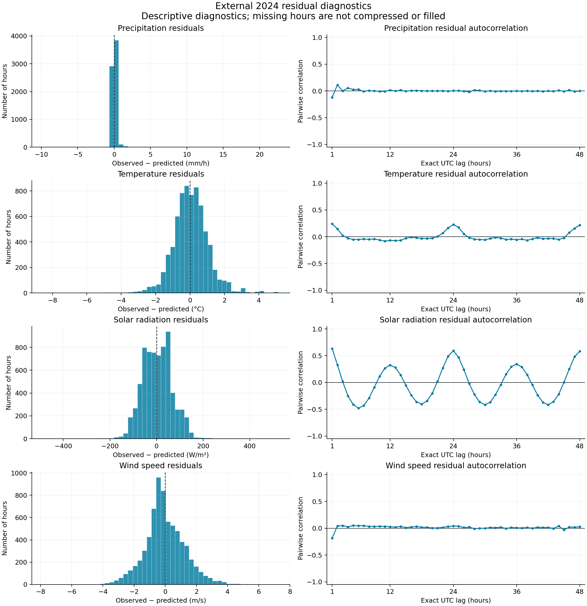

# HW C.2: Meteorological fitting for the wetland flood project

CEE690 — Systems Modeling for Climate Response

[Stage C guide and reproduction instructions](../README.md)

## A. Purpose and scope

This study applies the professor's official first-order `mimo_srs` routine to four meteorological variables and compares its fitted responses with persistence. It uses the existing original fit as the main analysis; no model was refitted for this report. The aim is to assess conditional meteorological responses, not river levels or wetland flood-reduction benefits. Weather variables are external disturbances in the physical project, not gate controls or optimization decisions.

## B. Data and time alignment

| Variable | Meaning and units | Source |
| --- | --- | --- |
| P | Precipitation, mm/h; native one-hour accumulation divided by one hour | NOAA ISD, KMKE station `72640014839` |
| T | Air temperature, °C | NOAA ISD, KMWC station `72640594869` |
| Rs | Hourly mean solar radiation, W/m² | NASA POWER `ALLSKY_SFC_SW_DWN`, 43.0547222° N, −88.0461111° E; hourly Wh/m² divided by one hour |
| W | Wind speed, m/s | NOAA ISD, KMWC station `72640594869` |

[Source and QC documentation](data_sources.md) identifies the regional observations and gridded estimates. They have different spatial support and are not four colocated measurements. The FIT dataset is separately aligned from the preserved source caches; it does not reuse future-ending precipitation redistributed into nominal lag hours.

At prediction cutoff `c`, the **eight predictors** are the latest completed native-hour P, latest valid T and W, completed-hour Rs, and annual/diurnal sine and cosine terms. Calendar features refer to the target reference time in `America/Chicago` and are known in advance. The **four outputs** are P, T, Rs and W selected at the next hourly reference, `t = c + 1 hour`. Every estimate uses observed pre-cutoff inputs, not recursively predicted weather.

The physical observation intervals differ. Rainfall input typically covers `(c−68 min,c−8 min]`, while its target covers `(c−8 min,c+52 min]`, including eight minutes before the cutoff. T/W use the latest reports at or before each reference time, no more than 60 minutes old, without future-dependent interpolation. Solar input and target are interpreted as `[c−1 h,c]` and `[c,c+1 h]`; the cached metadata does not independently confirm that interval anchor. Instrument averaging windows and publication delays are not fully known. This is **retrospective observation-time-aligned evaluation**, not a demonstrated operational or exact future-clock-hour forecast. [Saved alignment examples](../tables/mimo_srs/alignment_examples.csv) retain the actual intervals and ages.

Periods are defined by **target-reference UTC year**:

| Use | Years | Eligible paired samples |
| --- | --- | ---: |
| Development pool | 2019–2023 | 41,924 |
| Official random internal coefficient-training subset | Within 2019–2023 | 29,346 |
| Official random internal diagnostic subset | Within 2019–2023 | 12,578 |
| External evaluation | 2024 | 7,029 |

The internal split is not an independent chronological holdout. All four outputs and persistence use the same 7,029 external timestamps. Exact hourly adjacency and finite inputs/targets are required; missing rain is not zero-filled, and trace zero is a flagged quantified lower bound. Of 8,784 possible 2024 hourly rows, 1,589 are excluded for missing/nonfinite responses and 166 for missing/nonfinite lag inputs. No observations are excluded because their rainfall or error is large. [Sample counts](../tables/mimo_srs/sample_counts.csv) document eligibility.

## C. Official method and evaluation

The original implementation is multivarious **1.2.1**, revision `06d7aed5b541ec7fe26a6dc69be6aa7fb610aa02`. With seed `6902026`, the saved execution used:

```python
mimo_srs(X_scaled, Y_scaled, max_order=1, pTrain=70,
         scaling=np.array([0, 0]), L1_pnlty=1.0,
         basis_fctn='P', var_names={'X': PREDICTORS, 'Y': OUTPUTS})
```

For each output, the fitted response has an intercept and eight linear terms. Development extrema are mapped to ±0.9 using saved affine scales; official internal scaling is disabled. Scaling uses the whole development pool before its random internal split. No 2024 response informs fitting or scaling, and external values are not clipped. The routine retained all 41,924 supplied development pairs. L1=1.0 is the **initial** setting; the official algorithm adapts the penalty internally.

Persistence predicts each target using that variable's observed input available at cutoff `c`. RMSE and MAE are calculated in physical units on identical timestamps; R² uses the observed-data mean as its denominator. Residuals are **observed minus predicted**. The [model specification](../tables/mimo_srs/model_specification.json), [coefficients](../tables/mimo_srs/coefficients.csv), [scales](../tables/mimo_srs/affine_scaling.csv) and [execution provenance](../tables/mimo_srs/execution_provenance.json) identify the saved analysis.

The official function executed and returned finite arrays. However, **independent stationarity/convergence was not assessed for this original fit**, and its effective final penalty and per-output stopping histories were not recorded. Saved-prediction replay checks do not establish optimizer convergence or physical validity; later experiments' diagnostics cannot certify this model.

## D. Main results and diagnostic figures

**Table 1. Original mimo_srs versus persistence, external 2024, N=7,029 for every row and method.** Values are read from the existing [evaluation CSV](../tables/mimo_srs/external_evaluation.csv) and rounded to six decimals. Lower RMSE/MAE indicate smaller error; larger R² indicates better agreement under the stated definition.

| Variable (unit) | mimo_srs RMSE | Persistence RMSE | mimo_srs MAE | Persistence MAE | mimo_srs R² | Persistence R² |
| --- | ---: | ---: | ---: | ---: | ---: | ---: |
| P (mm/h) | 0.724479 | 0.887513 | 0.140924 | 0.120672 | 0.127916 | -0.308747 |
| T (°C) | 1.043630 | 1.264945 | 0.775372 | 0.841798 | 0.989626 | 0.984760 |
| Rs (W/m²) | 64.587830 | 85.775066 | 51.791657 | 56.209960 | 0.937301 | 0.889419 |
| W (m/s) | 1.304868 | 1.400097 | 0.987756 | 0.982288 | 0.714916 | 0.671786 |

All four RMSEs improve over persistence. Temperature and solar radiation also improve in MAE, whereas precipitation and wind MAEs worsen. Rainfall R² is only 0.127916: the overall RMSE improvement does not establish reliable storm-peak prediction.


**Figure 1. Observed versus predicted, original official fit.** All 7,029 eligible 2024 samples are shown for each output in physical units; the dashed line denotes 1:1 agreement. Temperature and radiation follow the observed range more closely than rainfall. Large rainfall values are often severely underestimated, and wind predictions remain dispersed. This figure describes predictive agreement, not numerical convergence.


**Figure 2. Continuous comparison over the earliest eligible 168-hour window, January 1 00:00–January 7 23:00, 2024 UTC.** Black denotes observations, blue `mimo_srs`, and dashed orange persistence. The window was selected by timestamp coverage, not fit quality. Time labels are target selection/reference times; physical measurement supports differ by variable. Rain peaks are damped, and negative rainfall/radiation predictions remain visible. This single week is an illustration, not the basis for the full-year metrics or extreme-event assessment.



**Figure 3. Residual distributions and temporal dependence, external 2024.** Left panels show observed-minus-predicted residuals; positive residuals indicate underestimation. Right panels show pairwise Pearson autocorrelation at exact UTC lags of 1–48 hours, using available pairs at each lag. Missing hours are not compressed or filled. Temperature and especially solar radiation retain daily structure. No confidence bands or formal residual-independence conclusion are implied.

### Interpretation and limitations

**Rainfall peaks.** At the largest observed rainfall target, June 29, 2024 at 07:00 UTC, the observation is **24.6 mm/h**, compared with **3.125237 mm/h** from the original fit and **7.6 mm/h** from persistence. This observed-maximum example is taken directly from the saved predictions, not from a new fit. It demonstrates a serious extreme-rainfall limitation despite lower aggregate RMSE.

**Residual patterns.** Solar residual autocorrelation is 0.592801 at 24 hours and 0.582640 at 48 hours; temperature retains 0.227958 at 24 hours. These [saved residual diagnostics](../tables/mimo_srs/residual_acf.csv) show remaining temporal structure and do not justify independent-error assumptions or a validated joint weather distribution.

**Nonphysical predictions.** The original fit has **2,352 negative P predictions** and **1,781 negative Rs predictions**. Wind has **zero negative predictions**; negative temperatures are physically permissible. Among 2,786 intervals classified as astronomical night by the approximate geometry diagnostic, 1,079 have positive predicted radiation. [Physical checks](../tables/mimo_srs/physical_prediction_diagnostics.csv) and [nighttime diagnostics](../tables/mimo_srs/night_radiation.csv) retain these outcomes. No values were clipped to improve the results.

**Coverage and interpretation.** Evaluation excludes unavailable hours and cannot represent unobserved storms. Native rain support, assumed solar timing, mixed station/grid locations and unknown historical publication delays limit forecast interpretation. The original model's numerical convergence remains unassessed. High temperature/radiation R² does not remove these limitations.

## E. Supplementary comparisons

Existing [rain-history](c2_rain_history_comparison.md), [squared-feature](c2_rain_square_comparison.md) and [penalty-setting](c2_rain_penalty_comparison.md) studies remain supplementary. They fit 33,412 common 2019–2022 pairs, validate on 8,078 pairs in 2023 and evaluate 6,951 pairs in 2024. Those sample and design differences prevent treating their scores as controlled comparisons with the main model. Repeated examination of 2024 makes these later trials exploratory, not fresh blind tests. Their numerical diagnostics apply only to the named variants and outputs.

[Copula/VAR and block-bootstrap methods](weather_method.md) and their [retained weather diagnostics](execution_report.md) are separate distributional work. They do not replace the official conditional-response fit or establish downstream flood probabilities. All supplementary files and results are retained; they are not part of the main comparison in Table 1.

## F. Relevance to the project and submission status

In the [wetland flood model](../../B/README.md), precipitation supplies water to the upland, dam pools, wetlands and river; temperature, solar radiation and wind determine its simplified evaporative demand and water losses. Rainfall peak underestimation therefore identifies a potentially important limitation for future flood-input applications. Its effect on river peaks, wetland storage or flood mitigation has **not been quantified by this fitting exercise**. The present unconstrained predictions are not automatically physically admissible weather inputs, and their structured residuals are not a validated stochastic forcing model. Stage C assesses meteorological fitting without changing the accepted A/B equations, gate schedules or initial conditions, and it establishes no additional wetland benefit or lack of benefit.

The requested official-method explanation, matched persistence table, three diagnostic figures and limitations are included. The **full HW C.2 rubric is unavailable**, so additional grading or formatting requirements cannot be verified; no specific unseen requirement is claimed satisfied or invented as missing. Independent original-fit convergence and operational availability remain unestablished, not implicitly passed.

This report reuses saved results only. No fitting, new forecasting algorithm, Monte Carlo ODE simulation or gate optimization was run. [Reproduction instructions](../README.md#reproduction) distinguish published artifacts from local-only caches, model arrays and predictions under `C/results/mimo_srs/`; fresh-environment reproduction has not been demonstrated. Rerunning the existing fitting command would also overwrite its generated report and is not required to read this submission.
