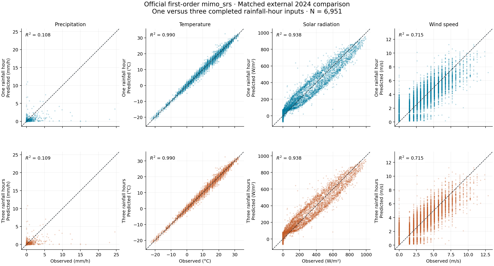
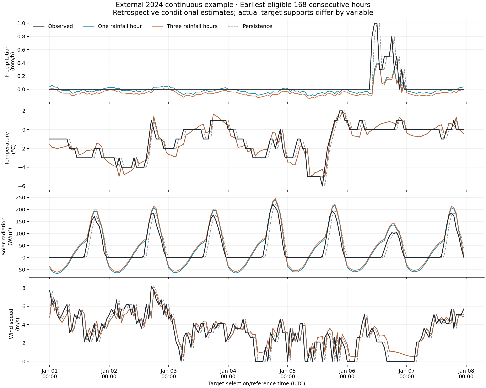
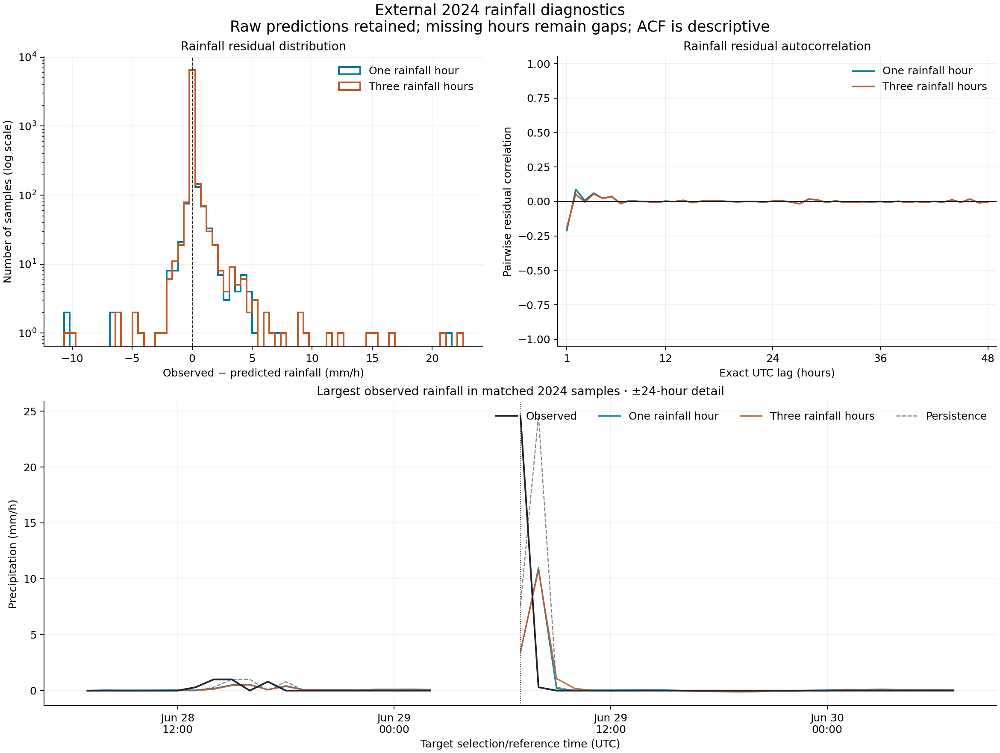

# Controlled rainfall-history comparison: official first-order FIT

## Design and chronology

The preserved historical fit used 2019-2023 development data. Its code, data, figures and results remain unchanged. Here **one_hour** means that same eight-input specification refitted on the common 2019-2022 pool; **three_hour** adds only two completed native-hour rainfall inputs. Both use the same observations, initial L1 penalty 1.0, power basis, order 1, seed 6902026, and official random 70/30 internal diagnostic split. This is a controlled predictor comparison, not a comparison against historical coefficients trained through 2023. No high-order, penalty or random-seed search was run.

The two extra inputs are selected at cutoff c-1 hour and c-2 hours. Retained actual native supports are (c-68,c-8], (c-128,c-68], (c-188,c-128] minutes. All three must be finite, each exactly 60 minutes, completed by its own selection cutoff, and touch without gaps/overlaps. No missing rain is filled. A real one-minute source gap is excluded explicitly. Shared eligibility is applied to both models and persistence; its reason is unrelated to target magnitude or error. See [pair audit](../results/mimo_rain_history/pair_eligibility.csv).

| period | hourly_rows | one_hour_eligible | common_eligible | missing_older_rain_history | invalid_native_rain_support | nonconsecutive_native_rain_intervals | invalid_target_rain_support |
| --- | --- | --- | --- | --- | --- | --- | --- |
| fit_2019_2022 | 35064 | 33784 | 33412 | 371 | 0 | 1 | 0 |
| validation_2023 | 8760 | 8140 | 8078 | 62 | 0 | 0 | 0 |
| external_2024 | 8784 | 7029 | 6951 | 78 | 0 | 0 | 0 |

2019-2022 alone supplies the fit pool and reversible affine scales. Both models retain all 33,412 supplied rows; the official seeded split uses 23,388 coefficient-training and 10,024 internal diagnostic rows. Internal random splitting is not a chronological validation. 2023 is the separate chronological validation year. Before evaluating 2024, the predeclared rainfall-RMSE rule selected **one_hour** (ties retain one_hour). This is the preferred candidate on that criterion, not a claim of general superiority. Both specifications and coefficients were frozen before evaluation; no refit using 2023 was performed. The same frozen models were evaluated on 2024 for the requested comparison. The previously inspected 2024 historical results are disclosed: this is not a newly untouched blind test.

## Results in physical units

| period | model | variable | units | N | MAE | RMSE | mean_prediction_error | R_squared |
| --- | --- | --- | --- | --- | --- | --- | --- | --- |
| validation_2023 | one_hour | P | mm/h | 8078 | 0.10952 | 0.542387 | -0.0516092 | 0.285368 |
| validation_2023 | three_hour | P | mm/h | 8078 | 0.123061 | 0.545317 | -0.088705 | 0.277625 |
| validation_2023 | persistence | P | mm/h | 8078 | 0.0916564 | 0.612392 | -0.000247586 | 0.0889899 |
| external_2024 | one_hour | P | mm/h | 6951 | 0.127153 | 0.71426 | -0.0522351 | 0.1081 |
| external_2024 | three_hour | P | mm/h | 6951 | 0.13812 | 0.713809 | -0.0891618 | 0.109225 |
| external_2024 | persistence | P | mm/h | 6951 | 0.110775 | 0.865578 | 0.000949504 | -0.309832 |

**The three-hour candidate does not demonstrate an overall improvement in this controlled case.** It loses the predeclared 2023 rainfall-RMSE comparison, so the one-hour specification remains preferred. In 2024 its RMSE decreases by only 0.0631%, while MAE increases by 8.63%. Negative rain predictions increase from 3,172 to 5,170. The small external RMSE difference is not used to reverse the frozen validation decision. Neither a statistical-significance claim nor a general conclusion that extra rainfall history can never help is made. This finding applies to these fixed first-order settings, data and years.

Full four-output metrics are in [evaluation.csv](../tables/mimo_rain_history/evaluation.csv). Error is predicted minus observed; plotted residual is observed minus predicted. No predictions are clipped, and no storms are discarded as outliers.

The heavier-rain diagnostic threshold is the 95th percentile of positive rain in the common 2019-2022 fit pool: **5.6 mm/h**. It is a descriptive sample threshold, not an engineering or meteorological warning level. It was fixed before validation/external comparisons. [Rain strata](../tables/mimo_rain_history/rain_strata.csv) distinguish quantified zero/trace lower bounds, positive rain, and values at/above that threshold; positive predictions at trace-zero targets are not proven false alarms.

Complete observed positive-rain spells require adjacent native supports and known quantified-zero/trace boundaries on both sides. This simple diagnostic definition is not a certified storm separation rule. Totals and peak timing are evaluated inside those same observed windows, without including rain from other events. Ties use the earliest peak. Incomplete boundary/gap spells are counted in [event coverage](../tables/mimo_rain_history/rain_event_coverage.csv), not silently completed; all their eligible hourly samples remain in overall metrics. Original negative predictions remain in totals.

These are within-observed-window diagnostics: they do not measure false rain outside the window or delayed predicted peaks occurring beyond it. Those hours remain in overall hourly evaluation and the displayed event detail where eligible.

| period | model | complete_events | total_MAE_mm | peak_MAE_mm_per_h | peak_time_MAE_hours |
| --- | --- | --- | --- | --- | --- |
| external_2024 | one_hour | 128 | 2.82287 | 1.55788 | 0.421875 |
| external_2024 | persistence | 128 | 1.34375 | 0.800781 | 0.414062 |
| external_2024 | three_hour | 128 | 2.89989 | 1.61095 | 0.4375 |
| validation_2023 | one_hour | 180 | 2.23795 | 1.07038 | 0.538889 |
| validation_2023 | persistence | 180 | 0.716111 | 0.38 | 0.472222 |
| validation_2023 | three_hour | 180 | 2.30206 | 1.11396 | 0.555556 |

At the largest observed rainfall sample in each comparison period:

| period | model | timestamp_utc | target_start_utc | target_end_utc | observed_mm_per_h | predicted_mm_per_h | error_mm_per_h |
| --- | --- | --- | --- | --- | --- | --- | --- |
| validation_2023 | one_hour | 2023-08-14 21:00:00+00:00 | 2023-08-14 19:52:00+00:00 | 2023-08-14 20:52:00+00:00 | 18.8 | 4.90413 | -13.8959 |
| validation_2023 | three_hour | 2023-08-14 21:00:00+00:00 | 2023-08-14 19:52:00+00:00 | 2023-08-14 20:52:00+00:00 | 18.8 | 4.81618 | -13.9838 |
| validation_2023 | persistence | 2023-08-14 21:00:00+00:00 | 2023-08-14 19:52:00+00:00 | 2023-08-14 20:52:00+00:00 | 18.8 | 10.7 | -8.1 |
| external_2024 | one_hour | 2024-06-29 07:00:00+00:00 | 2024-06-29 05:52:00+00:00 | 2024-06-29 06:52:00+00:00 | 24.6 | 3.41123 | -21.1888 |
| external_2024 | three_hour | 2024-06-29 07:00:00+00:00 | 2024-06-29 05:52:00+00:00 | 2024-06-29 06:52:00+00:00 | 24.6 | 3.47642 | -21.1236 |
| external_2024 | persistence | 2024-06-29 07:00:00+00:00 | 2024-06-29 05:52:00+00:00 | 2024-06-29 06:52:00+00:00 | 24.6 | 7.6 | -17 |

## Physical and temporal limitations

| period | model | variable | N | negative_predictions | minimum | maximum | night_positive_predictions |
| --- | --- | --- | --- | --- | --- | --- | --- |
| validation_2023 | one_hour | P | 8078 | 3960 | -0.153354 | 8.45778 | nan |
| validation_2023 | one_hour | Rs | 8078 | 2218 | -72.8274 | 936.088 | 1401 |
| validation_2023 | three_hour | P | 8078 | 6231 | -0.186345 | 8.4751 | nan |
| validation_2023 | three_hour | Rs | 8078 | 2116 | -66.8891 | 941.78 | 1487 |
| validation_2023 | persistence | P | 8078 | 0 | 0 | 18.8 | nan |
| validation_2023 | persistence | Rs | 8078 | 0 | 0 | 997.22 | 240 |
| external_2024 | one_hour | P | 6951 | 3172 | -0.154669 | 10.9728 | nan |
| external_2024 | one_hour | Rs | 6951 | 1753 | -73.8154 | 948.553 | 1068 |
| external_2024 | three_hour | P | 6951 | 5170 | -0.187885 | 10.7855 | nan |
| external_2024 | three_hour | Rs | 6951 | 1652 | -67.8207 | 954.279 | 1146 |
| external_2024 | persistence | P | 6951 | 0 | 0 | 24.6 | nan |
| external_2024 | persistence | Rs | 6951 | 0 | 0 | 995.8 | 240 |

Negative precipitation and radiation and nonzero nighttime radiation remain explicit. Negative temperatures are valid. Extra lagged rain may describe persistence but does not introduce an occurrence model, nonlinear transitions, a nonnegative response, or information about approaching storms. Small changes in aggregate metrics do not establish reliable extreme-rain prediction or flood probabilities.

This remains retrospective observation-time-aligned evaluation. The rain target spans c-8 to c+52 minutes rather than the exact future clock hour. Solar support remains conditional on the existing hour-start interpretation; T/W averaging-window bounds and operational publication latency are unknown. Observed histories are supplied anew at every evaluation time, not recursively simulated. Station and grid quantities retain different spatial supports. A/B, original weather data, weather-model results and the historical FIT are untouched.

## Figures and reproduction







The week is selected using timestamp coverage only. The largest-rain detail is selected by observed rainfall, not fit quality, and is explicitly an extreme-case diagnostic. Plot rules and timestamps are in [figure metadata](../results/mimo_rain_history/figures.json).

```sh
cd /Users/zhangjiaxuan/Documents/Codex/Modeling
/opt/miniconda3/bin/python3 -B -m C.run_fitting mimo-history
```

The command reads the existing FIT-only aligned cache, calls the unchanged official implementation at revision `06d7aed5b541ec7fe26a6dc69be6aa7fb610aa02`, evaluates validation first, saves the decision, then evaluates 2024. The official function returned finite arrays and exposes no convergence flag; certified convergence is not claimed. Saved coefficients and scales reproduce the saved predictions. [Study plan](../results/mimo_rain_history/study_plan.json), [frozen decision](../results/mimo_rain_history/frozen_validation_decision.json), [execution status](../results/mimo_rain_history/run_status.json), and [preservation check](../results/mimo_rain_history/preservation_check.json) provide provenance. No data were downloaded and no Git commit/push was made.
