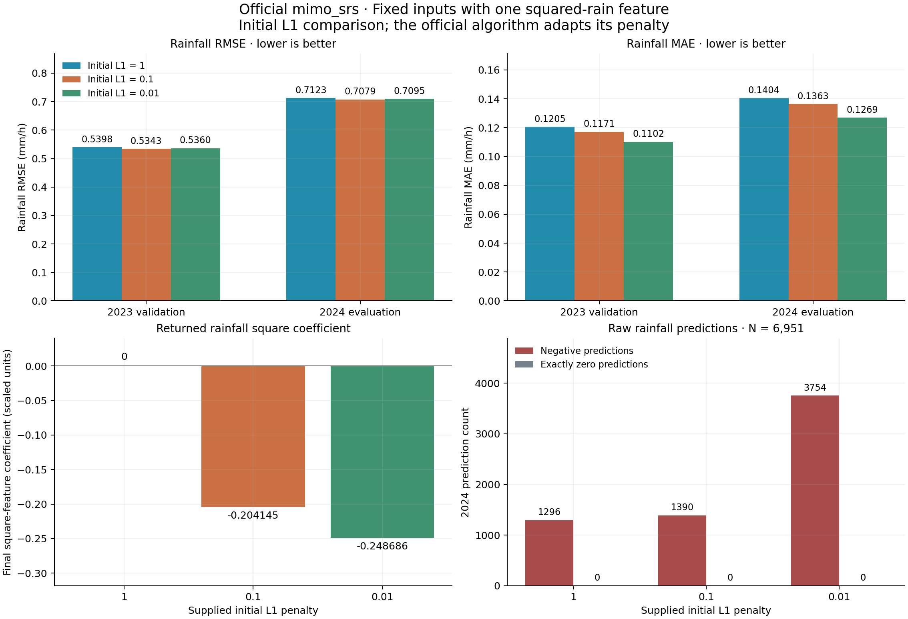
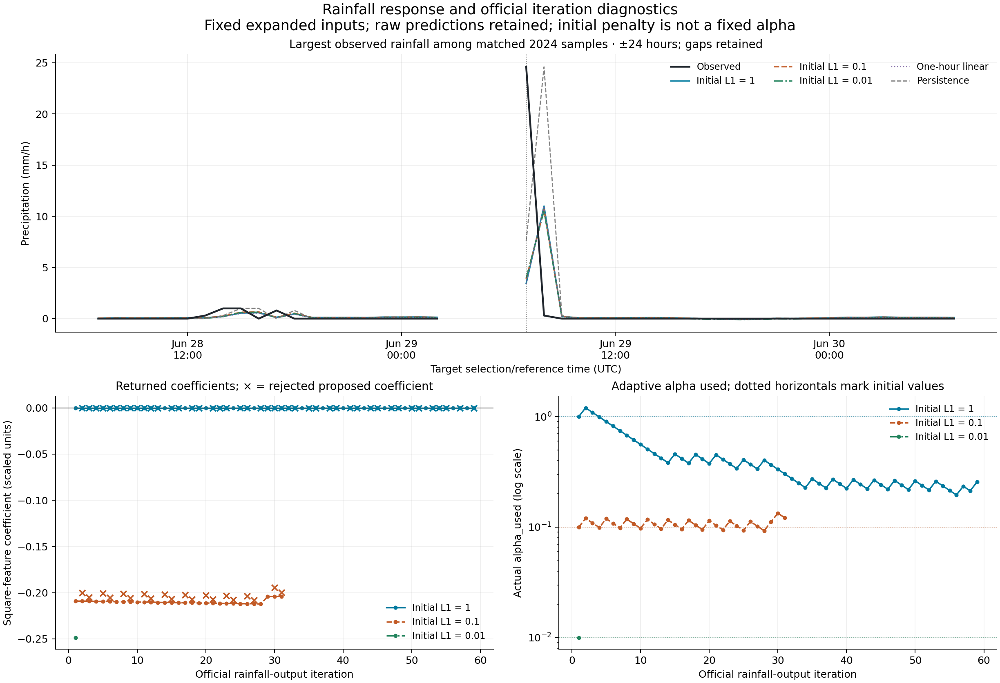

# Initial L1 penalty sensitivity in the official rainfall fit

## Outcome

Reducing the initial penalty from **1.0 to 0.1** retained the squared-rain term and produced a **small predictive improvement over the previous squared-feature trial**. The rainfall coefficients at 0.1 pass the explicit stationarity diagnostic described below. This is the provisional rainfall-only choice among the three initial penalties, selected using 2023 before inspecting the new 2024 predictions.

This is not an overall solution to rainfall prediction. Compared with the original one-hour linear comparator, the 0.1 case improves 2024 RMSE by **0.895%** but worsens MAE by **7.166%**. Major observed rainfall is still severely underestimated. The temperature coefficients in the same four-output fit fail the stationarity diagnostic, so this result is not a numerical endorsement of the entire weather model.

## Controlled experiment and preservation

Only the **initial positive `L1_pnlty`** changes: 1.0, 0.1 and 0.01. The nine inputs remain the original eight predictors plus `P_completed_1h_squared`, obtained by squaring the physical completed native-hour rainfall before affine scaling. The professor's `mimo_srs` remains first order in these expanded inputs: `max_order=1`, `basis_fctn='P'`, `pTrain=70`, `scaling=[0,0]`, random seed 6902026. No other basis terms or models were added.

Exactly the existing saved cohorts and scaling are reused:

| Role | Years | Eligible rows |
|---|---|---:|
| Fit pool | 2019–2022 | 33,412 |
| Coefficient-training subset of fit pool | 2019–2022 | 23,388 |
| Internal diagnostic subset of fit pool | 2019–2022 | 10,024 |
| Chronological validation | 2023 | 8,078 |
| External evaluation | 2024 | 6,951 |

The 1.0 case was replayed only to obtain the missing iteration diagnostics. Its six model arrays and all saved comparison predictions match the original squared-feature trial **exactly**. The original one-hour model and persistence predictions were also replayed exactly. The two lower-penalty cases are new fits. All supplied samples were retained by the official routine, and each fit uses identical training membership. There is no refit with 2023, clipping, observation filling, or exclusion based on error or rainfall magnitude.

The existing raw observations, standardized data, original FIT, history comparison, squared-feature trial, weather-model results, and A/B files remain unchanged. The before/after SHA256 check covers **832 existing files**, including the official solver. Code, plots, tables and results for this study are stored separately in Stage C. No Git commit or push was made.

## What caused the original zero?

The captured official initialization has a scaled rainfall-square coefficient of **−0.25308056**. With initial penalty 1.0, the first accepted update makes the split-variable difference, and hence the coefficient, **exactly zero before the explicit `1e-6` cleanup**. It remains zero in the returned fit. Thus this particular zero was reached by the official update; it was not solely an output-formatting or tiny-coefficient rounding artifact.

At initial 0.1, the first accepted coefficient is −0.209138 and the returned coefficient is **−0.204145**. At initial 0.01, the returned coefficient is **−0.248686**. Both preserve a negative quadratic term. A negative term represents concavity conditional on the other predictors; it is not a general mechanism for amplifying rain peaks.

The official algorithm adjusts the penalty internally: accepted steps multiply it by 1.2 and rejected steps divide it by 1.1. The printed `alpha` in the legacy text log is the supplied initial value, not the final adaptive penalty. Every trial's actually used penalty, acceptance decision, pre-cleanup coefficient and returned coefficient are now captured in [solver iterations](../tables/mimo_rain_penalty/solver_iterations.csv). Capture reads Python execution frames without changing the official code, variables or returned arrays.

## Numerical diagnostics and selection

For the documented scaled objective `||Bc-y||^2 + alpha*sum(abs(c))`, including the penalized intercept, the diagnostic computes `g = 2 B.T (Bc-y)`. A nonzero coefficient requires `g_j + alpha*sign(c_j) = 0`; a zero coefficient requires `abs(g_j) <= alpha`. The reported residual is the largest violation over coefficients. The predeclared numerical threshold is **1e-6 in scaled summed-loss gradient units**, evaluated at the **last accepted step's alpha**. This is a diagnostic added by the study, not an official convergence flag or a statement that the last accepted step solved a fixed-alpha problem by construction.

| Initial penalty | Returned rain-square coefficient, scaled | Last accepted-step alpha | Proposed next alpha at return | Iterations / accepted | Maximum stationarity residual | Rainfall diagnostic |
|---:|---:|---:|---:|---:|---:|---|
| 1.0 | 0 | 0.213134 | 0.232509 | 59 / 15 | 0.703393 | Fail |
| 0.1 | −0.204145 | 0.111364 | 0.110443 | 31 / 11 | 1.02e-8 | Pass |
| 0.01 | −0.248686 | 0.010000 | 0.012000 | 1 / 1 | 82.985844 | Fail |

All three rainfall calls stopped at the official **update-size and split-variable feasibility condition**. They did not stop because a full stationarity check passed. In particular, the 0.01 fit stops after one update while its stationarity residual remains large. Lower initial penalty therefore does not guarantee a better numerical solution.

For the other outputs, 1.0 passes this diagnostic only for wind; 0.1 passes for solar and wind but fails for temperature; 0.01 passes for solar and wind but fails for temperature. See the [complete solver diagnostics](../tables/mimo_rain_penalty/solver_diagnostics.csv). No stationarity failure is hidden or repaired by substituting a different regression algorithm.

The declared choice is the lowest 2023 rainfall RMSE among cases passing the rainfall diagnostic; ties retain the larger initial penalty. **0.1 is both the only passing rainfall case and the lowest-RMSE case in 2023.** All coefficients and the decision were saved before the new 2024 evaluation. The years have already been inspected in previous exploratory work, so this is not a new untouched blind test. No automatic replacement of the existing models was made.

`L1_pnlty=0` was not run. In this checked-out official revision, that public-interface branch calls `lstsq(B, Zy)` with shapes `(23388, 10)` and `(4, 23388)`, without the required output transpose. The separate per-output OLS diagnostic in the log does not establish that the zero-penalty branch is usable. The official source was not patched.

## Actual rainfall results

All MAE and RMSE values below are in mm/h and use the identical eligible samples. The one-hour comparator is the previously saved controlled 2019–2022 fit, not the historical 2019–2023 fit.

| Model | 2023 RMSE | 2023 MAE | 2024 RMSE | 2024 MAE |
|---|---:|---:|---:|---:|
| One-hour linear comparator | 0.542387 | 0.109520 | 0.714260 | 0.127153 |
| Squared feature, initial L1=1.0 | 0.539811 | 0.120499 | 0.712254 | 0.140433 |
| Squared feature, initial L1=0.1 | **0.534257** | 0.117094 | **0.707866** | 0.136265 |
| Squared feature, initial L1=0.01; numerical caveat | 0.535954 | 0.110200 | 0.709509 | 0.126946 |
| Persistence | 0.612392 | 0.091656 | 0.865578 | 0.110775 |

Against initial 1.0, initial 0.1 lowers rainfall RMSE by **1.029% in 2023** and **0.616% in 2024**; MAE falls **2.826%** and **2.967%** respectively. The smaller error is real for these fixed samples, but these descriptive differences have no statistical significance claim.

Important 2024 tradeoffs remain:

- Negative rainfall predictions increase from **1,296 to 1,390** between initial 1.0 and 0.1. No values were clipped to zero. The one-hour comparator has 3,172 negative predictions.
- Among 6,530 zero/trace-lower-bound targets, positive predictions decrease from 5,242 to 5,148, but remain common. These are descriptive signs, not a newly calibrated rain/no-rain classifier.
- On 421 positive-rain targets, RMSE decreases from 2.779772 to 2.750815 mm/h. On the 21 targets above the unchanged training-derived 5.6 mm/h threshold, RMSE decreases from 10.923561 to 10.795519 mm/h; strong-rain underestimation remains substantial. Persistence has lower RMSE in this small strong-rain subset (10.034844 mm/h).
- The largest observed target is **24.6 mm/h** at reference time 2024-06-29 07:00 UTC, with actual accumulation interval **05:52–06:52 UTC**. Prediction rises from **3.446410 to 3.886739 mm/h**, still far below the observation. Persistence predicts 7.6 mm/h at that target.
- The four-output 0.1 case improves temperature RMSE over initial 1.0 (1.088759 to 1.042363 degC), but its temperature stationarity check fails. Solar RMSE changes from 64.508878 to 64.503916 W/m2, and wind RMSE slightly worsens from 1.303638 to 1.304074 m/s. The study does not claim uniform improvement.

The new squared coefficient is active at 0.1, but all original coefficients were also refitted. The predictive difference cannot be attributed exclusively to the squared term while holding the remaining coefficients fixed.

## Figures, files and reproduction



The first figure compares chronological-validation and external errors, the actual squared-rain coefficients, and unmodified negative/zero prediction counts. The initial penalty is a configuration value, not the final adaptive alpha.



The second figure uses the same ±24-hour window around the largest observed 2024 target for every model, retaining missing hours as gaps. The lower panels show returned coefficients and penalties actually used during the official iterations. A decreasing coefficient update does not itself certify stationarity.

Run from the project root using the existing tested environment:

```sh
cd /Users/zhangjiaxuan/Documents/Codex/Modeling
/opt/miniconda3/bin/python3 -B -m C.mimo_penalty
```

This command requires the existing saved cohorts and reference artifacts; it downloads no data. The run uses official multivarious **1.2.1**, revision `06d7aed5b541ec7fe26a6dc69be6aa7fb610aa02`, with exact source fingerprints checked against the prior run. A fresh installation was not attempted. The source-time limitations remain unchanged: the native rain predictor generally spans cutoff−68 to cutoff−8 minutes and its target cutoff−8 to cutoff+52; this is retrospective observation-time-aligned evaluation, not an exact next-clock-hour or operational forecast. Solar support retains the documented hour-start assumption; instrument and publication-delay timing remain unverified.

- Code: [`mimo_penalty.py`](../mimo_penalty.py), [`mimo_penalty_figures.py`](../mimo_penalty_figures.py).
- [All validation and external metrics](../tables/mimo_rain_penalty/evaluation.csv), [coefficients](../tables/mimo_rain_penalty/coefficients.csv), [rain strata](../tables/mimo_rain_penalty/rain_strata.csv), [physical diagnostics](../tables/mimo_rain_penalty/physical_diagnostics.csv).
- [Frozen validation decision](../results/mimo_rain_penalty/frozen_validation_decision.json), [run status](../results/mimo_rain_penalty/run_status.json), [preservation check](../results/mimo_rain_penalty/preservation_check.json).
- Raw official logs, model arrays, scales and captured per-output histories: `results/mimo_rain_penalty/l1_1/`, `l1_0p1/`, `l1_0p01/`.

Verification: **45 existing and focused Stage C tests passed**, including analytic stationarity checks and validation-only selection. The execution additionally checks exact old-model replay, identical cohorts, saved-prediction replay and preservation of the existing project files. Both new figures were visually inspected.
