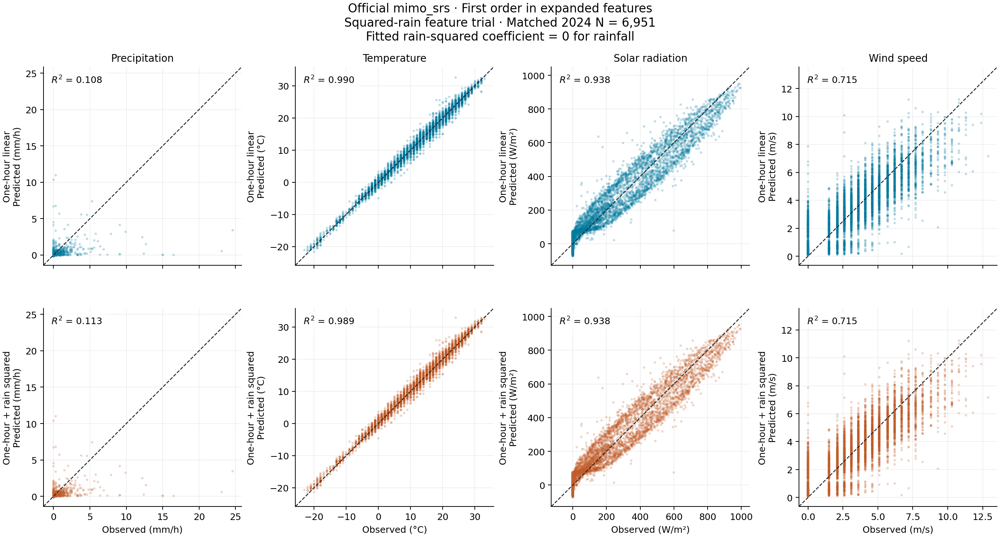
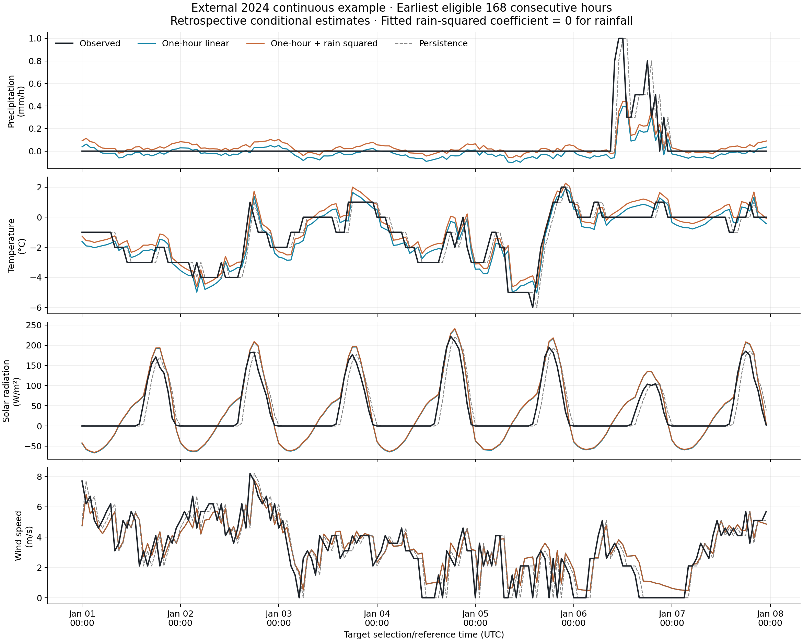
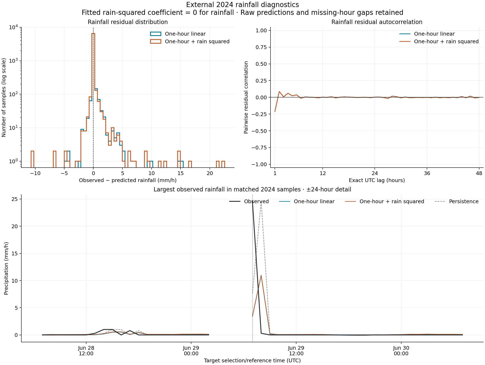

# Restricted quadratic rainfall response: one added squared-rain input

## Controlled change

This exploratory case adds **only `P_completed_1h_squared = P_completed_1h_at_cutoff ** 2`** to the original eight predictors. Squaring is applied to the physical completed native-hour rain predictor before reversible training-only affine scaling. No target value enters the feature. No older rainfall lags or interaction terms are fitted. The official call remains `mimo_srs(..., max_order=1, pTrain=70, scaling=[0,0], L1_pnlty=1.0, basis_fctn='P')`, seed 6902026. The candidate family is affine in the nine expanded inputs and **permits a restricted quadratic response in original rainfall**. There are ten candidate basis terms per output; the coefficient finding below distinguishes the permitted family from the fitted functions.

**Key finding:** The added squared-rain coefficient is **exactly zero for all four outputs**. The official fit did not retain this feature. Consequently the actual fitted responses remain affine in the original eight inputs; changes in scores come from refitted intercepts and other original coefficients, not active quadratic rainfall curvature.

| output | coefficient_scaled | coefficient_physical | coefficient_units |
| --- | --- | --- | --- |
| P | 0 | 0 | mm/h per ((mm/h)^2) |
| T | 0 | 0 | degC per ((mm/h)^2) |
| Rs | 0 | 0 | W/m2 per ((mm/h)^2) |
| W | 0 | 0 | m/s per ((mm/h)^2) |

The original one-hour comparator is reused exactly from the previous controlled fit (2019-2022), including its coefficients and scales; its predictions are replayed and checked against the saved results. The older historical 2019-2023 fit and three-hour trial remain unchanged. The new response has four outputs P, T, Rs and W, with only the one added input differing. No observation, raw file, A/B model or official package is modified.

## Same data, chronology and numerical settings

Exactly the saved common cohorts are used: **33,412** rows in the 2019-2022 fit pool, **8,078** validation rows in 2023 and **6,951** external rows in 2024. The inherited common mask is kept for a controlled comparison even though this candidate does not use the two older rain lags. There is no new exclusion by magnitude, error or feature value. Training scales come only from 2019-2022. The official internal diagnostic split has **23,388** coefficient-training and **10,024** internal diagnostic rows, identical to the comparator; it is not the chronological validation.

The squared term's source interval is the same as its original rain predictor, usually (c-68,c-8] minutes relative to cutoff c. Squaring does not shift time or add future information. The rain target remains (c-8,c+52] rather than the exact next clock hour. Solar intervals retain the documented hour-start assumption; station averaging windows and operational publication latency are not verified. This is retrospective observation-time-aligned evaluation, not an operational or recursive forecast.

The fit uses the unchanged official checkout revision `06d7aed5b541ec7fe26a6dc69be6aa7fb610aa02` (source SHA256 `36c56bf25006bcc0b9f3af1092c3c0eff07fce150f589341443ab5b1e8ccf38b`). Supplied and retained counts are both **33,412**. On the actual coefficient-training subset, the expanded basis has 10 terms, rank 10, and condition number 226.314. The full two-degree expansion of all calendar predictors is deliberately not used because sin-squared plus cos-squared creates redundant terms. The official function returned finite arrays but exposes no convergence flag; certified convergence is not claimed.

## Validation decision and actual results

Before predicting 2024, the previously declared primary criterion selected **rain_square**: lower 2023 rainfall RMSE, with ties retaining the simpler one-hour comparator. All coefficients and scales were then frozen. No refit with 2023 or tuning using 2024 was performed. Preference under that one criterion is not proof of overall or extreme-rain improvement; the secondary diagnostics below remain part of the interpretation. Both 2023 and 2024 have already been inspected in earlier exploratory work, so this is not a new untouched blind test.

| period | model | variable | units | N | MAE | RMSE | mean_prediction_error | R_squared |
| --- | --- | --- | --- | --- | --- | --- | --- | --- |
| validation_2023 | one_hour | P | mm/h | 8078 | 0.10952 | 0.542387 | -0.0516092 | 0.285368 |
| validation_2023 | rain_square | P | mm/h | 8078 | 0.120499 | 0.539811 | -0.00900468 | 0.292138 |
| validation_2023 | persistence | P | mm/h | 8078 | 0.0916564 | 0.612392 | -0.000247586 | 0.0889899 |
| external_2024 | one_hour | P | mm/h | 6951 | 0.127153 | 0.71426 | -0.0522351 | 0.1081 |
| external_2024 | rain_square | P | mm/h | 6951 | 0.140433 | 0.712254 | -0.0103674 | 0.113101 |
| external_2024 | persistence | P | mm/h | 6951 | 0.110775 | 0.865578 | 0.000949504 | -0.309832 |

Changes are squared-rain candidate minus one-hour comparator; a negative percentage means lower error:

| period | RMSE_change_percent | MAE_change_percent | mean_error_change_mm_per_h |
| --- | --- | --- | --- |
| validation_2023 | -0.474801 | 10.024 | 0.0426046 |
| external_2024 | -0.28078 | 10.4437 | 0.0418677 |

The result is a tradeoff, not a demonstrated overall improvement: external rainfall RMSE decreases by 0.281%, but MAE increases by 10.44%. Mean prediction error moves from -0.0522351 to -0.0103674 mm/h, and negative rain predictions fall from 3,172 to 1,296. Positive predictions on quantified-zero/trace observations increase, as the strata table shows; fewer negative values do not prove correct rain occurrence. Temperature performance worsens, while the maximum rain remains severely underestimated. Selection on the prespecified rainfall-RMSE criterion is preserved, but the case is not promoted as a generally improved weather model or proof that the quadratic hypothesis works. No significance claim is made.

Mean error is predicted minus observed; plotted residual is observed minus predicted. The [full evaluation](../tables/mimo_rain_square/evaluation.csv) includes all four outputs and persistence on identical rows. Raw negative predictions and out-of-training-range values are not clipped. The [rain strata](../tables/mimo_rain_square/rain_strata.csv) show quantified-zero/trace, positive-rain and heavier-rain performance. The heavier-rain diagnostic threshold remains **5.6 mm/h**, the previous 95th percentile of positive rain in the common fit pool; it is not a hazard threshold.

At the largest observed sample in each comparison year:

| period | model | timestamp_utc | target_start_utc | target_end_utc | observed_mm_per_h | predicted_mm_per_h | error_mm_per_h |
| --- | --- | --- | --- | --- | --- | --- | --- |
| validation_2023 | one_hour | 2023-08-14 21:00:00+00:00 | 2023-08-14 19:52:00+00:00 | 2023-08-14 20:52:00+00:00 | 18.8 | 4.90413 | -13.8959 |
| validation_2023 | rain_square | 2023-08-14 21:00:00+00:00 | 2023-08-14 19:52:00+00:00 | 2023-08-14 20:52:00+00:00 | 18.8 | 4.94872 | -13.8513 |
| validation_2023 | persistence | 2023-08-14 21:00:00+00:00 | 2023-08-14 19:52:00+00:00 | 2023-08-14 20:52:00+00:00 | 18.8 | 10.7 | -8.1 |
| external_2024 | one_hour | 2024-06-29 07:00:00+00:00 | 2024-06-29 05:52:00+00:00 | 2024-06-29 06:52:00+00:00 | 24.6 | 3.41123 | -21.1888 |
| external_2024 | rain_square | 2024-06-29 07:00:00+00:00 | 2024-06-29 05:52:00+00:00 | 2024-06-29 06:52:00+00:00 | 24.6 | 3.44641 | -21.1536 |
| external_2024 | persistence | 2024-06-29 07:00:00+00:00 | 2024-06-29 05:52:00+00:00 | 2024-06-29 06:52:00+00:00 | 24.6 | 7.6 | -17 |

## Physical diagnostics and event limitations

| period | model | variable | N | negative_predictions | minimum | maximum | night_positive_predictions |
| --- | --- | --- | --- | --- | --- | --- | --- |
| validation_2023 | one_hour | P | 8078 | 3960 | -0.153354 | 8.45778 | nan |
| validation_2023 | one_hour | Rs | 8078 | 2218 | -72.8274 | 936.088 | 1401 |
| validation_2023 | rain_square | P | 8078 | 1586 | -0.129034 | 8.4955 | nan |
| validation_2023 | rain_square | Rs | 8078 | 2207 | -73.748 | 937.48 | 1412 |
| validation_2023 | persistence | P | 8078 | 0 | 0 | 18.8 | nan |
| validation_2023 | persistence | Rs | 8078 | 0 | 0 | 997.22 | 240 |
| external_2024 | one_hour | P | 6951 | 3172 | -0.154669 | 10.9728 | nan |
| external_2024 | one_hour | Rs | 6951 | 1753 | -73.8154 | 948.553 | 1068 |
| external_2024 | rain_square | P | 6951 | 1296 | -0.115556 | 11.0015 | nan |
| external_2024 | rain_square | Rs | 6951 | 1735 | -72.4427 | 950.027 | 1084 |
| external_2024 | persistence | P | 6951 | 0 | 0 | 24.6 | nan |
| external_2024 | persistence | Rs | 6951 | 0 | 0 | 995.8 | 240 |

Negative temperatures are valid and are not treated as physical violations. Rainfall and radiation negatives remain explicit. The squared feature is zero when the preceding rain is zero, so it supplies no new information on rain onset. It neither enforces nonnegative precipitation nor provides approaching-storm observations.

| period | model | complete_events | total_MAE_mm | peak_MAE_mm_per_h | within_window_peak_time_MAE_hours |
| --- | --- | --- | --- | --- | --- |
| external_2024 | one_hour | 128 | 2.82287 | 1.55788 | 0.421875 |
| external_2024 | persistence | 128 | 1.34375 | 0.800781 | 0.414062 |
| external_2024 | rain_square | 128 | 2.69944 | 1.51323 | 0.421875 |
| validation_2023 | one_hour | 180 | 2.23795 | 1.07038 | 0.538889 |
| validation_2023 | persistence | 180 | 0.716111 | 0.38 | 0.472222 |
| validation_2023 | rain_square | 180 | 2.11959 | 1.02494 | 0.538889 |

Event diagnostics reuse the unchanged definition: complete consecutive positive native-rain intervals bounded by quantified-zero/trace observations. They measure totals and peak timing **inside the observed wet window**; false rain outside it and delayed predicted peaks beyond it are not captured by event metrics, although their eligible hours remain in overall evaluation. Incomplete boundary/gap windows are counted separately. These are simple wet-spell diagnostics, not certified storm separation or extreme-risk estimates.

## Figures and reproducibility







The week is the earliest complete 168-hour common 2024 interval, chosen without prediction errors. The maximum-rain view is deliberately selected by observed rainfall, not favorable fit. Missing hours remain gaps.

```sh
cd /Users/zhangjiaxuan/Documents/Codex/Modeling
/opt/miniconda3/bin/python3 -B -m C.run_fitting mimo-square
```

The existing saved comparison cohorts and one-hour model are required; no download is attempted. [Study plan](../results/mimo_rain_square/study_plan.json), [frozen validation decision](../results/mimo_rain_square/frozen_validation_decision.json), [execution status](../results/mimo_rain_square/run_status.json), [coefficients](../tables/mimo_rain_square/coefficients.csv), and [preservation check](../results/mimo_rain_square/preservation_check.json) record reproducible provenance. No commit or push is performed.
