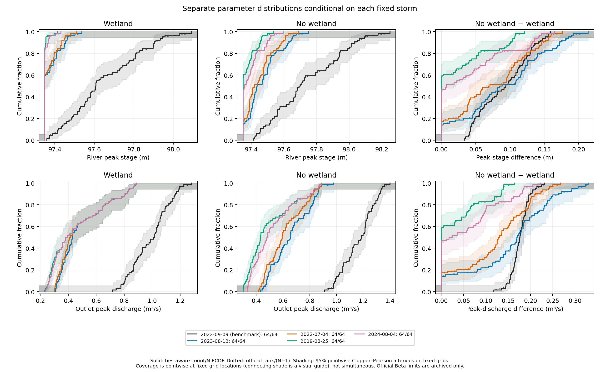

# Stage D — uncertainty propagation and historical-storm robustness

[Project overview](../README.md)

**Status:** the analyses below are completed. The final HW D.2 submission report has not been written. These are conditional experiments for a hypothetical installation, not calibrated flood probabilities or local engineering certification.

The eight-state wetland and six-state no-wetland models use matched inputs and the accepted Stage D feedback policy. Original A/B/C equations and results remain preserved.

| Analysis | Completed scope | Entry point |
|---|---|---|
| Physical parameter uncertainty | 27 deterministic sensitivity cases and 64 paired exploratory Monte Carlo samples under the September 2022 reference storm | [Methods, results and reproduction](d2_analysis/parameter_uncertainty/README.md) |
| Historical-storm robustness | Five distinct 144-hour windows, reusing the same 64 parameter vectors; 320 retained paired outcomes, including the benchmark once | [Technical findings](d2_analysis/historical_storm_robustness/FINDINGS.md) |
| Earlier weather pilot and response metrics | Original nonfreezing weather scenarios, initial-peak diagnostics and numerical refinement | [D.2 validation](d2_analysis/README.md) |
| Feedback controller | Accepted level-based policy, actuator limits, hydraulic/safety checks and paired pilot | [Policy and validation](feedback_control/README.md) |
| Hydraulic development history | Original G5 diagnosis, energy/geometry audit, and separate Stage D hydraulic candidate | [G5](g5_diagnostics/README.md), [feasibility](low_head_feasibility/README.md), [hydraulic variant](gate_hydraulics_revision/README.md) |

Historical-event peak reductions are nonnegative in the tested draws, but their magnitudes vary and some full-window differences are zero because both peaks occur at the initial condition. Duration and cumulative outlet-volume contrasts can have the opposite sign. All initial peaks and outcome categories remain in the published tables. The exploratory parameter law and selected windows do not establish weather occurrence probabilities.

The [event-selection and source audit](d2_analysis/historical_storm_robustness/event_selection.md), [parameter mapping](d2_analysis/parameter_uncertainty/parameter_mapping.md), [uncertainty assumptions](d2_analysis/parameter_uncertainty/uncertainty_basis.md), and [figure captions](d2_analysis/historical_storm_robustness/figure_captions.md) describe applicability and limitations.

The repository includes scripts, frozen plans, per-run JSON diagnostics, numerical summaries, tables, figures, selected trajectory fixtures and a small frozen-input bundle. Dense trajectory ensembles and controller time histories remain local. See the [publication and reproduction guide](reproducibility_inputs/README.md) before running commands on another workstation; it distinguishes saved-results analysis from full simulation and full-data audits.
