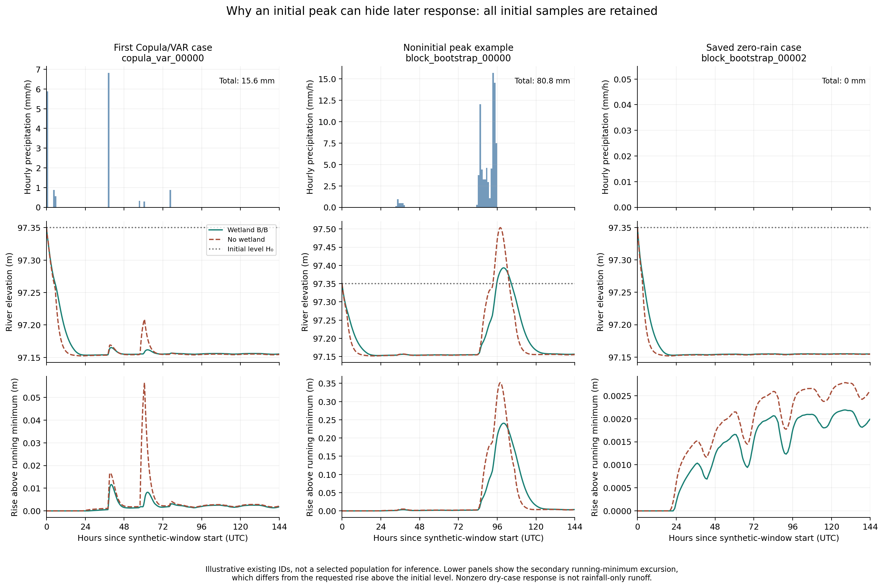
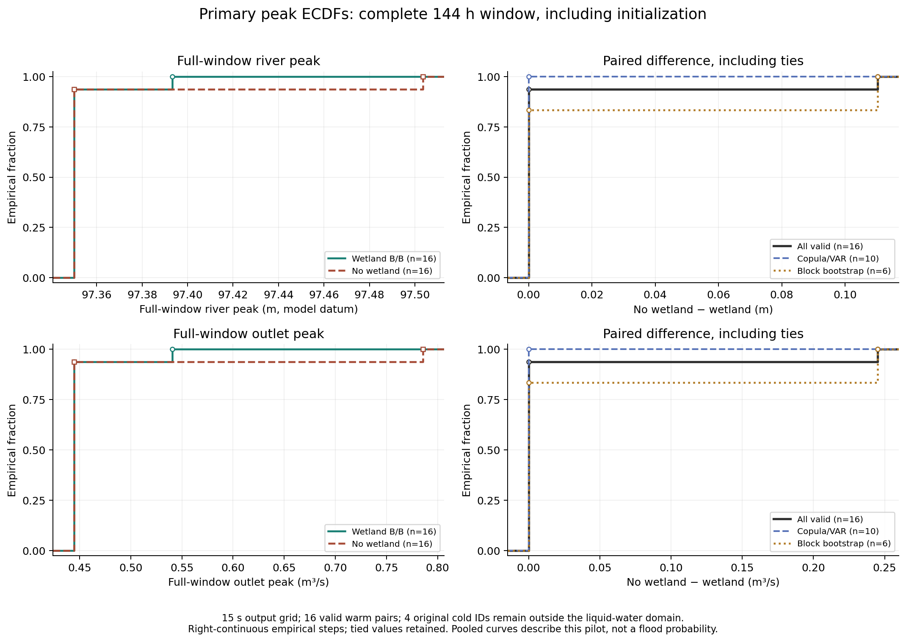
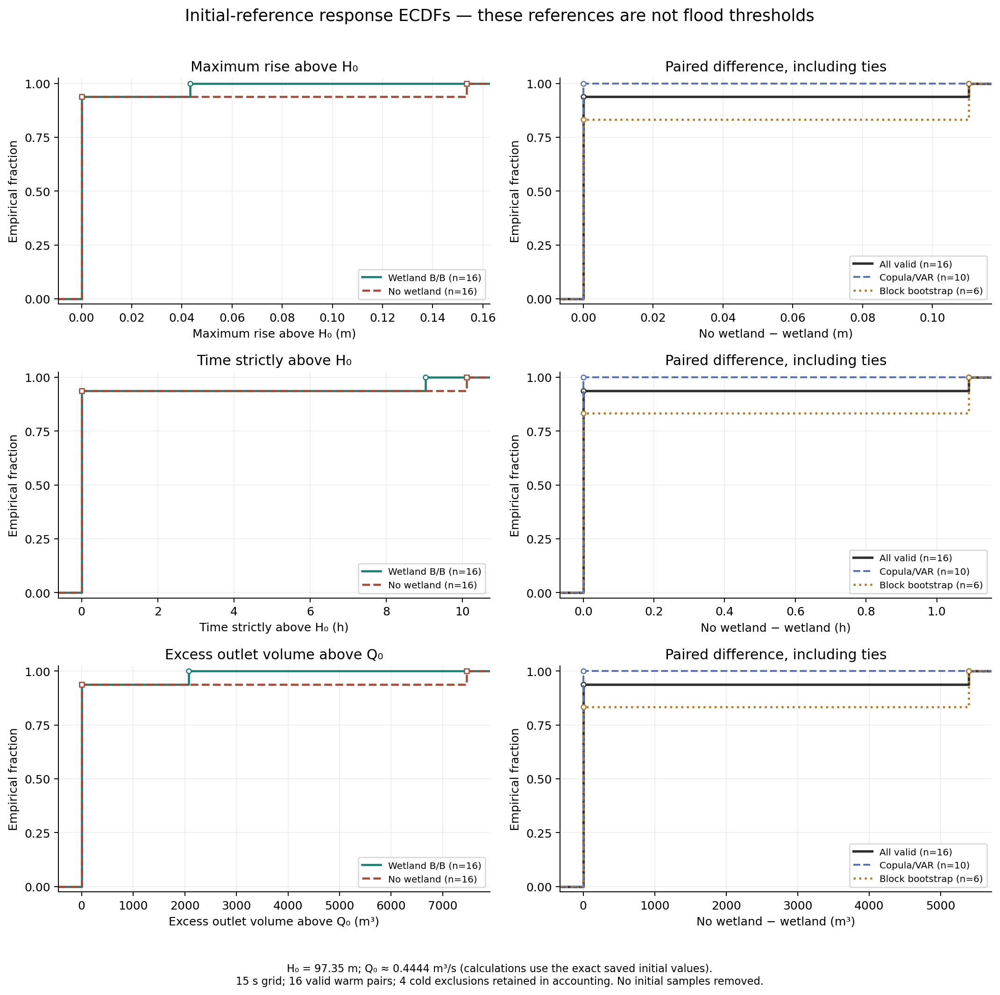
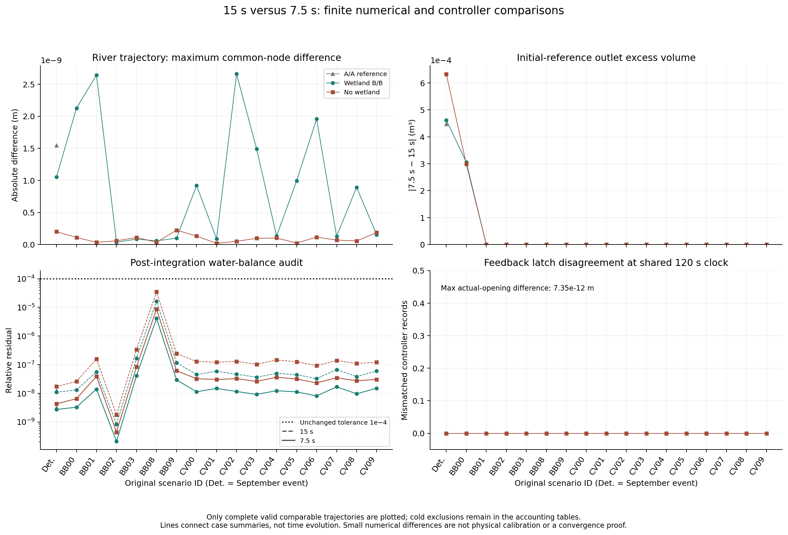

# Stage D.2 preliminary response metrics and numerical validation

The fixed feedback policy is numerically consistent for the tested deterministic event and all **16 non-freezing weather pairs** at both 15 s and 7.5 s. The existing pilot nevertheless provides **little evidence about heavy-rainfall flood mitigation**: 15 pairs retain their prescribed initial river maximum, and only one weather member produces a later, higher maximum. The ECDFs below describe this small, conditional pilot; they are not regional flood probabilities or universal validation of the controller or wetlands.

All work is confined to this new directory. The original A/B/C files, completed Stage D hydraulic studies and feedback-control pilot remain unchanged. The [preservation check](preservation_check.json) verifies 2,502 protected files. Initial states, hydraulic equations, coefficients, geometry, weather scenarios, seeds, boundary conditions, wetland design and policy settings were preserved. No spin-up, full Monte Carlo analysis, optimization, Git commit or push was performed.

## Why 15 pairs peak at initialization

The accepted river state is **7,000 m³**, with area **20,000 m²** and bed datum **97.00 m**, giving

`H_r(0) = 97.00 + 7000/20000 = 97.35 m`.

With the fixed downstream boundary at 97.15 m, the saved outlet relation is `Q_out = max(H_r - 97.15, 0)/0.45` throughout these trajectories. Thus the initial discharge is **0.44444444444441916 m³/s**. Its exact relation to stage was checked against saved output arrays. Stage and discharge peaks are therefore coupled metrics under these settings, not independent validation evidence.

At the start of every warm scenario, outflow exceeds river inflow: the initial river-storage derivative ranges from **−0.202554 to −0.169879 m³/s** with wetlands, and **−0.433064 to −0.364409 m³/s** without wetlands. The river first recedes. The isolated linear outlet has characteristic time `A_r R_r = 9000 s = 2.5 h`; this is not a demonstrated equilibration time for the full soil/groundwater/pool/wetland system.

Most saved weather is too weak to lift the subsequent river stage above this prescribed initial level. The 16 warm six-day rainfall totals span **0–80.76 mm**, with median **13.22 mm**; the other 15 members excluding `block_bootstrap_00000` have totals no greater than **22.08 mm** and maximum 24-hour depths no greater than **12.8 mm**. The deterministic September 2022 forcing totals **145.3 mm**, including **141.4 mm** within a clock-aligned 24-hour period. These are ordinary September weather windows, not 16 storm-conditioned realizations of the reference event. [Weather values and provenance](results/weather_summary.csv).

The initial maximum is retained in every metric and figure. No initial segment is deleted. The saved scenarios contain no corresponding antecedent hydrologic forcing, and the weather generator's 336-hour latent burn-in does not initialize water storages. Cached antecedent observations for the historical event do not identify all water states or supply antecedent paths for the stochastic scenarios. A hydrologic spin-up could be a separate sensitivity study with explicit antecedent forcing, initial-state alternatives and controller memory; it is not justified as an automatic correction here. [Definitions and spin-up discussion](metric_definitions.md).



*Three disclosed examples: the first Copula/VAR member, the member with a later event maximum, and the saved zero-rain member. Every hydrograph includes its initial value. The lower panels show the secondary rise from a preceding running minimum, which differs from rise above the initial level. Even the zero-rain system evolves, so that secondary metric is not rainfall-only runoff.*

## Metrics, pairing and preliminary distributions

The primary results use the existing uniform **15 s** trajectories; **7.5 s** results verify numerical sensitivity rather than create additional statistical samples. Both cases receive the same saved weather and the same [upstream-level feedback policy](../feedback_control/policy_basis.md), with unchanged shared initial storages. The wetland design retains the historical B/B synthetic response classes; no design is reoptimized or identified as a real species. Actual gate histories agree to roundoff; the largest difference across all checked pairs, including deterministic controls, is **5.68e-15 m**. The wetland case retains **5,500 m³ additional initial wetland water**. This is a matched structural comparison conditional on the accepted initial states, not matched total initial water volume.

The requested maximum rise above the initial river stage is `max_t H_r(t) - H_r(0)`, with t=0 included. It is zero for the same 15 pairs; changing the name of the metric does not remove initial-condition dominance. Its paired difference equals the full-peak difference because both cases share H_r(0).

There is **no accepted downstream flood threshold**. As confirmed for this task, flood duration, flood excess volume and flood exceedance probability remain undefined. The retired illustrative 97.9 m value is not restored; the 99 m river applicability ceiling and the four upstream safety limits are not substituted as river flood thresholds.

Two supplementary reference metrics are reported separately:

- Time strictly above the exact initial stage H₀ = 97.35 m.
- Excess outlet volume `integral max(Q_out - Q₀, 0) dt`, using the exact saved initial Q₀, not its rounded display value.

These describe exceedance of the initial reference, **not flooding**. Crossings are located on the piecewise-linear output interpolant and integrated exactly for that interpolant. Stage-excess area has units m·h; discharge-excess volume has units m³. [Metric formulas](metric_definitions.md), [nine passing metric checks](results/metric_checks.json).

All paired differences use **no wetland minus wetland**. Negative values and complete unsafe simulations would remain outcomes, not reasons to discard a pair. Here both resolutions have no unsafe or incomplete warm trajectories. Invalid trajectories would have no invented complete-window metrics.

| Primary 15 s metric | Wetland mean | No-wetland mean | Mean paired difference | Median paired difference |
|---|---:|---:|---:|---:|
| Full-window river peak, m | 97.352705 | 97.359600 | 0.006896 | 0 |
| Full-window outlet peak, m³/s | 0.450455 | 0.465779 | 0.015323 | 0 |
| Maximum rise above initial stage, m | 0.002705 | 0.009600 | 0.006896 | 0 |
| Time above initial stage, h | 0.563745 | 0.631866 | 0.068121 | 0 |
| Excess volume above initial discharge, m³ | 129.828573 | 466.627670 | 336.799096 | 0 |
| Total six-day outlet volume, m³ | 17094.973460 | 14556.288758 | −2538.684701 | −2712.010782 |

These are descriptive means of the 16 retained pairs, not expected regional flood benefits. The peak difference is zero in 15 pairs and positive in one. In contrast, total outlet-volume and time-integrated river-level differences are negative in 15 pairs and positive in one. Extra initial wetland water, timing, evaporation, groundwater exchange and remaining end storage all contribute; a smaller secondary upward excursion does not establish a lower complete-window downstream burden. The tables retain these unfavorable contrasts. [All metrics](results/metrics.csv), [paired values](results/paired_metrics.csv), [summary statistics](results/summary_statistics.csv).

The single later-peak case, `block_bootstrap_00000`, illustrates both the contrast and the limits:

| Metric | Wetland | No wetland | No wetland minus wetland |
|---|---:|---:|---:|
| River peak, m | 97.393277 | 97.503606 | 0.110329 |
| Maximum rise above initial stage, m | 0.043277 | 0.153606 | 0.110329 |
| Outlet peak, m³/s | 0.540616 | 0.785791 | 0.245175 |
| Time above initial stage, h | 9.019925 | 10.109857 | 1.089933 |
| Excess volume above initial discharge, m³ | 2077.257169 | 7466.042713 | 5388.785544 |
| Total outlet volume, m³ | 47803.207335 | 48221.444563 | 418.237228 |

The 5,388.79 m³ reference-excess contrast is not the 418.24 m³ total-volume contrast, and neither is a documented avoided flood volume. No flood threshold has been supplied.



*Full-window stage/outlet maxima and paired differences, including all initial samples and ties. Each pooled curve has 16 valid warm pairs. Separate paired curves show the ten Copula/VAR and six block-bootstrap members. The stage and discharge plots are linked by the fixed outlet relation.*



*Maximum rise above H₀, time above H₀, and excess discharge volume above Q₀. These are initial-reference metrics, not flood-threshold metrics. The large zero jump is a real property of this saved pilot, not missing values filled with zero.*

The four original cold bootstrap IDs, 00004–00007, remain in the 20-ID accounting. They are not assigned zero outcomes or treated as low-risk cases. The pooled ECDF is conditional on 16 valid non-freezing pairs and has generator weights 10/16 and 6/16, not 50/50. Within-trajectory nodes and repeated resolutions do not increase the sample count. No inferential confidence band, return period or flood probability is inferred. [Exact ECDF values](results/ecdf_values.csv).

## Every scenario's safety and numerical robustness

| Resolution | Wetland warm completions | No-wetland warm completions | Valid pairs | Unsafe warm runs | Incomplete/invalid warm runs | Cold original IDs |
|---|---:|---:|---:|---:|---:|---:|
| 15 s | 16/16 | 16/16 | 16 | 0 | 0 | 4 |
| 7.5 s | 16/16 | 16/16 | 16 | 0 | 0 | 4 |

At each resolution, all four dam/wetland constraints are checked for every wetland run, and both dam constraints for every no-wetland run: 96 applicable scenario–constraint combinations. The absent wetland compartments are explicitly marked not applicable. Both successful Runge–Kutta evaluations and accepted output levels are audited; these checks are not continuous-time engineering certification. Three deterministic control cases also pass at each resolution. [Complete accounting](results/accounting.csv), [individual safety results](results/safety_audit.csv).

| Compartment | Unchanged limit, m | Largest peak among all warm 7.5 s runs, m | Smallest safety margin, m |
|---|---:|---:|---:|
| Dam 1 | 101.20 | 100.632845 | 0.567155 |
| Dam 2 | 101.00 | 100.432845 | 0.567155 |
| Wetland 1 | 98.90 | 98.495744 | 0.404256 |
| Wetland 2 | 98.80 | 98.344473 | 0.455527 |

The controller decision clock remains **120 s**, independent of the ODE step. Audits check each saved hysteresis decision, target, planned/attained endpoint, continuous actual position, rate limit and agreement with accepted upstream states. All 140 branch/run audits pass across the 70 valid trajectories at the two resolutions. There are **zero mismatched latch records**, and every corresponding switch time agrees between 15 s and 7.5 s. [Controller audit](results/controller_audit.csv).

Across all 35 completed deterministic/weather cases, halving the step from 15 s to 7.5 s gives:

- Maximum common-node river difference: **2.66037e-9 m**.
- Maximum common-node outlet-discharge difference: **5.91194e-9 m³/s**.
- Maximum common-node actual gate-opening difference: **7.34987e-12 m**.
- Maximum difference in each grid's sampled river maximum: **3.54757e-8 m**; this differs from the common-node comparison because the finer grid samples additional times.
- Maximum initial-reference duration change: **8.75427e-7 h**; maximum initial-discharge excess-volume change: **0.0006332 m³**.
- Largest fine-grid relative water-balance residual: **8.65579e-6**, below the unchanged **1e-4** criterion. Maximum instantaneous physical mass-identity mismatch is **1.77636e-15 m³/s**.

The minimum open-gate H/a remains approximately **1.98969**. Only the previously supported energy-gate and closed states are used. The low-head transition remains unvalidated; the policy avoids it in these tests. Weather and boundary inputs at common nodes, initial states, controller settings and hydraulic settings are unchanged. These results support numerical stability at the tested resolutions; they are not a proof of global convergence or safety for arbitrary storms. [Convergence table](results/convergence.csv).



*The comparison retains the 120 s decision clock and the same weather realizations. Common-node trajectory differences, actual gate histories, switch consistency and mass-balance residuals are numerical checks, not a fitted probability model.*

## Separate controls, hydraulics and wetlands

The paired ECDFs compare wetland versus no wetland **under the same new policy and D hydraulic formulation**. Their differences are conditional wetland-configuration contrasts, with the initial-water caveat above. They do not measure the benefit of changing the gate-control policy.

The existing deterministic 120 s attribution is retained separately. For the historical B/B design, changing B to D hydraulics under fixed gates changes the river peak by **−24.909 mm**. Subsequently changing fixed gates to feedback under D hydraulics changes it by **+86.997 mm**, giving a net **+62.088 mm** relative to the original B fixed case. This is a signed path decomposition, not two independent universal causal effects. The feedback policy improves upstream safety but increases this downstream peak. The old fixed-gate stochastic cases did not complete, so no full-event policy-benefit distribution is fabricated from them. [Preserved attribution values](results/policy_hydraulics_attribution.csv).

## Heavy-rainfall limitation and the next experiment

The current scenarios are suitable as an ordinary-weather applicability pilot, not a representative sample of extreme-rainfall mitigation. A defensible next experiment is an **intact joint historical high-rainfall catalogue**, preserving precipitation, temperature, wind and solar together. The proposed design selects rainfall episodes using a predeclared upper-tail criterion from cached 2019–2023 August–October data, declusters overlapping episodes, retains a fixed 144-hour context, and reports missing-data and freezing exclusions before any model outcomes are examined. It does not multiply rain, shuffle weather variables, change initial conditions to obtain larger peaks, or silently substitute less severe available events.

The proposed empirical positive-24-hour-depth 95th-percentile selection value is **35.138 mm** for that declared historical pool. It is a sample-selection assumption, not a downstream flood threshold, NOAA return-period depth or annual probability. The short, incomplete historical record may leave too few distinct complete episodes; that limitation must be reported instead of relaxed after seeing results. The design is documented with local source hashes and NOAA/USACE references in [heavy_rainfall_scope.md](heavy_rainfall_scope.md). It has **not** been implemented. Frequency-rated rare-event risk would require additional justified inputs and assumptions.

## Reproduce and inspect

The tested environment is the existing `/opt/miniconda3/bin/python3` with NumPy, pandas and Matplotlib. The external official `multivarious` solver remains at revision `06d7aed5b541ec7fe26a6dc69be6aa7fb610aa02`. No replacement solver or forecasting model was added.

```bash
cd /Users/zhangjiaxuan/Documents/Codex/Modeling
export MPLCONFIGDIR=/private/tmp/cee690-d2-matplotlib

# Read-only input/provenance checks; no ODE simulation.
/opt/miniconda3/bin/python3 -B D/d2_analysis/run_refinement.py --check-only

# Recompute metrics/statistics and the four figures from saved trajectories.
/opt/miniconda3/bin/python3 -B D/d2_analysis/analysis.py
/opt/miniconda3/bin/python3 -B D/d2_analysis/plotting.py

# Verify all earlier project files remain unchanged.
/opt/miniconda3/bin/python3 -B -m D.d2_analysis.preservation verify
```

The actual refinement was run with `python3 -B D/d2_analysis/run_refinement.py`. It refuses to overwrite its existing `results/fine_7p5` directory. The new wrapper privately adds 7.5 s to the frozen runner's timestep whitelist in memory; original source files and function globals are not changed. Its [actual 15 s regression](results/fine_7p5/regression_15s.json) first reproduced all eight compared saved arrays exactly. The [execution plan](results/fine_7p5/execution_plan.json) records source hashes, adaptation and matched weather. The run then produced 35 valid 7.5 s trajectories plus eight cold preflight records, representing the original 20 weather IDs and three deterministic controls, not a new weather ensemble.

Per-run JSON diagnostics, NPZ trajectories and compressed actual gate histories are in [results/fine_7p5](results/fine_7p5/). Analysis provenance is in [analysis_manifest.json](results/analysis_manifest.json). The original failed/coarse historical runs remain in their original directories; this study does not overwrite or reinterpret them.
