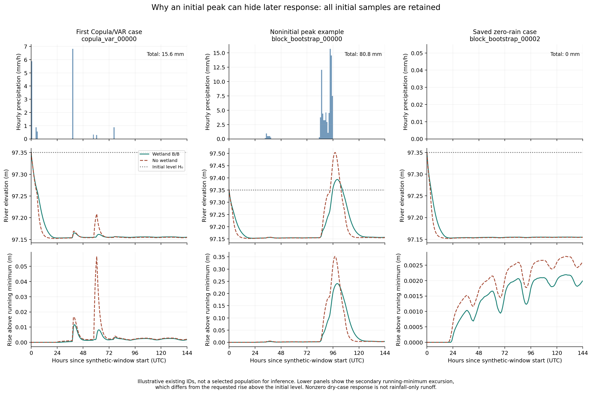
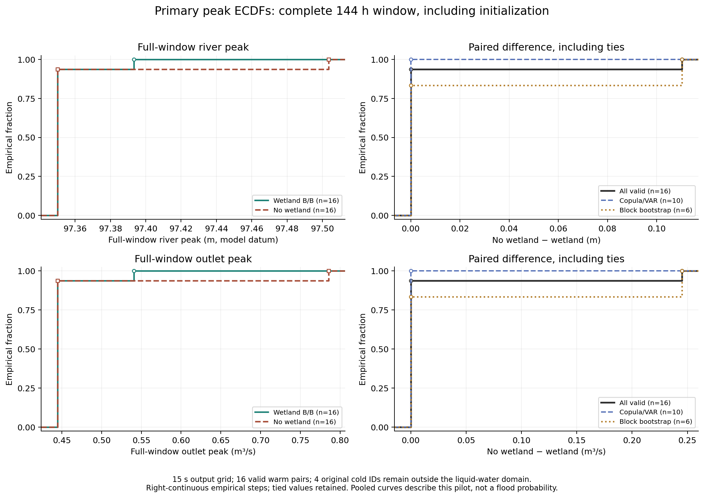
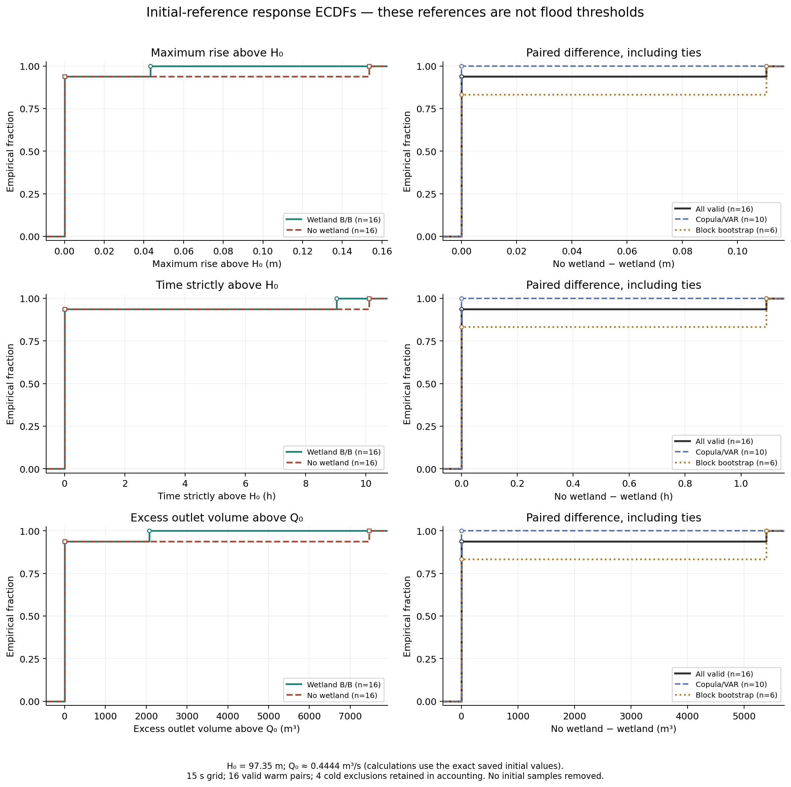
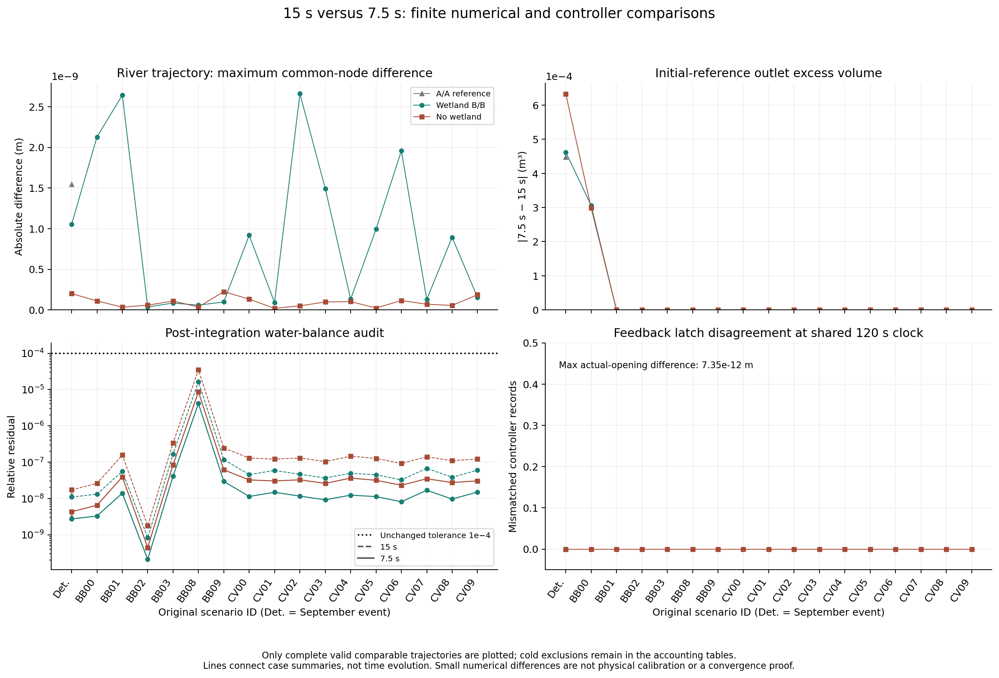

# Stage D.2 figure captions

These figures are generated by [plotting.py](plotting.py) from saved trajectories and the extracted result tables. Primary summaries use the uniform 15 s output grid. The 7.5 s simulations are numerical comparisons of the same original cases, not additional weather draws. No initial samples or unfavorable outcomes are removed.

## 01 — Initial peak diagnosis

Three explicitly illustrative saved IDs show why the initial condition can dominate a whole-window peak: the first Copula/VAR case, `block_bootstrap_00000` with a later event peak, and the zero-rain `block_bootstrap_00002`. Top panels show the original hourly precipitation intervals; middle panels retain the complete 144 h river trajectories and the accepted initial level. Bottom panels show the secondary rise above an earlier running minimum. This differs from the requested rise above the fixed initial level in Figure 03. A nonzero excursion in the zero-rain case demonstrates that this diagnostic is not rainfall-only runoff. The examples are not a new statistical population; each panel's vertical scale is shown explicitly.

## 02 — Primary peak ECDFs

The left panels compare whole-window physical river and outlet peaks, including initialization, for the 16 valid warm pairs. The right panels show paired no-wetland-minus-wetland differences, with descriptive pooled and generator-specific ECDFs. Every tie is retained as a step: fifteen pairs have the same initial-condition peak, rather than fifteen distinct event peaks. The pooled denominator is 16, comprising 10 Copula/VAR and six block-bootstrap cases; four original cold IDs remain in the 20-ID accounting outside the liquid-water model's applicability. The pooled curve therefore does not represent a 50/50 generator mixture or an estimated flood probability. In this fixed configuration, stage and outlet discharge are connected by the same monotone rating, so the two rows are related descriptions, not independent model validation.

## 03 — Initial-reference response ECDFs

The three rows show maximum rise above the accepted initial river level, time strictly above that level, and **excess** outlet volume above the accepted initial discharge: the integral of `max(Qout − Q0, 0)`, not the full discharge volume during an exceedance. Left panels compare the two models; right panels compare paired differences and their generator-specific distributions. The references are H0 = 97.35 m and Q0 approximately 0.4444 m³/s; calculations use the exact saved initial values. Neither is a flood threshold or channel-capacity estimate. Crossing times and excess integrals are calculated for the documented piecewise-linear output interpolant over the entire event. Fifteen zero outcomes remain visible; changing the metric does not erase initial-condition dominance. These quantities do not establish flood-exceedance duration, flood volume or flood probability.

## 04 — Resolution and controller comparison

The same complete valid cases are compared at 15 s and 7.5 s with the feedback decision clock fixed at 120 s. The upper panels show the largest river-level difference at shared output nodes and the absolute difference in initial-reference discharge-excess volume. The lower panels retain each grid's post-integration water-balance residual and the number of controller-latch disagreements at common decision times. Dashed balance curves are 15 s; solid curves are 7.5 s; the dotted acceptance line is the unchanged relative tolerance. The actual-opening difference is separately annotated. Deterministic A/A, deterministic B/B and no-wetland cases remain distinct from the original weather IDs. Cold cases have no fabricated trajectories and remain in the accounting tables. Lines connect case summaries for readability; they are not a time series. These are finite numerical consistency checks, not a demonstrated asymptotic convergence order, field validation or physical accuracy at the scale of the plotted numerical differences.

All paired interpretations remain conditional on the accepted initial states, including 5,500 m³ of additional wetland water. A positive reduction in a peak or reference-excess metric does not automatically imply less total outlet water or a smaller time-integrated river level. See [metric_definitions.md](metric_definitions.md) for signs, units, ECDF denominators and initialization limits.
