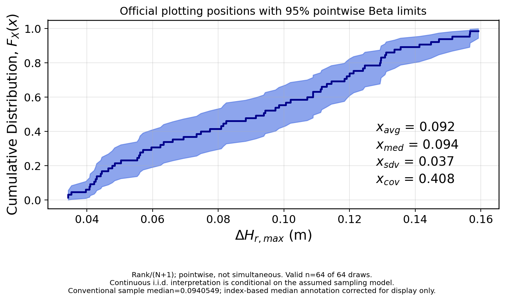
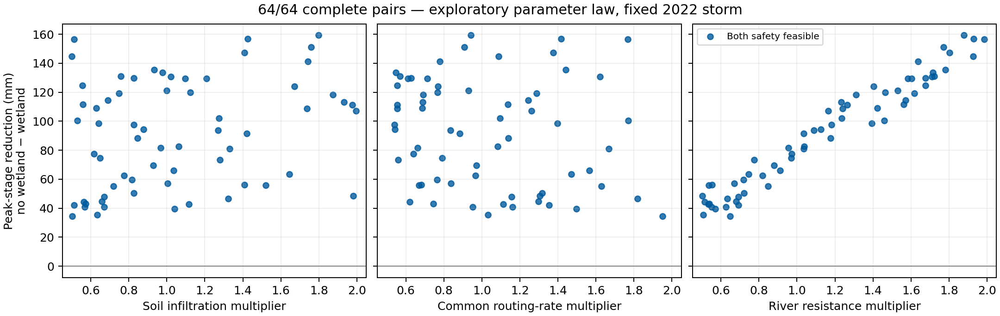
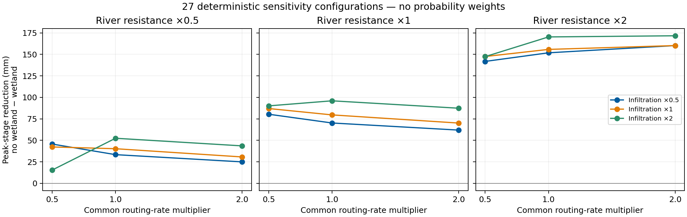

# HW D.2 — exploratory physical-parameter uncertainty

This study propagates three explicitly assumed parameter uncertainties through the existing Stage D feedback-controlled eight-state wetland and six-state no-wetland models. The saved September 9–15, 2022 UTC meteorological event is fixed. This is a conditional exploration of a hypothetical installation, not a calibrated Milwaukee flood-risk estimate.

## Results

Both studies are complete. Every planned pair has a recorded outcome; no sample was dropped, replaced, resampled or filtered by benefit sign or safety. There were **zero hydraulic-applicability failures, zero numerical failures, zero other execution/applicability failures and zero unsafe trajectories** in either study. This observed result is not proof of zero failure probability outside the tested samples or parameter law.

| Separate experiment | Planned pairs | Valid pairs | Valid unsafe pairs | Invalid/incomplete pairs |
|---|---:|---:|---:|---:|
| Deterministic factorial | 27 | 27 | 0 | 0 |
| Exploratory Monte Carlo | 64 | 64 | 0 | 0 |

Each pair contains one wetland and one no-wetland result. Pilot/refinement repeats are not counted as additional random draws. See [classification_counts.csv](tables/classification_counts.csv), the complete [trajectory audit](tables/trajectory_audit.csv) and [per-variable safety checks](tables/safety_checks.csv).

### Exploratory Monte Carlo: 64 paired vectors

| Paired outcome, no-wetland minus wetland | Mean | Median | Observed minimum–maximum | Sample 5th–95th percentiles |
|---|---:|---:|---:|---:|
| Full-horizon peak stage reduction (mm) | 91.573 | 94.055 | 34.284–159.218 | 40.822–150.626 |
| Full-horizon peak discharge reduction (m³/s) | 0.176506 | 0.176330 | 0.117574–0.231001 | 0.145302–0.209869 |
| Maximum-rise reduction above initial stage (mm) | 91.573 | 94.055 | 34.284–159.218 | 40.822–150.626 |
| Reduction in duration above initial stage (h) | 0.579 | 0.264 | −3.355–5.639 | −1.315–4.489 |
| Reduction in volume above each pair's initial discharge (m³) | 7737.5 | 7953.9 | 4525.4–8782.6 | 5522.8–8617.5 |

Percentiles describe the propagated sample spread under the assumed law; they are **not confidence limits**. Paired differences are calculated within each realization before summarizing, so a median difference need not equal the difference of two marginal medians. The Monte Carlo standard error of the estimated mean peak-stage reduction is **4.665 mm** and that of mean peak-discharge reduction is **0.002552 m³/s**. These are finite-sampling errors, not total physical prediction errors.

All 64 pairs have smaller wetland-model stage and discharge peaks. No Monte Carlo river peak occurs at time zero; the initial samples and conditions are nevertheless retained. Mean absolute river peaks are **97.648717 m** (wetland) and **97.740291 m** (no wetland); mean discharge peaks are **0.988750** and **1.165256 m³/s**. The nominal configuration is one evaluation point, not necessarily the mean or median propagated outcome.

In **27/64 pairs**, the wetland model stays above the initial river level longer, despite its lower peak. This negative duration difference remains in the table and demonstrates why attenuation and delayed release need not improve every metric. The reference level is not a flood threshold. Event-window total outlet volume is lower in the wetland case by 1,054.8–1,892.6 m³, but this is neither permanent water removal nor a flood-volume estimate; initial wetland water, end-of-window storage and evaporation also matter.



**Figure 1.** All 64 physical paired stage reductions under the approved exploratory parameter law and the fixed storm. The unchanged official routine supplies rank/(N+1) positions and 95% pointwise Beta order-statistic limits; they are not simultaneous confidence bands. The horizontal axis is metres (0.10 m = 100 mm). No invalid or unsafe sample was excluded. These intervals do not quantify calibration error, observed flood frequency or uncertainty in the assumed parameter distributions.



**Figure 2.** Each point is one of the same 64 complete paired ODE evaluations. The strongest sampled association with **stage** reduction is outlet resistance (Pearson r approximately 0.975). In contrast, its association with **discharge** reduction is approximately 0.023; infiltration and routing correlations with discharge reduction are approximately +0.722 and −0.547. These are descriptive sample associations, not independent causal effects or Sobol indices. The fixed rating relation explains much of the stage/resistance pattern. Full official scatter and marginal-distribution diagnostics are in [plots/official_mc/](plots/official_mc/).

The smallest Monte Carlo safety margin was **0.153490 m** at Wetland 1; minimum dam margins were **0.313720 m** for both branches. Maximum relative mass residual was **4.91e-8**. Actual gate openings within each wetland/no-wetland pair agreed to `5.73e-15 m`, with zero latch mismatches and identical meteorological inputs. Thus the paired contrast is not caused by different gate operating histories in these realized samples.

### Deterministic sensitivity: 27 configurations

The **27/27 factorial pairs** completed with valid hydraulics and no dam or wetland safety-limit violation. The smallest safety margin was **0.148859 m**. Peak-stage reduction ranged from **15.462719 to 171.660009 mm**, and peak-discharge reduction from **0.0687232 to 0.2329546 m³/s**. These are extrema over the prescribed configurations, not probabilistic uncertainty bounds.

At the unchanged nominal parameters, the wetland and no-wetland full-horizon river peaks were **97.615517209 m** and **97.695105153 m**, respectively: a **79.587945 mm** paired reduction. The corresponding peak discharges were **1.034482686** and **1.211344785 m³/s**, a reduction of **0.176862100 m³/s**.

The following contrasts vary one factor while holding the other two at 1. They are taken from [one_factor_at_a_time.csv](tables/one_factor_at_a_time.csv).

| Varied factor | Stage reduction at ×0.5 (mm) | At ×1 (mm) | At ×2 (mm) | Discharge reduction at ×0.5 / ×1 / ×2 (m³/s) |
|---|---:|---:|---:|---|
| Infiltration `K_u` | 70.171 | 79.588 | 95.975 | 0.155935 / 0.176862 / 0.213277 |
| Common routing rate | 86.989 | 79.588 | 70.085 | 0.193309 / 0.176862 / 0.155745 |
| Outlet resistance `R_r` | 40.231 | 79.588 | 155.798 | 0.178803 / 0.176862 / 0.173109 |

Changing infiltration from ×0.5 to ×2 lowered both absolute river peaks in all nine comparisons at fixed routing/resistance; changing routing from ×0.5 to ×2 raised both in all nine comparisons. A wetland peak can plateau at its retained initial value. Effects on the **difference between models** are more complicated: routing's benefit contrast changes direction across the other factor settings. Do not generalize a one-factor trend to all configurations. Increased resistance raises the water-level reduction strongly in this table while slightly reducing the discharge reduction; the rating-curve identity discussed below explains why the two metrics need not rank parameter settings alike.



**Figure 3.** All 27 deterministic sensitivity configurations, without probability weights. Panels fix the outlet-resistance multiplier, line colors fix infiltration, and the horizontal axis varies the common routing-rate factor. Points are actual paired ODE results; connecting lines guide the eye and do not add simulated settings. Positive values mean a lower wetland-model peak. The initial-time peaks in `grid_009` and `grid_018` are retained, not excluded or replaced by later local peaks.

## Scope and assumptions

The uncertainty coordinates are the existing upland infiltration coefficient `K_u`, one common multiplier on `k_ud[0]`, `k_ud[1]` and `k_ur`, and the river outlet resistance `R_r`. Baselines are `1e-6 m/s`, routing timescales of 8/10/20 h, and `0.45 s/m²`. The three routing rates retain their proportions; perfectly correlated relative changes within that group are assumed. Other parameters, initial physical storages, gate geometry, hydraulics, controller, safety limits and boundaries remain fixed.

Two distinct experiments were authorized:

1. **Deterministic sensitivity:** the full 27-point cross-product of factors 0.5, 1 and 2. These points have no assigned probabilities.
2. **Exploratory Monte Carlo:** 64 iid vectors, each containing three independent log-uniform factors between 0.5 and 2. The factors have median 1 and arithmetic mean approximately 1.082. Support, law and independence are approved exploration assumptions, not fitted distributions or observed bounds.

The source evidence and its limits are in [uncertainty_basis.md](uncertainty_basis.md), with exact physical laws, units and mapping in [parameter_mapping.md](parameter_mapping.md). D.1 did not specify numerical distributions. Weather-only and combined weather/parameter uncertainty are not pooled into this experiment. The earlier weather pilot's 16 non-freezing scenarios and four cold-weather exclusions remain unchanged in the earlier D.2 accounting; they are not additional samples or exclusions in this 64-vector fixed-storm parameter study.

## Paired interpretation

Every vector is applied to both complete dynamic models. A common feedback policy is used; its realized openings are checked within each pair and may vary across parameter vectors. No parameter draw triggers gate optimization, changed safety limits or a substitute hydraulic equation.

For any reported scalar outcome, `difference = no-wetland − wetland`. A positive peak-stage difference indicates a smaller wetland-model peak under that paired configuration. This comparison does not isolate the effect of changing the control policy: both models already use the accepted Stage D policy. It also does not compare the historical Stage B fixed schedule against Stage D.

The no-wetland model removes the wetland compartments; it is not a zero-cover wetland. Shared physical initial states are matched, while the wetland case retains its accepted additional 5,500 m³ of initial wetland water. Consequently, total outlet-volume differences are not automatically avoided floodwater.

## Metrics and classifications

All physical peaks include the initial time. Maximum rise above the initial river stage is reported separately. There is no accepted downstream flood threshold, so flood duration, flood excess volume and flood exceedance probabilities remain undefined. Duration above the initial river level and volume above each realization's own initial outlet discharge are explicitly reference-response metrics, not flood metrics. Initial discharge changes with sampled `R_r`; its nominal value is not reused across draws.

Complete but unsafe trajectories remain valid physical results and stay in the summaries. Unsupported hydraulics, other physical applicability failures, numerical failures and unexpected execution errors receive separate diagnoses. An incomplete trajectory is not assigned a fabricated physical peak, zero benefit or penalty value. The planned sample inventory is retained regardless of outcome.

Dam and wetland safety peaks use the larger value found at accepted output nodes and evaluated successful Runge–Kutta stages. These are numerical trajectory checks, not an analytic guarantee between every evaluation time. For a failed run, any recorded safety margin describes only its evaluated partial trajectory; it is not a full-event safety certificate.

With the fixed downstream head and blockage, the outlet law is `Q_out = min(3, max(H_r − 97.15, 0)/R_r)` in SI units. When its cap is inactive, paired peak differences satisfy `ΔH_peak = R_r × ΔQ_peak`. Stage and discharge reductions are therefore related outputs of the same assumed rating curve, not independent confirmations of benefit. A larger stage reduction at higher resistance does not by itself establish a larger discharge reduction.

## Numerical and methodological checks

The private parameter adapter reproduced the saved nominal wetland and no-wetland 15 s trajectories exactly, including all state, derivative, forcing, output and balance arrays. See [adapter_regression.json](results/adapter_regression.json).

Before the complete Monte Carlo, a predeclared pilot compared 15 s with 7.5 s integration for the first two saved Monte Carlo vectors and the all-half/all-double sensitivity endpoints. All eight paired evaluations (16 simulations) completed, remained hydraulically valid and met the existing safety limits. The 120 s controller decision clock and all latch histories agreed. Maximum common-grid water-level difference was `5.35e-9 m`; maximum native-grid peak difference across all water-level variables was `1.04e-7 m`; maximum river-peak difference was `2.92e-8 m`; maximum actual-opening difference was `2.45e-11 m`. Maximum relative mass residual was `4.77e-8`, against the unchanged `1e-4` criterion. See [pilot_summary.json](results/pilot/pilot_summary.json) and [numerical_comparison.csv](results/pilot/numerical_comparison.csv).

These are practical numerical checks at four predeclared parameter points, not proof of convergence over the entire parameter box or physical validation of the hypothetical installation. The 120 s controller decision clock, hysteresis memory, rate-limited gate motion and full event horizon were unchanged. The nominal regression and numerical repeats are not extra independent Monte Carlo draws.

Across the completed 27+64 configurations, the recorded hydraulic regimes are `energy_gate` and `closed`; the smallest open-gate `H/a` is **1.98920**, above the Stage D energy-gate applicability boundary of 1.5. Maximum derivative-level water-mass identity residual is `1.78e-15 m³/s`. These results support use of the accepted controller for this tested, fixed-storm exploration. They do not newly validate unused low-head regimes, establish empirical parameter bounds, certify real structures, or justify extrapolation to freezing or more extreme meteorological conditions.

Professor Gavin's example is used for the sequence **sample → full physical analysis → retain outputs/constraints → empirical distributions and scatter**. The official `multivarious.rvs.uniform.rnd` samples log-multipliers before exponentiation. The same sample is reused for the two ODE models. Official `ode4u`, ECDF and scatter utilities come from the existing pinned checkout, revision `06d7aed5b541ec7fe26a6dc69be6aa7fb610aa02`. Neither the example's 10,000 runs nor its 30% CV is adopted. The original professor file is unchanged.

The `mimo_srs` interface was inspected; a surrogate is not required to compute these direct-ODE Monte Carlo outcomes. Its current automatic outlier removal and scaling before train/test splitting would require explicit adaptation before any additional predictive study. No new surrogate or forecasting algorithm is fitted here. See [professor_method_review.md](professor_method_review.md).

## Statistical limits

The professor's ECDF routine uses rank/(N+1) plotting positions and pointwise Beta order-statistic intervals. These are not simultaneous bands for the complete CDF. Their exact interpretation assumes iid draws and a continuous output distribution; ties or outlet caps must be disclosed. Plot annotations use the conventional sample median, with the official routine's original index-based annotation recorded in metadata. The official source itself is unchanged.

The 95% intervals describe finite Monte Carlo sampling uncertainty conditional on the declared hypothetical parameter law. They do not include model discrepancy, calibration uncertainty, uncertainty in that law, weather variation or observed flood-frequency evidence. With only 64 draws, extreme-tail quantiles and rare failures remain poorly resolved. Scatter correlations are descriptive associations, not causal or variance-based sensitivity indices. The 27 deterministic configurations receive no probability confidence bands.

## Reproducibility and preservation

All new code, configurations, plans, diagnostics, figures and tables reside in this directory. The preservation manifest checks earlier project files and the supplied professor/D.1 sources. No A/B/C model, prior Stage D result, physical threshold or original input is rewritten. No Git commit or push is part of this work.

The master random seed is **69020261118**. Three distinct spawned `SeedSequence` streams generate the three independent marginal batches through the official uniform sampler. Samples are generated once and saved before any ODE execution. They are not redrawn by either model or at derivative evaluations. The first two Monte Carlo vectors and two sensitivity corners reuse their already checked 15 s pilot results; the central sensitivity configuration reuses the nominal regression source. Provenance identifies every reuse.

| File or directory | Purpose |
|---|---|
| [config.json](config.json) | Approved law, physical mapping, numerical settings and pilot tolerances |
| [results/study_plan.json](results/study_plan.json), [planned_samples.csv](results/planned_samples.csv) | Immutable sample vectors, physical values, seed streams and source hashes |
| [adapter.py](adapter.py) | Private per-run physical parameters; original ODE/controller modules unchanged |
| [sampling.py](sampling.py), [run_study.py](run_study.py) | Official sampling, complete paired ODE evaluations and separate outcome classifications |
| [results/pilot/](results/pilot/) | Complete pilot arrays, controller histories and refinement checks |
| [results/sensitivity/](results/sensitivity/), [results/monte_carlo/](results/monte_carlo/) | Separate planned/actual tables, per-run diagnostics and actual controller histories |
| [analyze_results.py](analyze_results.py) | Saved-result summaries, safety checks and deterministic sensitivity figures |
| [run_official_analysis.py](run_official_analysis.py), [official_plots.py](official_plots.py) | Official ECDF/scatter methods with explicit sampling provenance and captions |
| [tables/](tables/), [plots/](plots/) | Final summary tables and scientific figures |
| [preservation.py](preservation.py), [preservation_check.json](preservation_check.json) | Hash check for all 2,659 protected earlier files and original supplied sources |

Executed from the project root with the existing Miniconda environment and pinned local official checkout:

```bash
cd /Users/zhangjiaxuan/Documents/Codex/Modeling
/opt/miniconda3/bin/python3 -B D/d2_analysis/parameter_uncertainty/run_study.py --phase prepare
/opt/miniconda3/bin/python3 -B D/d2_analysis/parameter_uncertainty/run_study.py --phase pilot --workers 2
/opt/miniconda3/bin/python3 -B D/d2_analysis/parameter_uncertainty/run_study.py --phase sensitivity --workers 2
/opt/miniconda3/bin/python3 -B D/d2_analysis/parameter_uncertainty/run_study.py --phase monte_carlo --workers 2
/opt/miniconda3/bin/python3 -B D/d2_analysis/parameter_uncertainty/analyze_results.py
/opt/miniconda3/bin/python3 -B D/d2_analysis/parameter_uncertainty/run_official_analysis.py
/opt/miniconda3/bin/python3 -B D/d2_analysis/parameter_uncertainty/preservation.py verify --output D/d2_analysis/parameter_uncertainty/preservation_check.json
```

The two study phases are independent and may run concurrently after the pilot passes. The runner refuses to overwrite an existing phase directory. To repeat a phase, first archive that phase's directory **inside this study directory**, retaining the immutable study plan and prior results. To regenerate only tables/figures, run the two analysis commands; they do not call the ODE or redraw parameters. Full trajectory arrays are retained for the pilot and original nominal reference. The larger studies retain per-run diagnostics, full controller histories and physical summary metrics; the saved parameter plan reproduces their ODE trajectories when needed.
