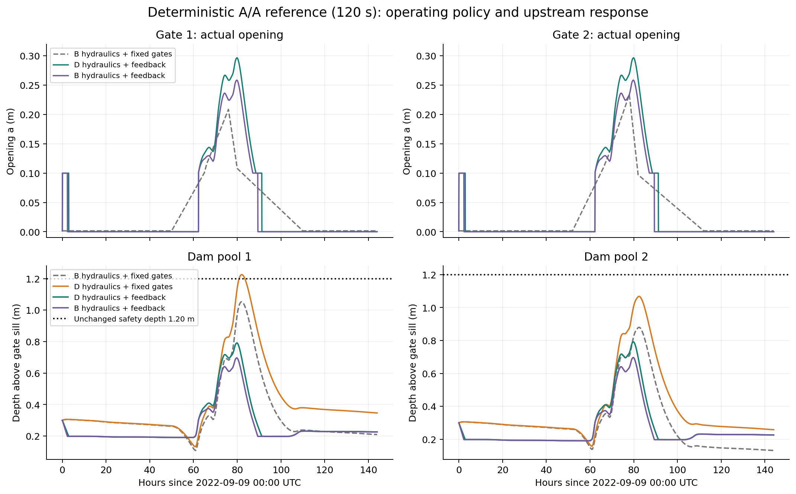
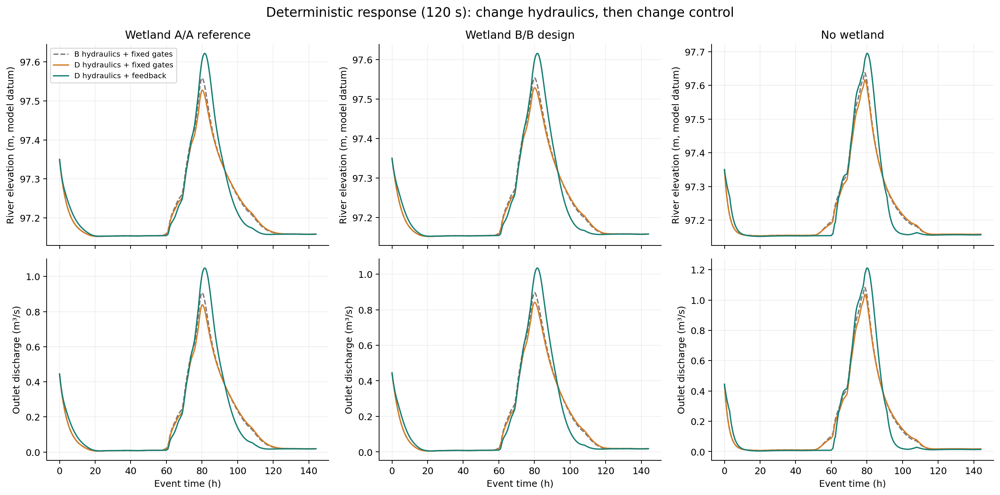
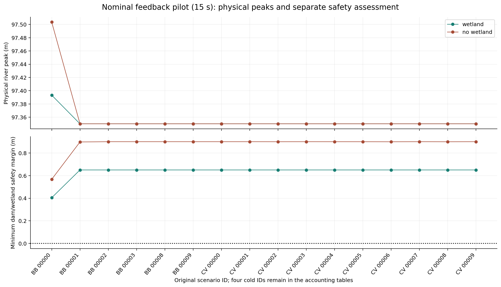
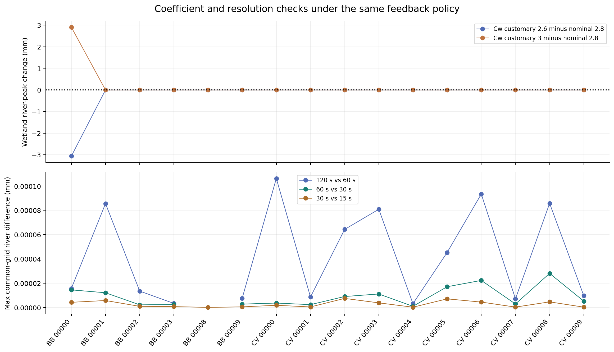

# Feedback-control saved-results report

This report analyzes saved trajectories and controller records only. The hydraulic candidate is unchanged; the operating policy and its engineering assumptions are documented in [policy_basis.md](policy_basis.md). Results describe the tested hypothetical system, not a calibrated installation or certified controller.

## Completion and safety accounting

| dt_s | original_ids | hydraulically_completed_pairs | complete_valid_pairs | safe_complete_pairs | cold_excluded_ids | invalid_or_incomplete_non_cold_ids |
| --- | --- | --- | --- | --- | --- | --- |
| 15 | 20 | 16 | 16 | 16 | 4 | 0 |
| 30 | 20 | 16 | 15 | 15 | 4 | 1 |
| 60 | 20 | 16 | 15 | 15 | 4 | 1 |
| 120 | 20 | 16 | 15 | 15 | 4 | 1 |

All 20 original weather IDs are retained. The four cold scenarios are preflight exclusions under the unchanged liquid-water assumption; they have no fabricated trajectories or river peaks. The 16 warm scenarios constitute a conditional non-freezing pilot. Repeated timesteps, hydraulic arms and coefficients are repeated evaluations, not additional independent weather draws. A complete unsafe trajectory remains a valid simulation with an unfavorable safety outcome. Full ODE/hydraulic completion is separate from passing the post-integration quadrature balance check; a complete trajectory can fail that numerical validation without a hydraulic failure. The original failed checks remain recorded, and refinement does not change the tolerance.

## Deterministic nominal feedback results (120 s ODE grid)

| case_name | design | physical_river_peak_m | river_peak_time_s | peak_outlet_m3_s | minimum_safety_margin_m | safety_feasible |
| --- | --- | --- | --- | --- | --- | --- |
| wetland | reference | 97.621747 | 293640 | 1.0483269 | 0.14321487 | True |
| wetland | best | 97.615517 | 293880 | 1.0344827 | 0.18402003 | True |
| no_wetland | best | 97.695105 | 288600 | 1.2113436 | 0.40825447 | True |



*September 2022 A/A reference, 120 s ODE grid. Gate panels show actual positions, including rate-limited travel. Pool depths use the unchanged sill datum; dotted lines are unchanged safety limits. Fixed openings are shared by the historical B and prior D cases. The additional B-feedback arm uses the same controller but may realize different openings.*



*The three deterministic physical cases use a common 120 s ODE grid. They use the same event and physical initial states within each case. Gray-to-orange changes the hydraulic law under fixed gates; orange-to-green changes the control under D hydraulics. This is a signed path comparison, not an optimized benefit. Unsafe fixed cases are retained. Feedback increases the downstream peak in these deterministic cases while keeping upstream levels below the safety limits.*

## Attribution and realized operation

The exact arithmetic path is `D feedback − B fixed = (D fixed − B fixed) + (D feedback − D fixed)`, applied to physical river and outlet peaks. [deterministic_attribution.csv](results/deterministic_attribution.csv) records the terms, additive residual, source hash and input checks. Negative signed changes mean a lower peak; they must not be confused with a penalized objective.

[paired_results.csv](results/paired_results.csv) checks scenario IDs, original seeds, weather bytes, mapped weather, initial shared states, time grids, policy and model source hashes before reporting a paired difference. It separately compares actual gates and controller latches. If actual gates differ, the comparison is under a common feedback policy, not identical operation. The wetland case retains its accepted additional 5,500 m³ initial wetland water, so this structural contrast is conditional on those accepted initial states, not a comparison with matched total initial water volume. Negative, zero and positive peak reductions are counted separately below; a negative modeled wetland effect is a normal risk result, not an invalid trajectory.

| dt_s | identical_actual_gate_pairs | negative_wetland_peak_reduction_pairs | zero_wetland_peak_reduction_pairs | positive_wetland_peak_reduction_pairs |
| --- | --- | --- | --- | --- |
| 15 | 16 | 0 | 15 | 1 |
| 30 | 15 | 0 | 14 | 1 |
| 60 | 14 | 0 | 14 | 1 |
| 120 | 15 | 0 | 14 | 1 |

In the canonical 15 s suite, 15 pairs attain their physical river maximum at the shared initial time. Their zero peak contrasts do not establish identical downstream trajectories or absence of a wetland routing effect; the whole-window maximum is dominated by the accepted initial river level. The remaining positive contrasts are listed below.

| scenario_id | wetland_peak_m | no_wetland_peak_m | wetland_peak_time_s | no_wetland_peak_time_s | no_wetland_minus_wetland_peak_m |
| --- | --- | --- | --- | --- | --- |
| block_bootstrap_00000 | 97.393277 | 97.503606 | 359925 | 352560 | 0.11032859 |

The B-feedback arm is an additional closed-loop hydraulic-model comparison. A difference from D feedback is not a pure discharge-law effect when feedback changes the realized gate history. No counterfactual wetland improvement is interpreted as optimization.



*Nominal D feedback at the finest uniformly completed reported weather resolution (see summary.json). Every started original weather ID appears; unavailable full-event values remain missing. Safety margin is the smallest dam/wetland limit minus the observed maximum, including successful RK evaluations. A positive margin indicates feasibility at the checked evaluations, not continuous-time certification. The four cold exclusions remain in the accounting table. Lines connect scenario summaries for readability; they are not a time series.*

## Resolution, coefficient and controller checks



*Top: change in the wetland physical peak for the declared lower/upper coefficient cases, with the policy held fixed. The finest available common numerically valid comparison is shown per scenario; its timestep is explicit in the sensitivity table, including targeted refinements. Failed coarse checks remain in the tables. Actual gate histories can respond differently. Bottom: maximum river-level difference over common output nodes under ODE refinement; the controller clock remains 120 s. These are finite comparisons, not a formal convergence proof.*

[resolution_comparison.csv](results/resolution_comparison.csv) reports 120→60, 60→30 and available 30→15 differences in full trajectories, physical peaks, actual gates and latch states. Latch-event times are matched by ordinal event number only when counts agree. Unequal counts are reported explicitly. [coefficient_sensitivity.csv](results/coefficient_sensitivity.csv) retains all outcomes for all three declared coefficients; failed cases are not assigned substitute peaks.

## Numerical balance and limits

Maximum recorded relative integrated balance residual: 0.0022169117; maximum recorded absolute residual: 0.10706202 m³. Maximum instantaneous physical mass-identity mismatch: 1.3322676e-15 m³/s. Each run retains its own tolerance and conservation status in [case_results.csv](results/case_results.csv). These maxima can belong to different runs. Maximum relative residual among accepted trajectories: 6.5741201e-05; maximum in the canonical 15 s nominal suite: 3.4624279e-05. The unchanged acceptance tolerance is 1e-4.


Safety, completion, mass balance and controller behavior are distinct tables. A stopped hydraulic run has partial-state scope; a completed run that fails the post-integration balance check retains full-horizon safety diagnostics but is excluded from accepted physical-peak comparisons until a documented finer-grid run passes. Gate, wetland-drainage and overflow volumes in [physical_outcomes.csv](results/physical_outcomes.csv) are individual internal transfers; they must not be added together as independent external water inputs. No water level, opening command, discharge or weather value was clipped by this report.

The target-opening rule aims for H/a ≥ 2 while enabled; actual rate-limited travel can produce a slightly smaller ratio. [controller_results.csv](results/controller_results.csv) records the minimum ratio over successful RHS evaluations, including its time, head and opening, and the executed hydraulic regimes. The actual ratio is assessed separately from the target ratio; no opening is clipped to force it to two. Remaining in a supported gate regime avoids invoking the unvalidated low-head branches; it does not validate those branches. No downstream flood threshold has been invented: river elevation, outlet discharge and timing are physical outputs.

Hydraulic geometry, the assumed transition, coefficient transfer to small openings, ideal sensors/actuators and omitted freezing remain limitations. Computational completion does not validate those assumptions or establish safety for untested weather. The main README supplies the project readiness decision.

## Reproduce the report

```bash
cd /Users/zhangjiaxuan/Documents/Codex/Modeling
/opt/miniconda3/bin/python3 -B D/feedback_control/report.py
```

This command refuses unfinished suites and reads existing saved outputs; it does not run simulations. It rewrites only this report, its CSV/JSON summaries and four figures. [suite_checks.csv](results/suite_checks.csv) records plan counts and preservation results; [source_checks.csv](results/source_checks.csv) compares recorded source hashes with current bytes and, for a preserved earlier runner revision, verified source snapshots. A current-file mismatch is not hidden by the snapshot column; both are reported separately.
