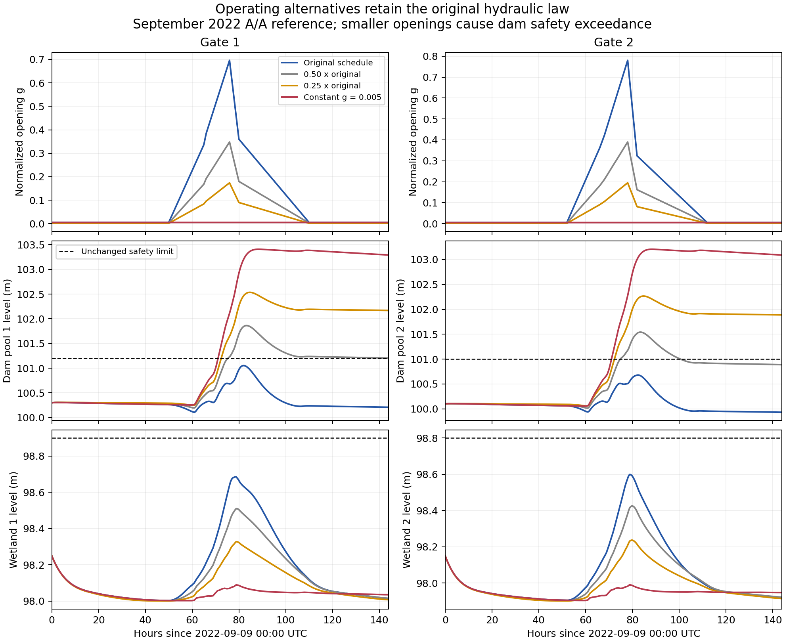
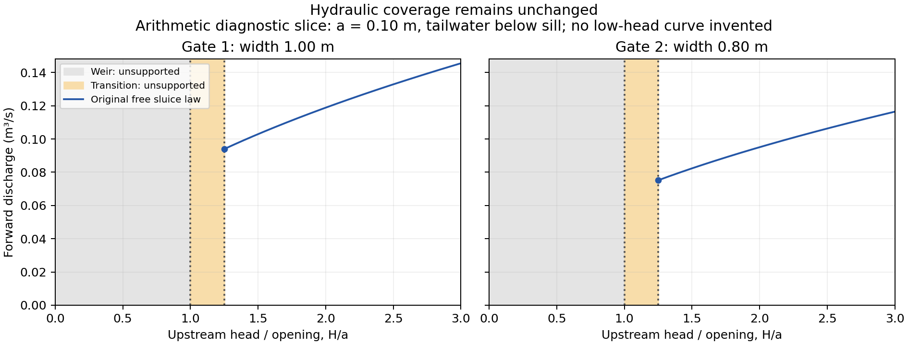

# Stage D — G5 hydraulic applicability diagnostic

**Status: G5 is not resolved. Do not start the full HW D.2 uncertainty propagation.**

The original September 2022 reference is reproducible. The original stochastic failures are genuine unsupported low-head states, not rainfall-unit, pairing, or output-extraction errors. Existing gate geometry is insufficient to justify a low-head discharge extension. Three explicitly recorded common operating alternatives were evaluated with the unchanged hydraulic law; none met both reference-event safety and complete pilot applicability. No alternative replaces the accepted Stage B schedule.

This is a bounded diagnostic study dated 2026-11-12. A/B/C code, configurations, data and saved results remain unchanged. No optimization, weather generation, full Monte Carlo analysis, commit or push was performed.

## Evidence and preserved configuration

The original 20 weather scenarios and adapter were recovered from the local `C2_scope_cleanup_20261028T205724Z` backup. The [recovery manifest](recovery_manifest.json) records original paths and SHA-256 hashes; [recovered/](recovered/) contains byte-identical copies used here. The recovered adapter is loaded only by this opt-in D runner, with its project-root path supplied at runtime. It is not restored into C.

The accepted gates are loaded from the saved Stage B fixed-reference decision, not the older opening values in `B/no_spillway_config.json`. Both physical cases retain the no-independent-dam-spillway topology. Wetland normal drainage and wetland overflow are retained in the eight-state case; the six-state counterfactual routes gate releases directly to the river.

| Preserved item | Value or source |
|---|---|
| Event horizon | 2022-09-09 00:00 UTC to 2022-09-15 00:00 UTC, 144 h |
| Original integration | Official `ode4u`, fixed RK4, 120 s |
| Solver provenance | multivarious 1.2.1; revision `06d7aed5b541ec7fe26a6dc69be6aa7fb610aa02` |
| Solver file SHA-256 | `0b55c31e77b0bae0205342e9e3118fb11db7c35f2fee2468149587151b077569` |
| Wetland reference | A/A synthetic classes, covers 0.65 / 0.60 |
| Wetland design used by original C scenarios | Saved B/B design, covers 0.2714117624187232 / 0.2141279193188096 |
| Eight-state initial storage order | upland, soil, wetland 1, wetland 2, dam 1, dam 2, groundwater, river |
| Eight-state initial storage (m³) | `[600, 90000, 3000, 2500, 3000, 2400, 409600, 7000]` |
| Six-state initial storage (m³) | `[600, 90000, 3000, 2400, 409600, 7000]`, same shared states |
| Initial-water qualification | Wetland case retains its additional 5,500 m³; no redistribution or spin-up |
| Fixed boundaries | External inflow 0 m³/s; downstream and exterior groundwater levels 97.15 m; blockage 0 |
| Fixed maximum levels | Dam 1: 101.20 m; dam 2: 101.00 m; wetland 1: 98.90 m; wetland 2: 98.80 m |

Each execution's `execution_plan.json` and case JSON record exact gate knots, design, initial conditions, boundary assumptions, source hashes and solver information. These remain hypothetical engineering assumptions, not a calibrated Underwood Creek installation.

## Original deterministic regression

All three fresh 120 s simulations completed, met the unchanged safety limits and matched the corresponding saved B trajectories **exactly** for states, outputs, inputs and time grids. The saved no-wetland derivative array also matched exactly. The two saved wetland files have no derivative array, so derivative-array regression is not claimed for them.

| Case | Physical river peak (m) | Dam 1 peak (m) | Dam 2 peak (m) | Wetland 1 peak (m) | Wetland 2 peak (m) |
|---|---:|---:|---:|---:|---:|
| Eight-state A/A reference | 97.5584415144 | 101.052899 | 100.679968 | 98.685565 | 98.598436 |
| Eight-state saved B/B design | 97.5534290929 | 101.052899 | 100.679968 | 98.629901 | 98.535812 |
| Six-state no wetland | 97.6377448215 | 101.052899 | 100.679968 | Not applicable | Not applicable |

Safety peaks include successful RK trial evaluations; they are not limited to saved output nodes. The smallest original deterministic G5 margin, `H − 1.25a`, was 0.0164475354 m. See [regression results](regression_results.json) and [all safety checks](safety_constraints.csv).

## Reproduced stochastic failure

All 20 saved scenarios were evaluated in each physical model. They use base seed 6902026 and the original PCG64 seed-sequence records: `[6902026, 1, 11, index]` for copula/VAR and `[6902026, 1, 22, index]` for block bootstrap. Saved weather was read directly; no random generator was rerun.

| Original 120 s outcome | Eight-state wetland | Six-state no wetland |
|---|---:|---:|
| Weather scenarios evaluated | 20 | 20 |
| ODE integrations started | 16 | 16 |
| G5 interruptions | 16 | 16 |
| Cold preflight exclusions | 4 | 4 |
| Complete trajectories | 0 | 0 |
| Numerical/state failures | 0 | 0 |

All 32 hydraulic interruptions occurred at Gate 1 in `weir_gate_transition`. Every original failure's time, branch, head, opening, residual and water elevations was reproduced exactly. [Original reproduction checks](original_reproduction_check.csv) and [scenario diagnostics](scenario_diagnostics.csv) retain every case.

For `copula_var_00000`, both cases first fail at 231,600 s (64 h 20 min), **2022-09-11 16:20 UTC**, during an RK4 `k4` trial evaluation:

| Quantity | Eight-state wetland | Six-state no wetland |
|---|---:|---:|
| Upstream elevation (m) | 100.12024490009853 | 100.12024490009853 |
| Tailwater elevation (m) | 98.15452674559877 | 97.22723886719933 |
| Upstream sill head H (m) | 0.12024490009852684 | 0.12024490009852684 |
| Actual opening a (m) | 0.09638666666666666 | 0.09638666666666666 |
| H/a | 1.24752628405 | 1.24752628405 |
| G5 residual, 1.25a − H (m) | +0.00023843323480649 | +0.00023843323480649 |

The root exception is `UnsupportedGateRegime` at `B/gate_hydraulics.py:141`, propagated as `HydraulicApplicabilityFailure` by the ODE RHS. This is the **first encountered invalid RK state**, not a solved continuous-time threshold crossing. No discharge is evaluated beyond the supported regime and no invalid full-event peak is manufactured.

The deterministic gate pulses occur near hours 65–82. They encounter insufficient upstream water in ordinary stochastic six-day windows, whose rain totals and timing differ from the reference storm. The four cold scenarios are `block_bootstrap_00004` through `00007`; their actual saved weather contains nonpositive temperatures, including October source blocks permitted by the original seasonal bootstrap. The original model has no snow/ice treatment. These are retained, explicitly labelled preflight exclusions, not integration failures or missing values replaced by zero.

### Input and numerical audit

All 20 files have 144 finite, contiguous, hourly UTC records. Each timestamp is the beginning of its accumulation/mean interval. There are no missing entries or negative precipitation, radiation or wind values. [Input audit](input_audit.csv) lists every scenario, original seed, hash, temperature limitation and conservation check.

- Rainfall in mm/h is divided by 3,600,000 to obtain m/s. Each hourly rainfall value is held over exactly its own interval. Maximum integrated-depth mapping error is `3.47e-18 m`.
- Solar radiation is an hourly mean in W/m²; its hourly energy is preserved. Maximum mapping error is `1.10e-11 Wh/m²`.
- Temperature and wind retain the original interpolation between hourly centers, with only first/last half-hour endpoint holds. This is meteorological forcing, not a causal forecasting evaluation.
- Official `ode4u` restarts at hourly boundaries for stochastic inputs, preventing its midpoint input averaging from smearing precipitation or radiation across interval boundaries. Storage is passed continuously between segments. The deterministic reference retains its original documented linear weather knots.
- Weather hashes, scenario IDs, seeds, durations and timestep settings match across both physical cases. Wetland `H_r/Q_out` output columns are 5/20; six-state columns are 3/10. Extracted arrays match those named columns. There is no pairing or output-field mismatch.
- Safety exceedance is recorded separately from trajectory validity. No downstream flood threshold or negative-wetland-benefit filter is used. Completed unsafe trajectories remain in the results.

## Hydraulic decision and fixed-schedule evaluation

The [source and geometry assessment](sources_and_decision.md) starts with [the existing B documentation](../../B/docs/07_gate_hydraulics.md) and the official USACE [low-flow guidance](https://www.hec.usace.army.mil/confluence/rasdocs/ras1dtechref/7.0/modeling-gated-spillways-weirs-and-drop-structures/hydraulic-computations-through-gated-spillways/low-flow-through-gates). Gate widths, sill elevations and opening heights do not establish the crest profile or weir coefficient. The dimensionless orifice coefficient cannot be reused as the dimensional weir coefficient. A transition algorithm also needs a documented choice consistent with the selected physical geometry.

**No low-head extension was implemented.** The requested weir and weir-gate transition regions remain explicitly unsupported; G5 remains active. The following finite operating checks alter only the two time-only opening schedules, identically for both physical cases and every scenario. They are diagnostics, not optimized solutions or accepted replacement controls.

| Schedule | September 2022 dam 1 / dam 2 maximum (m) | Original ten-ID pilot at 120 s | Decision |
|---|---:|---|---|
| Original frozen schedule | 101.052899 / 100.679968 | 9 G5 pairs; 1 cold exclusion | Reference works; stochastic applicability fails |
| Every original knot × 0.50 | 101.862676 / 101.542071 | Not run after reference safety failure | Rejected by unchanged dam limits |
| Every original knot × 0.25 | 102.535439 / 102.266694 | 2 complete safe pairs; 7 G5 pairs; 1 cold exclusion | Fails reference safety and pilot applicability |
| Constant g1 = g2 = 0.005 | 103.407443 / 103.207443 | 9 complete pairs, including 1 unsafe; 1 cold exclusion | Hydraulically completes warm pilot but fails safety and total applicability |

The constant value is the already existing low opening in the original schedule, not a fitted coefficient. Its physical opening is 0.0015 m. It removes the storm-timed pulses and is intentionally weather-independent. It is not state feedback and does not clip a commanded opening according to head. Only these three alternatives were tried; their failure does not prove that every conceivable fixed schedule is infeasible.



*Original A/A September event, same initial states, forcing, design and physical equations. Dashed lines are the unchanged safety limits. Lower releases reduce wetland inflow but retain too much water in the dam pools. Those unsafe river responses are not optimization benefits.*

## Ten-scenario pilot and resolution checks

The pilot uses the **first five original IDs from each generator**, exactly as the archived pilot did. Selection is by ID, not rainfall amount, hydraulic success or benefit. The cold scenario remains in the denominator.

| Original scenario | Original schedule | Constant 0.005 schedule |
|---|---|---|
| copula_var_00000 | G5 interruption | Complete, safety-feasible |
| copula_var_00001 | G5 interruption | Complete, safety-feasible |
| copula_var_00002 | G5 interruption | Complete, safety-feasible |
| copula_var_00003 | G5 interruption | Complete, safety-feasible |
| copula_var_00004 | G5 interruption | Complete, safety-feasible |
| block_bootstrap_00000 | G5 interruption | Complete, dam safety exceeded |
| block_bootstrap_00001 | G5 interruption | Complete, safety-feasible |
| block_bootstrap_00002 | G5 interruption | Complete, safety-feasible |
| block_bootstrap_00003 | G5 interruption | Complete, safety-feasible |
| block_bootstrap_00004 | Cold preflight exclusion | Cold preflight exclusion |

These classifications are identical in both physical models at **120, 60 and 30 s**. Constant-opening counts at every resolution are **9/10 complete pairs, 8/10 safety-feasible pairs, 1/10 cold exclusions**. At 30 s, `block_bootstrap_00000` reaches dam levels 101.831262 and 101.631262 m, exceeding both limits by approximately 0.631262 m. All complete pilot wetland trajectories satisfy their two wetland safety limits. The constant schedule still exceeds both dam limits by about 2.207443 m in the original deterministic storm.

[The pilot table](pilot_summary.csv) records every pairing. [The resolution table](numerical_resolution.csv) compares whole common-grid trajectories as well as peaks; it does not rely on an unchanged initial-time river maximum.

- Original G5 failures persist under refinement. For `copula_var_00000`, first detection is 231,600 s at 120/60 s and 231,585 s at 30 s. Across the ten-ID pilot, successive refinement changes detected failure time by at most 30 s, then 15 s. The regime and branch remain unchanged. A smaller timestep does not supply the missing hydraulic law.
- For completed constant-opening pilot trajectories, the largest 60-to-30 s common-grid river-level difference is `6.38e-9 m`; the largest dam/wetland-level difference is `1.24e-8 m`. Both models and all nine warm scenarios were included.
- All three original deterministic cases and all three constant-opening deterministic cases were also run at 120/60/30 s. The largest original 60-to-30 s river-peak change is `6.69e-7 m`. Sampled peak changes can differ from common-grid errors because the finer output grid locates a peak between coarse nodes.
- These are actual finite-grid consistency checks. They do not establish an error bound for arbitrary future meteorology, continuous-time safety certification or empirical model validation.

## Hydraulic, conservation and safety tests

[Regression results](regression_results.json) contain **22/22 passing targeted code-regression checks** plus the three original trajectory comparisons. Passing an expected rejection is not proof that the rejected physics is implemented.

| Requested check | Actual result |
|---|---|
| H/a = 0.5 and 1, both gates | Expected unsupported weir-region exception; physical coverage still absent |
| H/a = 1.125, both gates | Expected unsupported transition exception; physical coverage still absent |
| H/a = 1.25 and 1.5 | Nonnegative free-sluice discharge with unchanged coefficients |
| SI discharge dimensions, datum invariance, positive-flow scaling | Passed |
| Closed/dry/adverse-head behavior and supported-domain limits | Passed under the existing one-way assumptions |
| Continuity through H/a = 1 and 1.25 | Cannot be verified across an unimplemented low-head branch |
| Free/submerged transition at s = 0.67 | Existing approximately −0.501256% right-hand discharge jump measured and retained |
| Free/submerged transition at s = 0.80 | Continuous limiting behavior checked |
| Both full ODE instantaneous mass identities | Passed; internal gate/drainage transfers cancel |
| Both full ODE rainfall-unit checks | 1 mm/h over 660,000 m² adds 0.1833333333 m³/s |
| Unsafe state handling | No storage clipping; valid derivatives and separate failed safety audit |
| Routing preservation | No independent dam spillway; wetland drainage and overflow retained |



*An arithmetic slice at a = 0.10 m, using the actual widths and coefficients and tailwater below the sill. No synthetic discharge curve is drawn in unsupported regions. The operating alternatives use this same unchanged law.*

The dynamic observer checks `sum(dx) = P*A_rain + Q_ext + Q_gx − Q_out − E_tot` at every successful official-solver RHS evaluation. The maximum absolute mismatch over all runs is `1.78e-15 m³/s`. Across all 82 completed trajectories in this diagnostic set, the largest integrated balance residual is approximately 0.100902 m³, and the largest relative residual is `2.17e-5`, below the unchanged `1e-4` tolerance. The two maxima need not belong to the same run. Net external flux is integrated separately inside each hourly segment before joining outputs, so jumps and internal transfers are not double-counted.

All four dam/wetland safety limits were checked for the eight-state model, and both dam limits for the six-state model, at output nodes and successful RK stages. The six-state model has no wetland levels. Existing storage, soil-capacity, groundwater and river-geometry applicability checks remain active. On incomplete runs, stored safety maxima describe only evaluated states; full-horizon safety is unknown. See the explicit `safety_peak_scope` and `time_s_meaning` fields in the main CSV.

Wetland-induced gate submergence is excluded for safety-feasible eight-state trajectories because 98.90 < 100.00 m and 98.80 < 99.80 m. In the six-state model, its existing river-geometry ceiling, 99.00 m, is also below both sills. Actual stage observers confirm below-sill tailwater in these runs. The identified defect is upstream low head, not an untested submerged-gate transition.

## Remaining decisions

| Required evidence or decision | Why it is still needed |
|---|---|
| Define the gate-sill crest class, streamwise profile/length and edge/contraction conditions | Width and sill elevation alone do not select low-head physics |
| Supply a geometry-compatible weir coefficient or coefficient derivation, approach dimensions/loss assumptions and verified units | No defensible coefficient is present in the accepted configuration |
| Select and verify the weir-gate transition closure | It must use the chosen geometry/head convention and pass continuity/limiting tests; source descriptions alone do not settle the implementation |
| Decide how future analysis treats the existing nonpositive-temperature weather scenarios | The present liquid-water model cannot simulate them; they cannot simply be dropped or warmed to make the pilot pass |

The first three items are one coherent physical gate specification, not independent tuning knobs. New hypothetical geometry assumptions would require an explicit engineering decision and documentation. No alternative schedule has been accepted here. No failure is interpreted as proven global infeasibility. Full HW D.2 remains deferred.

## Files and reproduction

| File/directory | Content |
|---|---|
| `scenario_diagnostics.csv` | All 184 case evaluations, first failure fields, seeds, hashes, complete/partial labels, safety and balance diagnostics |
| `original_reproduction_check.csv` | Original 40 case records versus archived diagnostics |
| `input_audit.csv` | All 20 weather files, intervals, temperatures, missing/negative checks and conservation |
| `pilot_summary.csv` | All ten pilot IDs at each tested schedule/resolution, including failures |
| `safety_constraints.csv` | Per-variable limits, observed maxima, margins and scope |
| `numerical_resolution.csv` | 120→60 and 60→30 comparisons of complete trajectories or detected failure times |
| `regression_results.json` | Exact original trajectory comparisons and gate/full-RHS tests |
| `summary.json`, `preservation_check.json` | Machine-readable outcome and 896 unchanged protected-file hashes |
| `sources_and_decision.md` | Official sources, known geometry, missing evidence and hydraulic decision |
| `runner.py`, `run_study.py`, `gate_tests.py`, `summarize.py` | Opt-in diagnostic execution and report generation |
| `recovered/`, `results/`, `logs/`, `plots/` | Verified input copies, case JSON/complete NPZ outputs, logs and two figures |

184 case evaluations include repeated timestep/schedule checks; they are **not 184 independent weather draws**. There are only 20 original saved scenarios, with ten used for the alternative-schedule pilot. Failed runs have no complete trajectory NPZ. Two initial report-only errors (field name and plotting import path) were corrected without changing or rerunning scientific simulations; their logs are retained separately. Final summary generation succeeds.

The commands below were tested with `/opt/miniconda3/bin/python3` and the existing local official solver checkout. No dependency was downloaded or substituted. All paths below are relative to the project root; outputs are confined to this directory.

```bash
cd /Users/zhangjiaxuan/Documents/Codex/Modeling
/opt/miniconda3/bin/python3 -B D/g5_diagnostics/gate_tests.py --project-root "$PWD" --output-dir "$PWD/D/g5_diagnostics/results/gate_tests"

# Original deterministic cases, including 120 s regression against saved B.
for dt in 120 60 30; do
  /opt/miniconda3/bin/python3 -B D/g5_diagnostics/run_study.py deterministic --dt "$dt" --tag "original_reference_${dt}s"
done

# Replay all 20 original scenarios, then refine the original ten-ID pilot.
/opt/miniconda3/bin/python3 -B D/g5_diagnostics/run_study.py original --tag original_20_120s
for dt in 60 30; do
  /opt/miniconda3/bin/python3 -B D/g5_diagnostics/run_study.py pilot --dt "$dt" --tag "original_pilot_${dt}s"
done

# Finite schedule checks; no optimization.
/opt/miniconda3/bin/python3 -B D/g5_diagnostics/run_study.py deterministic --scale 0.5 --tag schedule_scale_050_reference_120s
/opt/miniconda3/bin/python3 -B D/g5_diagnostics/run_study.py deterministic --scale 0.25 --tag schedule_scale_025_reference_120s
/opt/miniconda3/bin/python3 -B D/g5_diagnostics/run_study.py pilot --scale 0.25 --tag schedule_scale_025_pilot_120s
for dt in 120 60 30; do
  /opt/miniconda3/bin/python3 -B D/g5_diagnostics/run_study.py deterministic --constant 0.005 --dt "$dt" --tag "constant_005_reference_${dt}s"
  /opt/miniconda3/bin/python3 -B D/g5_diagnostics/run_study.py pilot --constant 0.005 --dt "$dt" --tag "constant_005_pilot_${dt}s"
done

# Reports and figures only; does not simulate.
/opt/miniconda3/bin/python3 -B D/g5_diagnostics/summarize.py
```

Re-running a tag regenerates that tag's D outputs. Do not reinterpret a passing code regression or a completed unsafe trajectory as resolution of G5.
