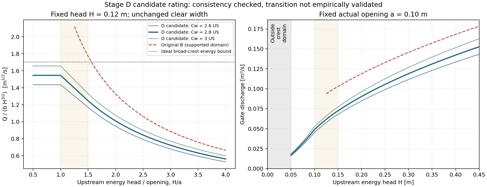

# Stage D hydraulic revision: candidate tested, G5 not resolved

The original Stage B September 2022 model remains reproducible. Its three
reference trajectories were rerun with the official `ode4u`; saved states,
outputs and inputs agree exactly on the original grid. A/B/C and earlier D
studies remain unchanged. This directory contains a separate, opt-in hydraulic
candidate and its actual tests, including failed pilot runs. No full HW D.2
Monte Carlo analysis, control optimization, commit or push was performed.

**Decision: do not use this candidate for full uncertainty propagation yet.**
The old transition gap is replaced by a continuous, energy-bounded engineering
approximation, but the complete pilot does not pass. Neither consistency tests
nor an empirical source for a component equation validate the assumed combined
rating. The candidate is not an accepted replacement for Stage B.

## Findings

1. The reported discrepancy is confirmed: the original free-gate equation at
   `H/a = 1.25` exceeds the ideal capacity of the proposed same-width,
   hydrostatic broad crest by **24.707658%**. Head is measured above the sill;
   the SI conversion and dimensional coefficients are explicitly checked.
   This is a conditional geometry/energy inconsistency, not a claim that the
   accepted historical B calculations were changed or failed to reproduce.
2. The D candidate retains the jet-depth energy term and uses the USBR
   relative-opening contraction relation. Its transition is an explicitly
   assumed normalized endpoint interpolation over `1 < H/a < 1.5`, **not an
   equation prescribed or calibrated by HEC-RAS**. The original gate schedules
   and both models' other balances are unchanged.
3. **123 focused checks pass**, including dimensions, discharge continuity,
   energy bounds, nonnegative forward flow, head/opening monotonicity, dry and
   closed behavior, explicit unsupported-domain rejection, unchanged non-gate
   outputs and full-RHS water conservation in both physical models.
4. All three nominal revised deterministic cases complete, but Dam 1 reaches
   **101.225533 m**, exceeding its unchanged **101.200000 m** limit by
   **25.533 mm**. This is a valid simulation with an unsafe result, not a
   numerical failure. Other dam/wetland safety maxima are tabulated separately.
5. All **20 original weather files and seeds** are retained. At each nominal
   grid, each model attempts **16 warm scenarios**, with **0 complete, 16
   hydraulic-applicability interruptions and 4 cold preflight exclusions**.
   The 1 m crest assumption has the explicit approximate broad-crest domain
   `0.05 <= H/Lc <= 0.5`. Every warm run eventually goes below its lower bound.
   No shallow-flow rating is invented to continue those trajectories.
6. For `copula_var_00000` at 120 s, both models first fail at **257520 s**
   (**2022-09-11 23:32 UTC**), Gate 1: H = **0.049940575 m**, actual opening =
   **0.166992 m**, H/a = **0.299060**. The original G5 boundary has been passed;
   the new interruption concerns the crest approximation. The source's
   approximate classification is a conservative model-domain boundary, not a
   physical claim that flow ceases below 0.05 m.
7. The same warm-scenario outcome occurs at **120, 60 and 30 s**, and with
   predeclared customary Cw values **2.6, 2.8 and 3.0**. Deterministic safety is
   coefficient-sensitive: 2.6 and nominal 2.8 exceed Dam 1's limit; 3.0 does not.
   The coefficient was not changed to select a successful result. Failed
   trajectories have no full-event peak or wetland benefit assigned.

The historical B-selected wetland design is merely carried into D. It has not
been reoptimized and is not described as the best design under the new rating.
Lower downstream peaks under the new hydraulics must be considered together
with increased upstream storage and safety violations.

## Evidence and files

- [Geometry, equations, units, primary sources and limitations](geometry_and_method.md)
- [Actual results, comparisons and figure captions](README_results.md)
- [Complete result summary](results/summary.json)
- [Nominal scenario diagnostics, including failures and exclusions](results/nominal/scenario_diagnostics.csv)
- [Hydraulic and full-RHS checks](results/hydraulic_checks.json)
- [Original-model reproduction](results/original_regression/)
- [Nominal simulations](results/nominal/), [lower coefficient](results/low/),
  [upper coefficient](results/high/); completed trajectories are saved as NPZ,
  including unsafe deterministic trajectories. Invalid partial runs are not
  relabeled as complete output.
- `hydraulics.py`: isolated candidate gate rating and explicit applicability
  errors. `model.py`: replace only internal gate transfers using the unchanged
  B non-gate constitutive laws. No additional spillway is created.
- `run_study.py`: official-solver execution using frozen deterministic inputs
  and saved hourly-weather adapter; all RK stages are observed for safety and
  mass identity. `verify.py`: focused consistency checks.
- `report_results.py` and `plot_rating.py`: figures/tables from saved results
  and algebraic ratings, without refitting or generating weather.
- `preservation_before.json`, `preservation.py` and per-suite preservation
  reports: **1,308 protected files** checked without changes.



*The candidate changes the adjoining gate regime as authorized; it is not a
low-head patch that preserves the old high-head discharge. Shaded transition
regions represent an assumed closure, not experimentally validated hydraulics.*

## Reproduction

Use the existing project Python environment and official local multivarious
checkout; no new solver or dependency is introduced. From the project root:

```bash
cd /Users/zhangjiaxuan/Documents/Codex/Modeling
export MPLCONFIGDIR=/private/tmp/cee690-stage-d-revision-matplotlib
python3 -B -m D.gate_hydraulics_revision.verify
python3 -B -m D.gate_hydraulics_revision.run_study run \
  --hydraulics original --suite deterministic --dt 120 --tag replay_original
python3 -B -m D.gate_hydraulics_revision.run_study run \
  --hydraulics revised --suite all --dt 120 60 30 \
  --variant-config D/gate_hydraulics_revision/variant.json --tag replay_nominal
python3 -B -m D.gate_hydraulics_revision.run_study run \
  --hydraulics revised --suite all --dt 120 \
  --variant-config D/gate_hydraulics_revision/variant_low.json --tag replay_low
python3 -B -m D.gate_hydraulics_revision.run_study run \
  --hydraulics revised --suite all --dt 120 \
  --variant-config D/gate_hydraulics_revision/variant_high.json --tag replay_high
python3 -B -m D.gate_hydraulics_revision.plot_rating
python3 -B -m D.gate_hydraulics_revision.report_results
```

Use a fresh tag for repeated executions; existing result directories are not
overwritten. The report command summarizes the delivered `nominal`, `low` and
`high` suites. These executions were actually tested with
`/opt/miniconda3/bin/python3 -B`; a fresh dependency installation was not tested.
The original official `ode4u` revision is
`06d7aed5b541ec7fe26a6dc69be6aa7fb610aa02`; its implementation and source hashes
are retained in the run manifests.

## Remaining evidence needed

A defensible rating is still needed for shallow flow on the specified apron,
including the relevance of friction and the geometry of the gate entrance.
The assumed transition and shared-loss transfer between regimes need a
published applicable rating, laboratory evidence or a suitable hydraulic
calculation for the actual hypothetical geometry. The original 1.5 mm minimum
opening also lacks Reynolds/surface-tension or seal-leakage validation. These
are hydraulic-method limitations, not missing meteorological data.

The present fixed schedules are not robustly safety-feasible under the tested
hydraulic uncertainty. No schedule, initial condition, safety limit or geometry
was adjusted in response. A future study titled **Uncertainty Propagation under
Non-Freezing Meteorological Conditions** can retain the temperature scope, but
that restriction alone does not address these hydraulic limitations.
