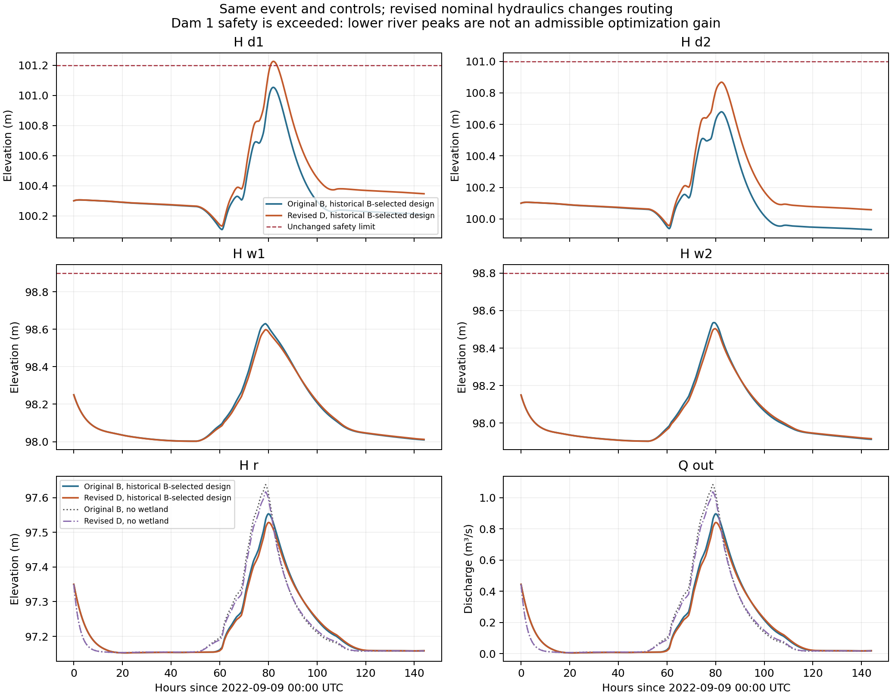
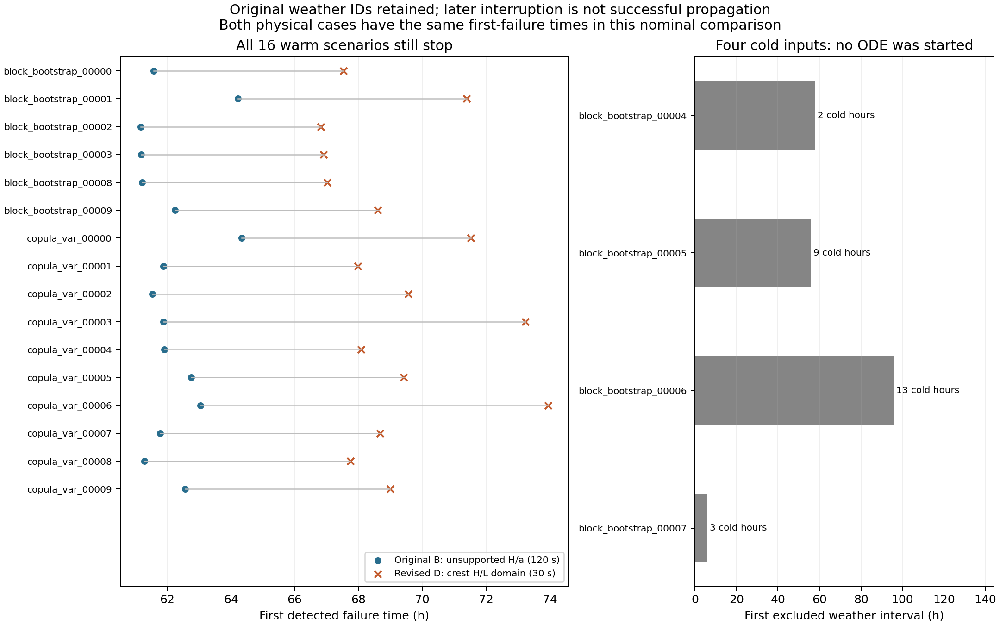
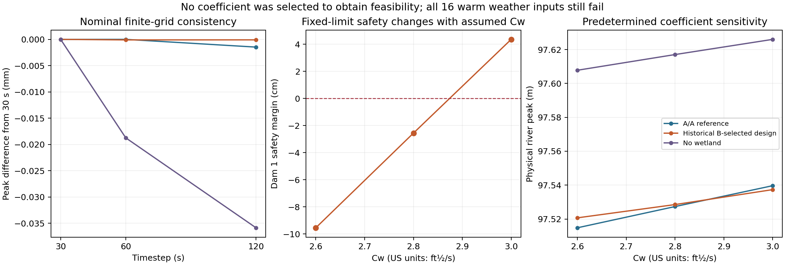

# Stage D revised-hydraulic execution results

This report reads saved execution artifacts only. The revised nominal model is **not ready for D.2 uncertainty propagation**. It completes the original deterministic event, but dam 1 exceeds its unchanged safety limit by approximately 0.025529 m. All 16 original warm weather scenarios still stop in both models, now at the explicit broad-crest head/length applicability boundary. The four cold scenarios remain preflight exclusions.

The implementation and its physical assumptions are described separately in the Stage D hydraulic-method documentation. This report does not validate those assumptions merely because a numerical trajectory completes. No gates, weather histories, initial states, safety limits or other fixed parameters were changed during reporting.

## Original B versus revised D

Nominal coefficient Cw = 2.8 ft½/s (1.54584346 m½/s). The table uses completed 30 s revised runs and the preserved 120 s B reference. Source arrays are compared on exactly aligned original 120 s nodes. Revised native-grid peaks also include finer samples; these are structural-model comparisons, not unchanged-model regression tests.

| Case | Design | Original B river peak (m) | Revised D river peak (m) | Dam 1 margin (m) | Safety feasible |
| --- | --- | --- | --- | --- | --- |
| wetland | A/A reference wetlands | 97.558442 | 97.527346 | -0.025529251 | False |
| wetland | Historical B-selected wetland design | 97.553429 | 97.52852 | -0.025529251 | False |
| no_wetland | No wetland | 97.637745 | 97.617081 | -0.025529251 | False |

The unchanged original implementation was separately rerun in [original_regression](results/original_regression/); its exact regression results must be distinguished from the revised trajectories. A reduced river peak under a dam-safety violation is not an admissible optimization gain. No Stage D optimization was performed, and the saved B/B label means the design selected under Stage B physics, not an optimum under the revised hydraulics.

*Same event, gates, physical initial states and saved wetland design. The revised nominal curves complete numerically but exceed dam 1's unchanged safety limit. The figure uses 30 s D output and preserved 120 s B output; it does not imply calibration.*

[Deterministic comparison](tables/deterministic_comparison.csv) records all coefficients/resolutions, source hashes, river/outlet peaks and safety margins. [Wetland contrasts](tables/wetland_contrasts.csv) reports no-wetland minus wetland peaks under identical controls. Those structural contrasts retain the extra 5,500 m³ initial wetland water and flag unsafe pairs explicitly; they are not new optimization benefits.

## Every original weather scenario

Each resolution evaluates all 20 original IDs in each physical model: 16 warm trajectories are attempted and four cold inputs are excluded before ODE entry. At each nominal resolution, **0/16 attempted warm scenario pairs complete**. The four cold scenarios are separately retained as preflight exclusions, accounting for all 20 original IDs. The low and high coefficient sensitivity runs at 120 s also have zero complete warm pairs. No invalid trajectory receives a complete-event peak, discharge or safety result.

For `copula_var_00000`, the nominal 30 s wetland run first fails at 257490 s (71.525000 h), with H = 0.049993565 m, a = 0.166914000 m, and H/a = 0.299517. The actual reason is `broad_crest_head_length_outside_supported_range`. With the declared 1 m crest, H/L falls below 0.05. This is a bounded physical applicability exclusion, not an ODE numerical failure and not the old H/a >= 1.25 rejection. The old G5 residual remains descriptive only.

[All-scenario first failures](tables/all20_first_failures.csv) retains every case, coefficient and timestep; original seeds/weather hashes; UTC and elapsed first-failure time; H, a, H/a, tailwater; the new physical residual; and the historical 120 s G5 failure time. Later interruption does not count as successful uncertainty propagation. Cold rows identify the first excluded weather interval rather than an ODE failure time. No precipitation/temperature was clipped, no weather was regenerated, and no scenario was excluded for flood magnitude or negative wetland benefit.

*All 20 original IDs remain visible. Warm-scenario points show first evaluated failing RK states, not exact continuous-time crossings. The nominal 30 s and original 120 s failures correspond to different physical applicability rules. Cold inputs are shown separately because their ODEs never start.*

## Resolution and coefficient sensitivity

The original weather and forcing conventions are unchanged: stochastic rain/radiation remain constant within each saved hour with official solver restarts at hourly boundaries; deterministic weather retains its original linear knots. All nominal outcomes agree across 120, 60 and 30 s. The largest complete deterministic 60-to-30 s common-grid river difference is 9.68943e-09 m; the corresponding largest difference over all reported stages is 2.00639e-08 m. The largest native-grid river-peak difference is 1.87425e-05 m (0.0187425 mm): the finer output grid samples a peak between coarser nodes, so this need not equal the common-grid error. The maximum change in first-failure detection time is 30 s from 120 to 60 s, and 15 s from 60 to 30 s. No full-trajectory convergence claim is made for interrupted weather runs.

| Sensitivity member | Cw (ft½/s) | Safe deterministic cases / 3 | Complete warm cases / 32 | Cold IDs retained |
| --- | --- | --- | --- | --- |
| low | 2.6 | 0 | 0 | 4 |
| nominal | 2.8 | 0 | 0 | 4 |
| high | 3 | 3 | 0 | 4 |

The coefficient values were declared before these runs; the high value is not selected or recalibrated to obtain safety. Even though its deterministic cases meet the modeled limits, all 16 warm weather scenarios still fail the crest-domain check. [Resolution comparisons](tables/numerical_resolution.csv) separate complete common-grid errors from failure-time changes. [Coefficient summary](tables/coefficient_sensitivity_summary.csv) records actual outcomes without inventing peaks for invalid runs.

*Left: finite-grid changes in deterministic physical river peaks. Center: dam 1 margin relative to its unchanged limit. Right: actual deterministic river peaks for the predetermined coefficient set. Nominal and low cases are unsafe; the high case is only a sensitivity member, and it does not repair stochastic applicability.*

## Conservation, safety and provenance

The largest relative cumulative water-balance residual among the 15 completed revised trajectories is 1.04769e-06, below the unchanged 1e-4 diagnostic tolerance. The largest successful-RHS mass-identity error is 1.33227e-15 m³/s. These checks concern numerical accounting, not empirical validation. Internal transfers cancel once; wetland drainage/overflow remain, and no independent dam spillway or state cap is introduced.

[Safety constraints](tables/safety_constraints.csv) include both dam limits and, where present, both wetland limits at every successful RHS/RK evaluation. Incomplete trajectories report observed partial-window maxima only; their full-event safety remains unknown. [Source hashes](tables/source_hashes.csv) compare recorded dependencies with current files. Each execution plan retains the original settings, seed sequence, time window and weather hashes. The preservation manifest protects A/B/C and previous D studies.

The **formal revised matrix contains 215 case evaluations**: nominal 3 resolutions × 43 cases plus two coefficient sensitivities × 43 cases. This denominator excludes 4 initial smoke-case evaluations and 3 original-B deterministic controls, which are retained separately. The repeated resolutions, coefficients and controls are not independent weather draws. There are exactly 20 original weather scenarios. No Monte Carlo probability, failure probability, polynomial response sensitivity fit or globally feasible design is inferred. A physical treatment covering the encountered crest-domain states, with its geometry and validity justified, remains necessary before bounded D.2 propagation can proceed.
