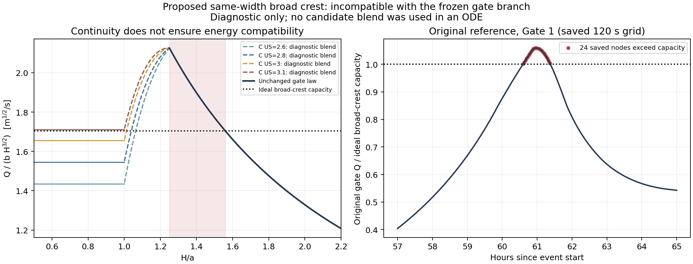

# Stage D: broad-crested gate extension feasibility

**Decision: the proposed extension cannot be implemented consistently while preserving the old gate equation at every H/a >= 1.25.** This is a new, quantitative compatibility finding, not a repetition of the former missing-geometry objection. Hypothetical geometry is now explicitly permitted and has been specified for the check. No revised hydraulic model or warm-scenario pilot is claimed complete.

The original deterministic cases were freshly rerun and reproduce Stage B exactly. All original A/B/C files, the original schedules, and the completed G5 diagnostic study remain unchanged. New work is confined to this directory. No optimization, full Monte Carlo study, commit or push was performed.

## 1. Explicit hypothetical geometry

The proposed passage is a rectangular vertical-lift gate at the upstream end of a horizontal, open rectangular broad sill/apron, followed by discharge toward the associated wetland or river. It is part of the existing gate route, never a second dam spillway.

| Item | Gate 1 | Gate 2 | Origin |
|---|---:|---:|---|
| Clear transverse width b | 1.00 m | 0.80 m | Original B geometry |
| Sill elevation | 100.00 m | 99.80 m | Original B, assumed datum |
| Maximum opening | 0.30 m | 0.30 m | Original B; actual a = maximum opening × g(t) |
| Streamwise flat crest length Lc | 1.00 m | 1.00 m | Explicit hypothetical audit dimension; not a local measurement |
| Effective flow width | 1.00 m | 0.80 m | Parallel vertical walls; no end-contraction deduction |
| Free / submerged orifice coefficients | 0.60 / 0.80 | 0.60 / 0.80 | Original dimensionless orifice coefficients; separate transition already exists |

The crest has a flat rectangular profile and a square upstream edge. There is no ogee profile, suction credit, lower hidden control section, wider parallel opening or energy source. Entrance, contraction and friction losses cannot add energy. The ideal no-loss calculation is deliberately favorable to feasibility; introducing real losses cannot cure the identified excess under this hydrostatic geometry.

This 1 m length is a transparent screening choice, not a fitted dimension. The [USBR classification guidance](https://www.usbr.gov/tsc/techreferences/mands/wmm/chap07_03.html) associates broad-crested flow approximately with 0.05 <= H/Lc <= 0.5. For the proposed crest this covers H = 0.05–0.50 m, including H up to 0.375 m at the requested switch with the maximum 0.30 m opening. No fixed positive crest length satisfies that range as H approaches zero. A future model must qualify very shallow friction-dominated flow; a mathematical limit Q -> 0 is not empirical validation of its rating.

The original assumption H = dam-pool water level minus sill is retained as total upstream energy head. Pool approach velocity is neglected; no additional velocity/pressure head is silently supplied. The geometry and its assumptions are machine-readable in [geometry_proposal.json](geometry_proposal.json). This candidate has **not** been accepted for dynamic simulation or represented as observed Milwaukee infrastructure.

## 2. Coefficients, units and primary references

The primary methodology is the [USACE HEC-RAS gated-flow reference](https://www.hec.usace.army.mil/confluence/rasdocs/ras1dtechref/7.0/modeling-gated-spillways-weirs-and-drop-structures/hydraulic-computations-through-gated-spillways), starting from [B's original hydraulic record](../../B/docs/07_gate_hydraulics.md). USACE describes weir flow, transition over H/a = 1–1.25, and gate/orifice flow. Its general transition description does not certify an independently chosen geometry/coefficient combination.

For free weir flow, Q = Cw b H^(3/2). The [USACE crest-coefficient table](https://www.hec.usace.army.mil/confluence/rasdocs/ras1dtechref/7.0/modeling-gated-spillways-weirs-and-drop-structures/uncontrolled-overflow-weirs) gives a broad-crested customary range 2.6–3.1. Its [high-flow guidance](https://www.hec.usace.army.mil/confluence/rasdocs/ras1dtechref/7.0/modeling-bridges/hydraulic-computations-through-the-bridge/high-flow-computations) corroborates the metric convention with broad-crest examples. Those examples provide a coefficient-range analogue, not a locally calibrated gate rating or permission to add an overflow path.

Cw is dimensional: m^(1/2)/s in SI, versus ft^(1/2)/s in customary units. Because 1 ft = 0.3048 m,

    Cw_SI = Cw_US sqrt(0.3048).

| Screening Cw, customary | Converted SI Cw (m^(1/2)/s) | Use |
|---:|---:|---|
| 2.6 | 1.435426069 | Lower published-envelope diagnostic |
| 2.8 | 1.545843459 | Interior diagnostic |
| 3.0 | 1.656260849 | Interior diagnostic |
| 3.1 | 1.711469544 | Rounded published upper-envelope diagnostic, not adopted |

No nominal Cw was selected for an ODE. The rounded 3.1 value lies slightly above the exact ideal coefficient for the stricter uniform hydrostatic assumptions below; it is retained visibly as a source-envelope check, not quietly adopted as a loss-free rating. The dimensionless gate Cd = 0.60 cannot be substituted for Cw. No coefficient was selected using simulation completion, feasibility or wetland benefit.

The [USBR rectangular broad-crest derivation](https://www.usbr.gov/tsc/techreferences/mands/wmm/chap02_13.html) supplies the independent specific-energy/critical-flow check. Further source qualifications are in [source_review.md](source_review.md).

## 3. Exact compatibility failure

For discharge per unit width q = Q/b at a hydrostatic rectangular crest section of depth y,

    E(y) = y + q²/(2 g y²).

With upstream total energy H, no energy gain and nonnegative losses, E(y) cannot exceed the available H. The minimum specific energy occurs at critical flow. Equivalently, maximizing discharge at fixed H gives y = 2H/3 and

    Q <= Qcritical = b sqrt(g) (2H/3)^(3/2)
                  = 1.704603788 b H^(3/2),  g = 9.80665 m/s².

The retained Stage B free-sluice branch is

    Qold = 0.60 b a sqrt(2 g H).

Writing r = H/a, its effective coefficient is C_old(r) = 0.60 sqrt(2g)/r. At the required r = 1.25 endpoint,

    Qold = 2.125771465 b H^(3/2)
         = 1.247076581 Qcritical.

The endpoint exceeds the ideal capacity by **24.707658%**. The inconsistency persists over **1.25 <= H/a < 1.558845727**, so it cannot be removed by a floating-point tolerance or an interpolation confined to 1 < H/a < 1.25.

For example, b = 1 m, a = 0.10 m and H = 0.125 m give Qold = 0.093946714 m³/s versus ideal capacity 0.075333556 m³/s. Gate 2 has the same relative conflict because both quantities scale with its width.

This result is conditional on a same-width, same-sill, hydrostatic rectangular broad crest with the retained energy convention. It is **not** a claim that all sluice geometries or the original computational model universally violate conservation. A short/ogee crest, nonhydrostatic jet or materially different passage needs a separate derivation and is not interchangeable with this specification.

### Why direct interpolation is not a correction

For diagnostic purposes only, the later USACE overview's direct-flow-transition description was evaluated as

    w = (H/a - 1)/0.25,
    Qprobe = (1-w) Cw b H^(3/2) + w Qold,   1 < H/a < 1.25.

This curve is algebraically continuous at both endpoints. It nevertheless reaches the same physically incompatible r = 1.25 value for every tested Cw. At fixed H, opening the gate from a = 0.8H to a = H would reduce predicted discharge by about 19.5%–32.5% over the screened coefficient range. That behavior further warns against interpreting this blended rating as the selected passive broad-crest passage. A smooth curve is not sufficient physical justification.

[Coefficient sensitivity](results/coefficient_sensitivity.csv) records all four screens. None passes the compatibility test. These are algebraic coefficient tests, **not** simulated completion, safety, or wetland-benefit sensitivity results. The probe has not been connected to either ODE. A cap, a wider transition interval or a changed Cd would alter the explicitly frozen high-head branch and therefore has not been silently applied.



*Left: dimensional effective coefficients of the proposed diagnostic transitions and unchanged high-head law. The red band is where the old branch exceeds the ideal broad-crest bound. Right: the same conditional test applied to saved original reference Gate 1 outputs. Neither panel is a corrected simulation.*

## 4. The conflict also affects the preserved reference

The saved Stage B reference, saved best wetland design, and six-state no-wetland case were checked at all 4,321 original output nodes. Their gate-release histories are identical in the relevant interval.

| Saved case | Gate 1 nodes exceeding candidate broad-crest capacity | Maximum excess | Gate 2 exceeding nodes |
|---|---:|---:|---:|
| A/A wetland reference | 24 | 5.888534% | 0 |
| B/B wetland design | 24 | 5.888534% | 0 |
| Six-state no wetland | 24 | 5.888534% | 0 |

The Gate 1 interval is 218,160–220,920 s. At the maximum ratio, t = 219,480 s, H = 0.1090858705 m, a = 0.0740993333 m and H/a = 1.4721572459. Qold = 0.06503170455 m³/s, while the ideal capacity is 0.06141524682 m³/s. H/Lc is about 0.109 for the proposed 1 m crest, inside the nominal broad-crest classification range. This is not an extrapolation of that range to a very large head.

The [saved-reference capacity table](results/saved_reference_capacity.csv) records all six case/branch checks. The [Gate 1 series](results/reference_gate1_capacity_timeseries.csv) supports the figure. These comparisons do not overwrite or reinterpret historical B as having this new crest. They show why assigning the new geometry and simultaneously requiring unchanged outputs is not automatically justified.

## 5. Fresh original regression and checks

The original accepted A/A reference, B/B wetland design and six-state no-wetland case were **freshly rerun at 120 s**, with the original fixed gates, forcing, states, parameters and official ode4u. All three completed, passed their existing safety and mass-balance checks, and reproduced their saved arrays exactly. Wetland historical files lack saved derivative arrays; no derivative-array regression is claimed for those two files. The no-wetland derivative comparison is available and exact.

| Original case | Physical river maximum (m) |
|---|---:|
| A/A reference | 97.5584415143834 |
| B/B design | 97.55342909286543 |
| No wetland | 97.63774482150569 |

[Fresh regression records](results/original_regression.json) and the individual case JSONs also report peak downstream discharge, all successful-RK safety maxima, mass balance and the unchanged source hashes. These are original-model results, not validation of a new geometry.

[Audit checks](results/audit_checks.json) contain 38 passing diagnostic-code regression checks. They verify SI conversion, critical-flow algebra, dimensional scaling, original behavior at H/a = 0.5, 1, 1.125, 1.25, 1.5 and above, and closed/dry/negative/equal/adverse head. Original low-head exceptions remain expected. The nominal interpolation continuity check passes, while physical compatibility fails. Passing the diagnostic code tests does not mean a low-head model exists or has passed.

The [previous complete G5 diagnostic report](../g5_diagnostics/README.md) retains both-model conservation checks and 120/60/30 s numerical checks. No new geometry integration or refinement is claimed. The original approximately 0.501% free/submerged transition jump at submergence 0.67 also remains unchanged; exact preservation does not establish global discharge continuity.

## 6. Weather accounting and bounded future scope

All original 20 weather-file hashes and seed records were verified. The 16 warm scenarios are `copula_var_00000`–`00009` and `block_bootstrap_00000`–`00003`, `00008`, `00009`. The four cold scenarios remain `block_bootstrap_00004`–`00007`.

[Scenario accounting](results/original_scenario_accounting.csv) contains both model cases for every original scenario. It identifies the original G5 interruption or cold exclusion and explicitly marks:

- Warm cases: **new variant not run — physical compatibility blocker**.
- Cold cases: **new variant not run — outside current liquid-water temperature domain**.

There are no new warm-scenario trajectories, safety results, downstream peaks or benefit estimates. Their fields remain missing, never zero. Original G5 logs remain available under `D/g5_diagnostics`; no weather was regenerated, clipped or selectively altered.

A later analysis may use the title **Uncertainty Propagation under Non-Freezing Meteorological Conditions**. Its population must then be explicitly conditioned on the declared non-freezing screen, rather than discarding cold outcomes after simulation. The current saved screen is all hourly air temperatures strictly greater than 0°C; this is a model-applicability convention, not proof that soil/water never freezes. The present subset has 16 of 20 weather scenarios. Its results, once validly produced, would not describe an unconditional annual weather distribution.

Wetland tailwater in safety-feasible eight-state trajectories is below the two sills (98.90 < 100.00 m and 98.80 < 99.80 m). The six-state river validity ceiling of 99.00 m is also below both sills. Thus low-head submergence is not the identified obstacle for those admissible states. A future variant must nevertheless explicitly reject or model any drowned-crest state outside its demonstrated domain; no submergence factor is invented here.

## 7. Required scope decision

| Requirement retained together | Outcome |
|---|---|
| Same clear widths and sills; negligible approach head; genuine broad-crest hydrostatic control | Establishes the energy/capacity test |
| Exact old free-gate equation for every H/a >= 1.25 | Conflicts with that test near the boundary, including saved reference states |
| Continuous low-head transition ending at that old value | Cannot remove the conflicting endpoint |
| Successful full pilot and safety verification before D.2 | Not yet achievable with a justified new law under these simultaneous requirements |

A practical next decision is to **allow Stage D alone to revise the overlapping gate-law approximation and transition range after a geometry-consistent derivation**, while preserving every original B file and result and keeping the same schedules/physical comparisons. Necessary bounds from this audit, not adopted settings, are Cd <= 0.481125224 at r = 1.25, or r >= 1.558845727 for Cd = 0.60 under the ideal capacity bound. Practical losses can require more restrictive values. These bounds are not a completed replacement law or recommended tuned coefficients.

Alternatively, a materially different gate/control geometry and energy convention would need separate substantiation. Broadening a crest while retaining a narrower control section, silently lowering a sill, adding hidden energy or selecting Cw to force a match is not a valid shortcut.

**Readiness for bounded HW D.2: not established.** The required hydraulic extension and warm-scenario safety pilot remain pending this decision. The physical incompatibility is reported at Step 2 as requested; no fabricated correction, independent spillway or full Monte Carlo propagation was introduced.

## Reproduce this check

From the project root, using the already tested local Python environment and original official solver checkout:

```bash
cd /Users/zhangjiaxuan/Documents/Codex/Modeling
/opt/miniconda3/bin/python3 -B D/low_head_feasibility/audit.py
```

This performs algebraic screens, reads saved trajectories/weather, freshly reruns only the three original deterministic cases, and rewrites this directory's diagnostic results/figure. It does not rerun the stochastic ODEs, generate weather, optimize, or activate a new hydraulic variant. The exact source/configuration preservation check is [preservation_check.json](preservation_check.json).
