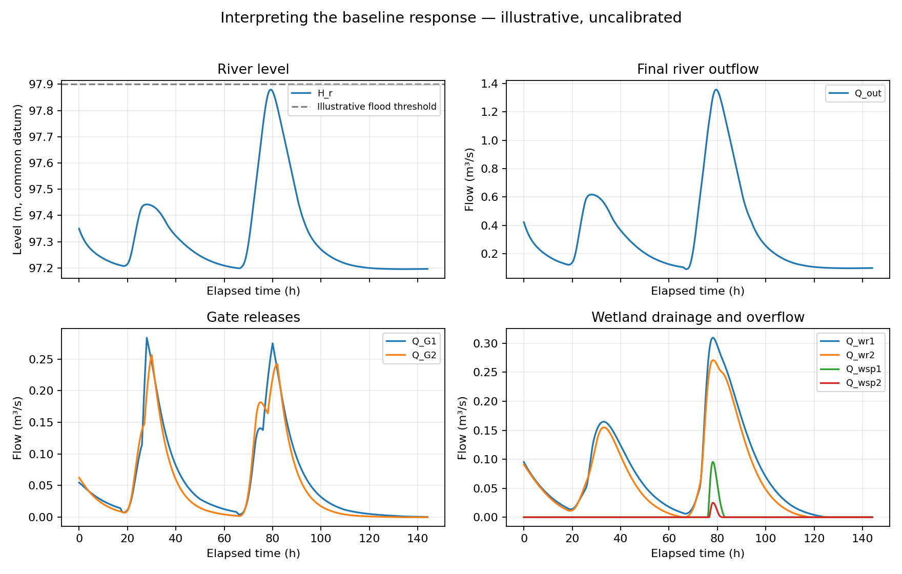
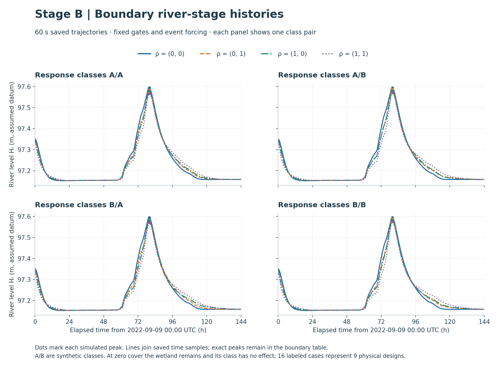

# Wetland Restoration and Flood Mitigation

**CEE690 — Systems Modeling for Climate Response, Duke University**

**Jiaxuan Zhang**

This project develops a dynamic water-storage model and uses it to study how wetland design changes a downstream river peak. Stage A establishes the initial eight-state model and a synthetic baseline. Stage B uses regional September 2022 event weather to drive a hypothetical engineered installation, optimizes wetland designs under fixed gate operations, and compares the wetland cases with a separate dynamic bypass case. Stage C retains meteorological data preparation, statistical fitting and weather diagnostic figures/tables for the HW C.2 scope. The official FIT/mimo_srs conditional-response application has now run with isolated causal data alignment and external 2024 evaluation; its results and limitations are reported on the Stage C page.

This page presents the model, data, method and main results. The stage pages contain the full explanations, parameter sources, figures and execution instructions. All scientific results are uncalibrated simulations; they do not establish observed flood reductions or engineering certification.

| Stage | Confirmed work | Detailed page |
|---|---|---|
| A | Initial eight-state model, algebraic relationships and synthetic baseline | [A — Model, data and baseline](A/README.md) |
| B | Fixed-gate wetland optimization, no-wetland comparison and design-bound verification | [B — Data, optimization and results](B/README.md) |
| C | Meteorological fitting; official FIT/mimo_srs one-step response, external 2024 evaluation and figures/tables | [C — Weather fitting and diagnostics](C/README.md) |
| D | Reserved; no confirmed analysis or results yet | [D](D/README.md) |

## The modeled system

The eight water-storage states are upland surface water, upland soil water, two wetlands, two dam pools, groundwater and a river reach. Storage is measured in m³, flow in m³/s, time in seconds and water level in metres in an assumed common datum.

The accepted B routing is:

```text
Upland -> Dam pool 1 -> Gate 1 -> Wetland 1 -> River -> Outlet
       -> Dam pool 2 -> Gate 2 -> Wetland 2 -> River
       -> Direct upland-to-river runoff
       -> Soil -> Groundwater -> River / external groundwater boundary
```

Both wetlands retain normal drainage, overflow, seepage and evaporation. B has no independent dam-spillway route. If a pool exceeds its fixed allowable level, the design is infeasible; water is not clipped or removed. A retains its original illustrative dam-spillway formulation. Its baseline is not compared against a differently formulated B optimized case.

| Role | Stage A | Accepted Stage B |
|---|---|---|
| Gate operations | Prescribed synthetic schedules | One prescribed, hydraulically admissible schedule; held fixed in all wetland comparisons |
| Wetland designs | Fixed response classes and cover | Two covers optimized; four synthetic response-class pairs enumerated |
| External disturbances | Synthetic rain, weather, inflow, boundary heads and blockage | Regional observed-event weather, gridded radiation and explicitly assumed boundaries |
| Purpose | Demonstrate the dynamic model and inspect its behavior | Compare wetland designs under controlled operating conditions |

The [A equations and parameter record](A/model_notes.md) and [B assumptions and complete active parameter provenance](B/data_sources_and_assumptions.md) explain the distinctions.

## A: initial model and synthetic baseline

A uses an assumed 660,000 m² rainfall footprint, six days of synthetic inputs and a 120 s integration step. Two triangular rain pulses have peaks of 15 and 20 mm/h and durations of 8 and 10 hours, respectively; their combined depth is 160 mm. These are designed test inputs, not Milwaukee observations. Geometry, soil, drainage and vegetation values are explicit illustrative assumptions. Each value, formula and source is listed in the [A parameter and forcing tables](A/model_notes.md#complete-numerical-provenance-for-the-accepted-a-example).

The baseline physical river peak is **97.879407 m** and the peak outlet discharge is **1.357896 m³/s**, from the existing simulation summarized in [A/model_notes.md](A/model_notes.md#recorded-baseline-results-and-calculation-lineage). Figures A–G inspect algebraic laws; H–J show the baseline storage, response and input histories. A is not an optimization or a calibrated flood prediction.



## B: geographic context and input data

B uses **2022-09-09 00:00 to 2022-09-15 00:00 UTC**, a 144-hour event window, for the same **hypothetical 0.66 km² installation**. The Underwood Creek gauge catchment is about **46.879 km²**, not the installation footprint. The facilities are not surveyed or located on a fabricated site polygon. Observed gauge elevations in NAVD88 are not mixed with the model's assumed elevation datum.

| Datum or input | Adopted value or coverage | Actual origin and use |
|---|---|---|
| Regional rainfall | 145.3 mm quantified event depth | NOAA ISD, KMKE station **72640014839**, `AA1–AA4` accumulation fields; spatial proxy, with five event trace intervals assigned a disclosed zero lower bound. [Exact requests and processing](B/docs/05_weather_observations.md) |
| Temperature and wind | KMWC event histories; 262 meteorological observations, maximum accepted interpolation gap 70 min | NOAA ISD station **72640594869**, `TMP` and `WND`; regional observations transferred to the hypothetical installation. [Fields, coverage and limits](B/docs/05_weather_observations.md) |
| Fixed relative humidity | 0.7084916611553665 | Derived event-time mean using KMWC temperature/dewpoint; a fixed approximation, not a direct soil or vegetation observation. [Derivation](B/docs/05_weather_observations.md) |
| Fixed pressure | 98,692.51171875 Pa | Event-time mean of KMWC `MA1` station pressure, not sea-level pressure. [Derivation](B/docs/05_weather_observations.md) |
| Shortwave radiation | 21,166.81 Wh/m² event energy | NASA POWER `ALLSKY_SFC_SW_DWN`, returned SYN1DEG product; gridded estimate, not a local radiation instrument. [Exact request and timing assumption](B/docs/05_weather_observations.md) |
| Observed stream context | USGS **04087088**; event peak discharge 28.2036 m³/s | Approved agency time series; contextual evidence only, never inserted as external inflow or fitted outlet target. [USGS query, dates and datum](B/docs/04_usgs_observations.md) |
| Geometry, initial water and boundaries | Assumed geometry and initial storages; `Q_ext=0`, `h_d=h_g=97.15 m`, blockage=0 | Explicit engineering/study assumptions. [Every active value and rationale](B/data_sources_and_assumptions.md#active-parameter-provenance) |
| Vegetation response | Synthetic A/B resistance and ET classes; cover in [0,1] | Assumed response endpoints, not measured species properties. [Mappings and numerical values](B/data_sources_and_assumptions.md#synthetic-vegetation-parameters-and-cover-bounds) |

The original data providers are [NOAA ISD](https://www.ncei.noaa.gov/products/land-based-station/integrated-surface-database), [NASA POWER](https://power.larc.nasa.gov/docs/services/api/temporal/hourly/) and [USGS 04087088](https://waterdata.usgs.gov/monitoring-location/USGS-04087088/). The linked project records give the actual station IDs, variables, query dates, transformations, checksums and limitations; a general provider citation alone is not treated as evidence for every model coefficient.

Missing or unsuitable local evidence remains disclosed. No local facility survey, September 2022 soil-storage reconstruction, connected shallow-groundwater series, observed outlet blockage or measured vegetation response was obtained. MMSD's tested historical response was unsuitable and was excluded. The [data availability table](B/tables/data_availability.csv) distinguishes data used, contextual records and remaining assumptions.

## B: optimization and fixed comparison

The accepted wetland-focused problem is:

```text
D1 = (class1, cover1), D2 = (class2, cover2)
Continuous optimizer vector: [cover1, cover2], each in [0,1]
Enumerated class pairs: A/A, A/B, B/A, B/B
Objective: minimize the maximum physical river stage over the event
Fixed: both gate histories, weather, geometry, initial water and physical limits
```

A/A means class A in wetland 1 and class A in wetland 2; it is unrelated to project stage A. A and B are synthetic hydraulic/ET response classes, not plant species. Zero cover retains the wetland compartment. Actual wetland absence is modeled separately by the six-state bypass.

The official [multivarious implementation](https://github.com/hpgavin/multivarious/tree/06d7aed5b541ec7fe26a6dc69be6aa7fb610aa02) supplies `ode4u` and `nms`. Four class pairs and three initial cover guesses produced 12 searches: seven converged and five reached their evaluation budget. The objective is physical peak level; penalty scores are not reported as water levels. [Search values and termination](B/tables/wetland_only/optimization_summary.csv)

Pool limits are **101.20/101.00 m** and wetland limits **98.90/98.80 m**, all explicit hypothetical design limits. They were not relaxed during the search. The G5 head/opening restriction remains a hydraulic applicability check for the fixed gates, outside the wetland-only optimizer's 18 residuals. Gate dimensions, coefficients and these limits have [separate source/assumption entries](B/data_sources_and_assumptions.md#fixed-design-limits-and-gate-applicability).

| Completed case, checked at 30 s | Design | Physical river peak (m) | Peak time after start (h) | Bypass peak minus case peak (mm) |
|---|---|---:|---:|---:|
| No-wetland dynamic bypass | Six states; gates discharge directly to river | 97.637815093 | 78.850000 | 0 |
| Reference wetlands | A/A; covers 0.65 / 0.60 | 97.558442514 | 80.041667 | 79.372579 |
| Best-found wetlands | B/B; covers 0.2714117624 / 0.2141279193 | 97.553430505 | 80.050000 | 84.384588 |

**Source:** [actual comparison CSV](B/tables/wetland_counterfactual/comparison.csv), rows with `timestep_s=30` and primary `case_id` values `bypass`, `reference`, `best`. These are simulated outputs, not field observations. Full cover precision is retained in the [search table](B/tables/wetland_only/optimization_summary.csv).

The reference-to-best wetland-design improvement is **5.012009 mm**. The 79.372579/84.384588 mm bypass differences are a separate structural comparison, not additional optimizer gains. The wetland cases initially contain 5,500 m³ more water; the documented zero-initial-wetland sensitivity changes their peaks by about 0.2875/0.2217 mm. The [complete comparison](B/docs/13_no_wetland_counterfactual.md) explains this initialization difference and the adopted bypass rainfall accounting.


## Why the modeled peak changes

With the same gate releases, total normal wetland drainage increases from **57,041.508 to 59,587.321 m³**, while wetland overflow decreases from **2,194.918 to 235.449 m³**. Peak wetland storages change from **8,226.768/6,984.349 to 7,558.433/6,358.098 m³**. These values are read from the two 30 s rows of [mechanism_metrics.csv](B/tables/wetland_only/mechanism_metrics.csv).

The smaller river peak accompanies a change in drainage/overflow timing and concentration. It does not require larger maximum wetland storage, and it does not imply lower total outlet volume. Storage, drainage, seepage and ET are coupled in these synthetic response classes. The [wetland optimization report](B/docs/12_wetland_only_optimization.md) separates those mechanisms and reports the constraint margins.


## Verification and interpretation

The reference, best design and bypass were checked at 120, 60 and 30 s with the same forcing and fixed gate functions. Their actual peak, balance and feasibility values are in the [comparison table](B/tables/wetland_counterfactual/comparison.md). These are numerical checks, not physical validation or a proof of global optimality.

The direct `analysis(v,c)` check evaluates every cover corner `(0,0), (0,1), (1,0), (1,1)` for every synthetic class pair at 120 and 60 s: **32 completed valid, feasible simulations**. Their largest change in sampled peak between grids is **0.010340 mm**. The [boundary table](B/tables/analysis_checks/boundary_checks.md) records each value. Endpoint checks do not establish feasibility everywhere inside the design box.



The other two line figures show [upstream safety/G5 headroom](B/plots/analysis_checks/02_boundary_safety_margins.png) and [time-aligned numerical differences/water balance](B/plots/analysis_checks/03_boundary_numerical_checks.png). Their horizontal axis is actual simulation time, not an arbitrary ordering of categories. [Full boundary-check method](B/docs/analysis_and_boundary_checks.md)

The event captures the simulated peaks, but some water remains stored and the river rises slightly at the endpoint. Results are conditional on this finite event, hypothetical geometry, assumed initial states and reduced hydraulic/ET laws. Neither the optimized cover nor a synthetic class is a Milwaukee planting recommendation.

## Project folders

```text
Modeling/
├── README.md
├── .gitignore
├── A/
│   ├── README.md
│   ├── wetland_flood_model.py
│   ├── algebraic_plots.py
│   ├── model_notes.md
│   ├── requirements.txt
│   ├── plots/          A–J figures
│   ├── results/        Local baseline arrays and diagnostics
│   ├── reference/      Local course and model-reference material
│   └── work/           Shared official multivarious checkout
├── B/
│   ├── README.md
│   ├── *.py            Models, study drivers, reporting and checks
│   ├── *.json          Study configurations and source catalog
│   ├── data_sources_and_assumptions.md
│   ├── docs/           Detailed scientific reports
│   ├── plots/          Figures grouped by study
│   ├── tables/         Tables grouped by study
│   ├── results/        Local trajectories and numerical records
│   └── work/           Local observations, processing and provenance
├── C/
│   ├── README.md
│   ├── run_fitting.py  Weather preparation, fitting and validation entry point
│   ├── configs/       Fitting-only configuration
│   ├── uncertainty/   Existing weather statistics modules
│   ├── docs/          Sources, statistical methods and execution status
│   ├── tests/         Retained data/fitting tests
│   ├── data/          Local source data, QC and fitted parameters
│   ├── results/       Local weather-validation records
│   ├── plots/         Weather diagnostic figures
│   └── tables/        Weather diagnostic tables
└── D/
    └── README.md
```

A and B are the physical stage folders, without assignment-number subfolders. Within B, names such as `wetland_only` and `wetland_counterfactual` identify different analyses. Wetland response labels A/A and B/B describe the two synthetic wetland classes; they do not subdivide the project stages.

## Running the project and locating every source

Run commands from the repository root. The [A environment guide](A/README.md#install-and-run) gives the exact dependency revision and installation status. Algebraic A plots require NumPy and Matplotlib; dynamic calculations additionally use the official solver. The existing local environment and official checkout were tested; a fresh installation is not claimed to have been tested.

```sh
python -m A.algebraic_plots       # A–G algebraic figures
python -m A.wetland_flood_model  # Stage A baseline; official ode4u required
```

B report commands require the already-completed local results:

```sh
python3 -B -m B.wetland_only_study --report
python3 -B -m B.wetland_counterfactual --report
python3 -B -m B.wetland_analysis_checks --report
```

These regenerate figures/tables from saved local records. A fresh GitHub clone does not contain the prepared event forcing, frozen schedule NPZ, source locks or completed arrays and therefore cannot immediately rerun all B workflows. Exact public source queries and provenance are documented; they are not a substitute for the excluded local artifacts required by the present loaders. See the [B execution guide](B/README.md#final-files-and-reproduction).

| Information needed | Public record |
|---|---|
| Every A parameter and synthetic input | [A parameter/forcing provenance](A/model_notes.md#complete-numerical-provenance-for-the-accepted-a-example) |
| Every active B physical parameter, gate schedule, initial state and numerical setting | [B active parameter provenance](B/data_sources_and_assumptions.md#active-parameter-provenance) |
| Actual weather source fields, queries, processing and checksums | [Weather provenance](B/docs/05_weather_observations.md) |
| Observed stream data, event dates, units and datum | [USGS provenance](B/docs/04_usgs_observations.md) |
| Values measured, derived, assumed, unused or still unsupported | [Current source guide](B/docs/03_data_sources.md), [availability table](B/tables/data_availability.csv) |
| Reported objective, safety, solver and mechanism numbers | [Wetland tables](B/tables/wetland_only/), [dynamic comparison tables](B/tables/wetland_counterfactual/), [boundary table](B/tables/analysis_checks/boundary_checks.md) |

The older [source catalog](B/source_catalog.json) and [evidence register](B/tables/evidence_register.csv) retain preparation-stage provenance, including superseded statuses and inactive A parameters. They are not the current parameter list; the active records linked above explain the adopted values. Raw data, local numerical results, professor handouts, the external solver checkout, environments and caches remain excluded by [.gitignore](.gitignore). No project license has been selected.
