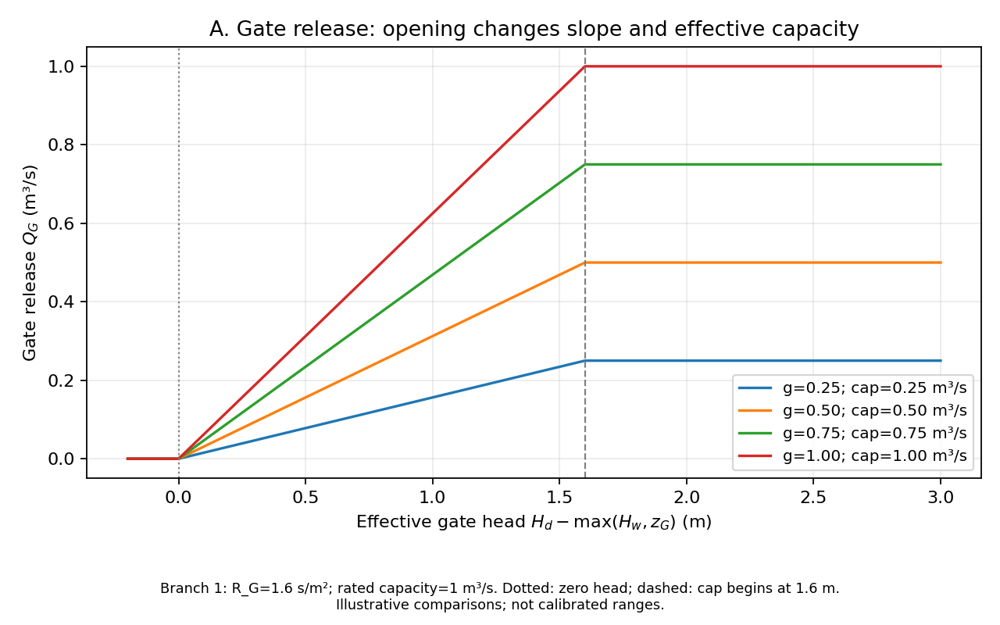

# Wetland Restoration and Flood Mitigation

A course project for **CEE690, Systems Modeling for Climate Response**, at Duke University. Current scope: **Stage A — development and understanding of a dynamic ODE model**. Suggested future repository name: `cee690-wetland-flood-model`.

The six-day example is **synthetic, illustrative, and uncalibrated**. It demonstrates model behavior; it is not a prediction of real flood risk or proof that a wetland design reduces flooding.

## System

Eight water-storage states represent upland surface water, upland soil water, two wetlands, two dam pools, groundwater, and a river reach:

`x = [S_u, S_m, S_w1, S_w2, S_d1, S_d2, S_g, S_r]`

```text
Upland -> Dam 1 -> Gate 1 -> Wetland 1 -> River -> Outside
Upland -> Dam 2 -> Gate 2 -> Wetland 2 -> River
Upland -> River
Upland -> Soil -> Groundwater -> River
Wetlands -> Groundwater; external groundwater <-> Groundwater
External inflow -> River
Dam spills -> corresponding wetlands; wetland overflows -> River
```

- **Controls:** the two gate-opening histories, each between 0 and 1.
- **Fixed designs:** each wetland's categorical vegetation type and fractional cover; fixed during a run and independently configurable.
- **Disturbances:** precipitation, air temperature, solar radiation, wind, external river inflow, downstream level, external groundwater level, and final-outlet blockage.

Surface connections are one-way, with tailwater able to suppress flow. External groundwater exchange is signed. Time is seconds, storage is m³, and volumetric flow is m³/s.

## Files and reading order

| File | Purpose |
|---|---|
| [model_notes.md](model_notes.md) | Student summary, eight ODEs, feedback explanations, A–J figure guide, and remaining-work checklist. |
| [parameters.md](parameters.md) | Symbols, code names, units, illustrative values, admissible domains, and evidence still needed. |
| [wetland_model_equations_v3_english.md](wetland_model_equations_v3_english.md) | Accepted mathematical specification, preserved unchanged. Its equation-review status text is a historical snapshot. |
| `wetland_flood_model.py` | Parameters, eight-state RHS, geometry checks, official solver loader, and one baseline simulation. |
| `algebraic_plots.py` | Seven focused algebraic comparisons; imports model relationships without loading the ODE solver. |
| `requirements.txt` | Only the two direct numerical/plotting dependencies, pinned to locally tested versions. |
| `.gitignore` | Keeps local runtime files, results, secrets, and professor-provided materials out of normal Git tracking. |
| `plots/` | Existing A–G algebraic figures and H–J baseline figures. |

## Python environment

Commands below assume **macOS/Linux**, a Python 3.13 interpreter available as `python3`, and a terminal in the project root (currently the local `Modeling` folder). The verified interpreter was Python **3.13.5**.

```sh
python3 -m venv .venv
source .venv/bin/activate
python -m pip install -r requirements.txt
```

The requirements are NumPy **2.2.6** and Matplotlib **3.10.6**. NumPy 2+ supplies `np.trapezoid`, used in baseline diagnostics. The scripts use a noninteractive plotting backend and save PNG files.

### Algebraic plots only — no solver needed

```sh
python algebraic_plots.py
```

This generates **A–G**: gate release, wetland normal drainage, wetland overflow, infiltration, evaporative demand, outlet blockage, and signed groundwater exchange. It requires only NumPy and Matplotlib. Importing either project script does not run a simulation.

### Baseline — official ode4u required

Use Henri P. Gavin's official [multivarious source](https://github.com/hpgavin/multivarious), verified at revision:

`06d7aed5b541ec7fe26a6dc69be6aa7fb610aa02`

Its package version is 1.2.1. Its package initializer also imports SciPy, even though this project uses `ode4u`; SciPy **1.16.2** was verified locally. The pinned source's runtime dependency list is not declared in `pyproject.toml`, so install SciPy explicitly. Do not substitute an unverified package with the same name.

After the base environment setup, install the external solver from its pinned official source (the VCS installation requires the Git command-line program):

```sh
python -m pip install scipy==1.16.2
python -m pip install --no-deps "multivarious @ git+https://github.com/hpgavin/multivarious.git@06d7aed5b541ec7fe26a6dc69be6aa7fb610aa02"
python wetland_flood_model.py
```

If the verified official checkout already exists at `work/multivarious`, the solver-install line can be omitted: the loader prefers that local checkout. It remains local and is excluded from the proposed upload. Otherwise, the loader uses the installed package. No solver is bundled into this repository, installed automatically, or replaced with another integrator. A missing solver/dependency produces a clear message when the baseline is requested.

The baseline workflow generates A–G, runs one six-day simulation with a 120 s step, and generates H–J. It saves figures in `plots/`, numerical arrays in `results/baseline.npz`, and a short diagnostic record in `results/baseline_summary.json`. The diagnostic's `solver_file` records the actual solver source used. Paths are resolved relative to the script, and reruns overwrite these same generated files. Matplotlib's cache is local under `work/mplconfig`.

### What has actually been tested

- In the existing Python 3.13.5 environment, both imports were inert and A–G generated with `multivarious` imports deliberately blocked.
- The patched baseline ran with the actual official checkout at the revision above; geometry, ordering, and explicit-refresh regression checks passed.
- The baseline reproduced Q_peak **1.357896 m³/s**, H_peak **97.879407 m**, and maximum integrated balance residual **0.076735 m³**. These are numerical regression results, not calibration targets.
- **Not executed:** a fresh virtual-environment installation, the pinned VCS `pip install` command above, or installation on another platform. Those setup instructions are based on the inspected source and verified import dependencies; no installation was performed during repository preparation.

## Representative figures

Gate opening changes the slope and effective cap of the accepted empirical release law:



The baseline connects river level and outflow to upstream releases, drainage, and overflow:


## Editing and limitations

Keep the accepted equations and state order. When changing geometry: **edit geometry → explicitly call `params.refresh_geometry_defaults()` if appropriate → construct initial conditions and inputs → validate → run**. The helper deliberately recomputes only the five documented linked defaults; independent empirical parameters remain independently editable.

Fixed areas, empirical flow ratings, limited reverse exchange, simplified ET, and synthetic vegetation endpoints restrict interpretation. Mathematical admissibility domains are not evidence-supported site ranges: those ranges remain pending evidence. Student work remains to explain the relationships and water balance, make small educational parameter edits, and present their implications. Data acquisition, calibration, optimization, and uncertainty propagation have not been performed. Running the script does not complete the entire assignment.

## Attribution and future upload

The implementation follows the professor-provided `earth_heat_2.py` structure (`class c`, `system(t,x,u,c)`, and `ode4u`) and the modeling workflow in `Project-ODE-how-to.md`. Those teaching materials remain local and are not bundled in the proposed upload. The ODE solver is Henri P. Gavin's official multivarious implementation, referenced above. The accepted v3 document retains its original scientific references. No project license has been selected.

The proposed upload contains this README, `.gitignore`, `requirements.txt`, the two project Python scripts, the three model Markdown documents, and the ten A–J PNGs in `plots/`. Keep `work/`, `results/`, environments, caches, local configuration/secrets, professor handouts, and private/reference documents local. `.gitignore` controls Git tracking; for a browser upload or manual archive, select the same intended files explicitly.

No remote repository, Git identity, commit, or upload has been created or configured for this project.
